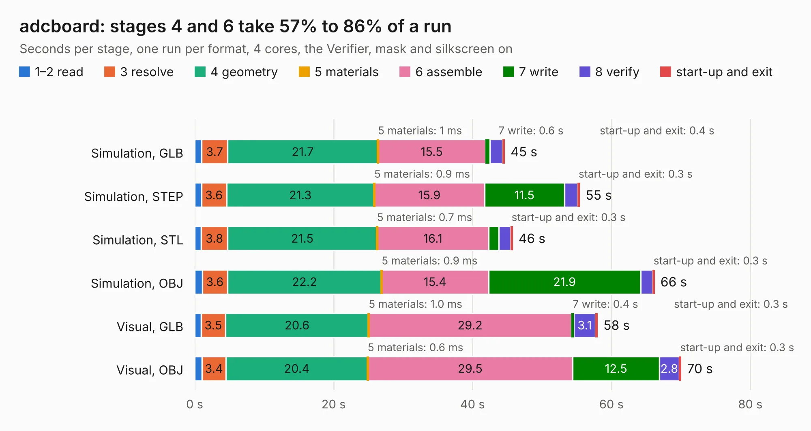

# 1777. adcboard

Board 1,777 of the 3,124 of [Corpus Testing](../Corpus-Testing.md), on [Corpus Page 17](../CorpusTestingPages/Corpus-Testing-17.md#1777-adcboard).

| Mode and format | 1–2 read | 3 resolve | 4 geometry | 5 materials | 6 assemble | 7 write | 8 verify | start-up and exit | Total |
|---|---:|---:|---:|---:|---:|---:|---:|---:|---:|
| Simulation, GLB | 1.0 | 3.7 | 21.7 | 1&nbsp;ms | 15.5 | 0.6 | 1.8 | 0.4 | 44.6 |
| Simulation, STEP | 1.0 | 3.6 | 21.3 | 0.9&nbsp;ms | 15.9 | 11.5 | 1.9 | 0.3 | 55.5 |
| Simulation, STL | 0.9 | 3.8 | 21.5 | 0.7&nbsp;ms | 16.1 | 1.4 | 1.7 | 0.3 | 45.8 |
| Simulation, OBJ | 1.1 | 3.6 | 22.2 | 0.9&nbsp;ms | 15.4 | 21.9 | 1.7 | 0.3 | 66.2 |
| Visual, GLB | 0.9 | 3.5 | 20.6 | 1.0&nbsp;ms | 29.2 | 0.4 | 3.1 | 0.3 | 58.0 |
| Visual, OBJ | 1.1 | 3.4 | 20.4 | 0.6&nbsp;ms | 29.5 | 12.5 | 2.8 | 0.3 | 70.1 |

<table align="center"><tr><td valign="top">

| Board | Repo: [nuclearfutureslab/ibxII-hardware](https://github.com/nuclearfutureslab/ibxII-hardware) Board: `adcboard.kicad_pcb` |
|---|---|
| Folder | adcboard |
| Complexity | 219&nbsp;/&nbsp;1000 (size&nbsp;184, features&nbsp;35) |
| KESE&nbsp;features | through vias, filled zones |
| Tested | 9th November 2026 |
| Copper&nbsp;layers | 2 |
| File&nbsp;format | KiCad 5 (20171130) |
| Parts,&nbsp;tracks,&nbsp;vias | 115, 920, 72 |
| Triangles,&nbsp;simulation | 3,351,378 in 110 parts |
| Verifier | PASS in all six runs |

</td><td valign="top">

<table>
<tr><th>File type</th><th>File size</th><th>Peak memory used</th></tr>
<tr><th colspan="3" align="left">Simulation</th></tr>
<tr><td>GLB</td><td align="right">116&nbsp;MB</td><td align="right">1.1&nbsp;GB</td></tr>
<tr><td>STEP</td><td align="right">590&nbsp;MB</td><td align="right">1.3&nbsp;GB</td></tr>
<tr><td>STL</td><td align="right">168&nbsp;MB</td><td align="right">1.2&nbsp;GB</td></tr>
<tr><td>OBJ</td><td align="right">358&nbsp;MB</td><td align="right">2.2&nbsp;GB</td></tr>
<tr><th colspan="3" align="left">Visual</th></tr>
<tr><td>GLB</td><td align="right">71&nbsp;MB</td><td align="right">1.2&nbsp;GB</td></tr>
<tr><td>OBJ</td><td align="right">220&nbsp;MB</td><td align="right">1.6&nbsp;GB</td></tr>
</table>

</td></tr></table>

| Previous | Next |
|:---|---:|
| [1776. alu](b1776b_74cpu_alu.md) | [1778. hvboard](b1778b_ibxII-hardware_hvboard.md) |
