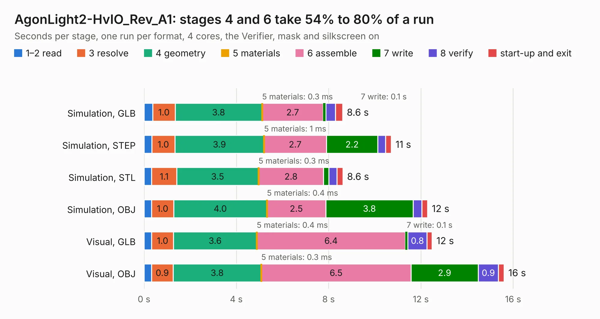

# 1778. AgonLight2-HvIO_Rev_A1

Board 1,778 of the 3,112 of [Corpus Testing](../Corpus-Testing.md), on [Corpus Page 17](../CorpusTestingPages/Corpus-Testing-17.md#1778-agonlight2-hvio_rev_a1).

| Mode and format | 1–2 read | 3 resolve | 4 geometry | 5 materials | 6 assemble | 7 write | 8 verify | start-up and exit | Total |
|---|---:|---:|---:|---:|---:|---:|---:|---:|---:|
| Simulation, GLB | 0.4 | 1.0 | 3.8 | 0.3&nbsp;ms | 2.7 | 0.1 | 0.4 | 0.3 | 8.6 |
| Simulation, STEP | 0.3 | 1.0 | 3.9 | 1&nbsp;ms | 2.7 | 2.2 | 0.3 | 0.2 | 10.7 |
| Simulation, STL | 0.3 | 1.1 | 3.5 | 0.3&nbsp;ms | 2.8 | 0.2 | 0.4 | 0.2 | 8.6 |
| Simulation, OBJ | 0.3 | 1.0 | 4.0 | 0.4&nbsp;ms | 2.5 | 3.8 | 0.4 | 0.2 | 12.3 |
| Visual, GLB | 0.3 | 1.0 | 3.6 | 0.4&nbsp;ms | 6.4 | 0.1 | 0.8 | 0.2 | 12.5 |
| Visual, OBJ | 0.3 | 0.9 | 3.8 | 0.3&nbsp;ms | 6.5 | 2.9 | 0.9 | 0.2 | 15.6 |

<table align="center"><tr><td valign="top">

| Board | Repo: [OLIMEX/AgonLight2-HvIO](https://github.com/OLIMEX/AgonLight2-HvIO) Board: `AgonLight2-HvIO_Rev_A1.kicad_pcb` |
|---|---|
| Folder | HARDWARE / AgonLight2-HvIO_Rev_A1 |
| Complexity | 267&nbsp;/&nbsp;1000 (size&nbsp;177, features&nbsp;90) |
| KESE&nbsp;features | through vias, filled zones, copper text, knockout text, stack-up, dielectric εr and tanδ |
| Tested | 9th November 2026 |
| Copper&nbsp;layers | 2 |
| File&nbsp;format | KiCad 7 (20221018) |
| Parts,&nbsp;tracks,&nbsp;vias | 62, 586, 180 |
| Triangles,&nbsp;simulation | 770,556 in 91 parts |
| Verifier | PASS in all six runs |

</td><td valign="top">

<table>
<tr><th>File type</th><th>File size</th><th>Peak memory used</th></tr>
<tr><th colspan="3" align="left">Simulation</th></tr>
<tr><td>GLB</td><td align="right">27&nbsp;MB</td><td align="right">425&nbsp;MB</td></tr>
<tr><td>STEP</td><td align="right">131&nbsp;MB</td><td align="right">475&nbsp;MB</td></tr>
<tr><td>STL</td><td align="right">39&nbsp;MB</td><td align="right">419&nbsp;MB</td></tr>
<tr><td>OBJ</td><td align="right">80&nbsp;MB</td><td align="right">582&nbsp;MB</td></tr>
<tr><th colspan="3" align="left">Visual</th></tr>
<tr><td>GLB</td><td align="right">21&nbsp;MB</td><td align="right">542&nbsp;MB</td></tr>
<tr><td>OBJ</td><td align="right">62&nbsp;MB</td><td align="right">502&nbsp;MB</td></tr>
</table>

</td></tr></table>

| Previous | Next |
|:---|---:|
| [1777. AgonLight2-HvIO_Rev_A](b1777b_AgonLight2-HvIO_AgonLight2-HvIO-Rev-A.md) | [1779. AgonLight2-PROTO_Rev_A](b1779b_AgonLight2-Proto_AgonLight2-PROTO-Rev-A.md) |
