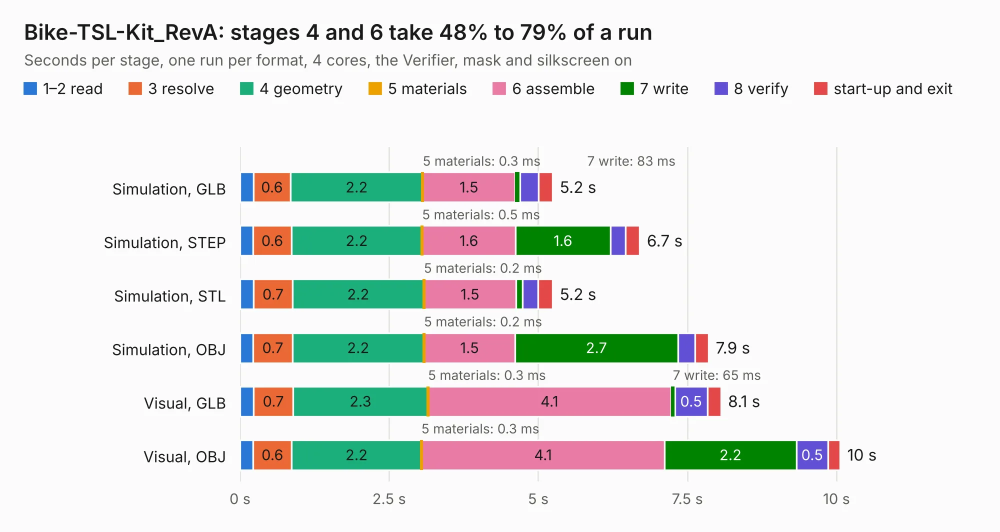

# 1779. Bike-TSL-Kit_RevA

Board 1,779 of the 3,102 of [Corpus Testing](../Corpus-Testing.md), on [Corpus Page 17](../CorpusTestingPages/Corpus-Testing-17.md#1779-bike-tsl-kit_reva).

| Mode and format | 1–2 read | 3 resolve | 4 geometry | 5 materials | 6 assemble | 7 write | 8 verify | start-up and exit | Total |
|---|---:|---:|---:|---:|---:|---:|---:|---:|---:|
| Simulation, GLB | 0.2 | 0.6 | 2.2 | 0.3&nbsp;ms | 1.5 | 83&nbsp;ms | 0.3 | 0.2 | 5.2 |
| Simulation, STEP | 0.2 | 0.6 | 2.2 | 0.5&nbsp;ms | 1.6 | 1.6 | 0.3 | 0.2 | 6.7 |
| Simulation, STL | 0.2 | 0.7 | 2.2 | 0.2&nbsp;ms | 1.5 | 0.1 | 0.3 | 0.2 | 5.2 |
| Simulation, OBJ | 0.2 | 0.7 | 2.2 | 0.2&nbsp;ms | 1.5 | 2.7 | 0.3 | 0.2 | 7.9 |
| Visual, GLB | 0.2 | 0.7 | 2.3 | 0.3&nbsp;ms | 4.1 | 65&nbsp;ms | 0.5 | 0.2 | 8.1 |
| Visual, OBJ | 0.2 | 0.6 | 2.2 | 0.3&nbsp;ms | 4.1 | 2.2 | 0.5 | 0.2 | 10.1 |

<table align="center"><tr><td valign="top">

| Board | Repo: [OLIMEX/Bike-TSL-Kit](https://github.com/OLIMEX/Bike-TSL-Kit) Board: `Bike-TSL-Kit_RevA.kicad_pcb` |
|---|---|
| Folder | HARDWARE / Bike-TSL-Kit.Rev-A |
| Complexity | 206&nbsp;/&nbsp;1000 (size&nbsp;161, features&nbsp;45) |
| KESE&nbsp;features | through vias, filled zones, curved board outline |
| Tested | 9th November 2026 |
| Copper&nbsp;layers | 2 |
| File&nbsp;format | KiCad 5 (20171130) |
| Parts,&nbsp;tracks,&nbsp;vias | 46, 390, 45 |
| Triangles,&nbsp;simulation | 445,982 in 50 parts |
| Verifier | PASS in all six runs |

</td><td valign="top">

<table>
<tr><th>File type</th><th>File size</th><th>Peak memory used</th></tr>
<tr><th colspan="3" align="left">Simulation</th></tr>
<tr><td>GLB</td><td align="right">16&nbsp;MB</td><td align="right">300&nbsp;MB</td></tr>
<tr><td>STEP</td><td align="right">82&nbsp;MB</td><td align="right">338&nbsp;MB</td></tr>
<tr><td>STL</td><td align="right">22&nbsp;MB</td><td align="right">299&nbsp;MB</td></tr>
<tr><td>OBJ</td><td align="right">47&nbsp;MB</td><td align="right">360&nbsp;MB</td></tr>
<tr><th colspan="3" align="left">Visual</th></tr>
<tr><td>GLB</td><td align="right">14&nbsp;MB</td><td align="right">351&nbsp;MB</td></tr>
<tr><td>OBJ</td><td align="right">40&nbsp;MB</td><td align="right">362&nbsp;MB</td></tr>
</table>

</td></tr></table>

| Previous | Next |
|:---|---:|
| [1778. BB-TB6612FNG-Rev_A](b1778b_BB-TB6612_BB-TB6612FNG-Rev-A.md) | [1780. DCDC-50-5-12_Rev_A1](b1780b_DCDC-50-5-12_DCDC-50-5-12-Rev-A1.md) |
