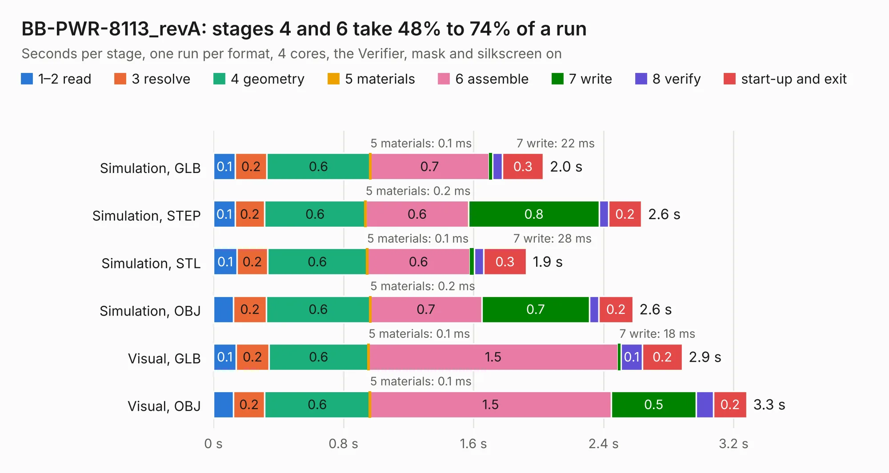

# 1780. BB-PWR-8113_revA

Board 1,780 of the 3,105 of [Corpus Testing](../Corpus-Testing.md), on [Corpus Page 17](../CorpusTestingPages/Corpus-Testing-17.md#1780-bb-pwr-8113_reva).

| Mode and format | 1–2 read | 3 resolve | 4 geometry | 5 materials | 6 assemble | 7 write | 8 verify | start-up and exit | Total |
|---|---:|---:|---:|---:|---:|---:|---:|---:|---:|
| Simulation, GLB | 0.1 | 0.2 | 0.6 | 0.1&nbsp;ms | 0.7 | 22&nbsp;ms | 62&nbsp;ms | 0.3 | 2.0 |
| Simulation, STEP | 0.1 | 0.2 | 0.6 | 0.2&nbsp;ms | 0.6 | 0.8 | 56&nbsp;ms | 0.2 | 2.6 |
| Simulation, STL | 0.1 | 0.2 | 0.6 | 0.1&nbsp;ms | 0.6 | 28&nbsp;ms | 56&nbsp;ms | 0.3 | 1.9 |
| Simulation, OBJ | 0.1 | 0.2 | 0.6 | 0.2&nbsp;ms | 0.7 | 0.7 | 58&nbsp;ms | 0.2 | 2.6 |
| Visual, GLB | 0.1 | 0.2 | 0.6 | 0.1&nbsp;ms | 1.5 | 18&nbsp;ms | 0.1 | 0.2 | 2.9 |
| Visual, OBJ | 0.1 | 0.2 | 0.6 | 0.1&nbsp;ms | 1.5 | 0.5 | 0.1 | 0.2 | 3.3 |

<table align="center"><tr><td valign="top">

| Board | Repo: [OLIMEX/BB-PWR-8113](https://github.com/OLIMEX/BB-PWR-8113) Board: `BB-PWR-8113_revA.kicad_pcb` |
|---|---|
| Complexity | 139&nbsp;/&nbsp;1000 (size&nbsp;119, features&nbsp;20) |
| KESE&nbsp;features | filled zones |
| Tested | 9th November 2026 |
| Copper&nbsp;layers | 2 |
| File&nbsp;format | KiCad 4 (4) |
| Parts,&nbsp;tracks,&nbsp;vias | 15, 81, 0 |
| Triangles,&nbsp;simulation | 112,386 in 20 parts |
| Verifier | PASS in all six runs |

</td><td valign="top">

<table>
<tr><th>File type</th><th>File size</th><th>Peak memory used</th></tr>
<tr><th colspan="3" align="left">Simulation</th></tr>
<tr><td>GLB</td><td align="right">4.1&nbsp;MB</td><td align="right">191&nbsp;MB</td></tr>
<tr><td>STEP</td><td align="right">21&nbsp;MB</td><td align="right">198&nbsp;MB</td></tr>
<tr><td>STL</td><td align="right">5.6&nbsp;MB</td><td align="right">191&nbsp;MB</td></tr>
<tr><td>OBJ</td><td align="right">11&nbsp;MB</td><td align="right">182&nbsp;MB</td></tr>
<tr><th colspan="3" align="left">Visual</th></tr>
<tr><td>GLB</td><td align="right">3.4&nbsp;MB</td><td align="right">159&nbsp;MB</td></tr>
<tr><td>OBJ</td><td align="right">9.3&nbsp;MB</td><td align="right">159&nbsp;MB</td></tr>
</table>

</td></tr></table>

| Previous | Next |
|:---|---:|
| [1779. BB-PWR-8009_revA](b1779b_BB-PWR-8009_BB-PWR-8009-revA.md) | [1781. BB-TB6612FNG-Rev_A](b1781b_BB-TB6612_BB-TB6612FNG-Rev-A.md) |
