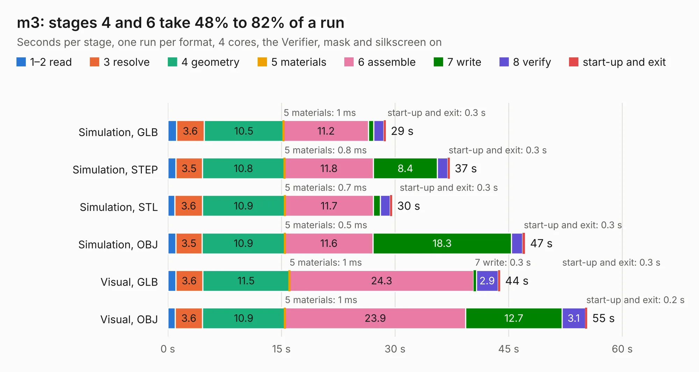

# 1780. m3

Board 1,780 of the 3,122 of [Corpus Testing](../Corpus-Testing.md), on [Corpus Page 17](../CorpusTestingPages/Corpus-Testing-17.md#1780-m3).

| Mode and format | 1–2 read | 3 resolve | 4 geometry | 5 materials | 6 assemble | 7 write | 8 verify | start-up and exit | Total |
|---|---:|---:|---:|---:|---:|---:|---:|---:|---:|
| Simulation, GLB | 1.2 | 3.6 | 10.5 | 1&nbsp;ms | 11.2 | 0.7 | 1.3 | 0.3 | 28.8 |
| Simulation, STEP | 1.0 | 3.5 | 10.8 | 0.8&nbsp;ms | 11.8 | 8.4 | 1.4 | 0.3 | 37.2 |
| Simulation, STL | 0.9 | 3.6 | 10.9 | 0.7&nbsp;ms | 11.7 | 0.9 | 1.3 | 0.3 | 29.6 |
| Simulation, OBJ | 1.0 | 3.5 | 10.9 | 0.5&nbsp;ms | 11.6 | 18.3 | 1.5 | 0.3 | 47.2 |
| Visual, GLB | 1.0 | 3.6 | 11.5 | 1&nbsp;ms | 24.3 | 0.3 | 2.9 | 0.3 | 43.9 |
| Visual, OBJ | 1.0 | 3.6 | 10.9 | 1&nbsp;ms | 23.9 | 12.7 | 3.1 | 0.2 | 55.4 |

<table align="center"><tr><td valign="top">

| Board | Repo: [oak-wjr/rocket-flight-computer](https://github.com/oak-wjr/rocket-flight-computer) Board: `m3.kicad_pcb` |
|---|---|
| Folder | m3_design / assembly_review |
| Complexity | 355&nbsp;/&nbsp;1000 (size&nbsp;265, features&nbsp;90) |
| KESE&nbsp;features | through vias, slotted holes, custom pads, rounded, trapezoid or chamfered pads, filled zones, copper drawings, curved board outline |
| Tested | 9th November 2026 |
| Copper&nbsp;layers | 4 |
| File&nbsp;format | KiCad 10 (20260206) |
| Parts,&nbsp;tracks,&nbsp;vias | 183, 2,037, 608 |
| Triangles,&nbsp;simulation | 2,975,214 in 175 parts |
| Verifier | PASS in all six runs |

</td><td valign="top">

<table>
<tr><th>File type</th><th>File size</th><th>Peak memory used</th></tr>
<tr><th colspan="3" align="left">Simulation</th></tr>
<tr><td>GLB</td><td align="right">102&nbsp;MB</td><td align="right">980&nbsp;MB</td></tr>
<tr><td>STEP</td><td align="right">404&nbsp;MB</td><td align="right">1.3&nbsp;GB</td></tr>
<tr><td>STL</td><td align="right">149&nbsp;MB</td><td align="right">1.0&nbsp;GB</td></tr>
<tr><td>OBJ</td><td align="right">313&nbsp;MB</td><td align="right">2.0&nbsp;GB</td></tr>
<tr><th colspan="3" align="left">Visual</th></tr>
<tr><td>GLB</td><td align="right">71&nbsp;MB</td><td align="right">1.2&nbsp;GB</td></tr>
<tr><td>OBJ</td><td align="right">220&nbsp;MB</td><td align="right">1.4&nbsp;GB</td></tr>
</table>

</td></tr></table>

| Previous | Next |
|:---|---:|
| [1779. barebones](b1779b_barebones_barebones.md) | [1781. m1](b1781b_rocket-flight-computer_m1.md) |
