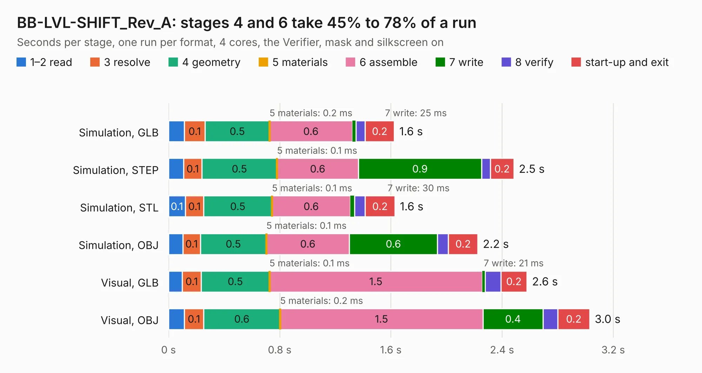

# 1783. BB-LVL-SHIFT_Rev_A

Board 1,783 of the 3,111 of [Corpus Testing](../Corpus-Testing.md), on [Corpus Page 17](../CorpusTestingPages/Corpus-Testing-17.md#1783-bb-lvl-shift_rev_a).

| Mode and format | 1–2 read | 3 resolve | 4 geometry | 5 materials | 6 assemble | 7 write | 8 verify | start-up and exit | Total |
|---|---:|---:|---:|---:|---:|---:|---:|---:|---:|
| Simulation, GLB | 0.1 | 0.1 | 0.5 | 0.2&nbsp;ms | 0.6 | 25&nbsp;ms | 66&nbsp;ms | 0.2 | 1.6 |
| Simulation, STEP | 0.1 | 0.1 | 0.5 | 0.1&nbsp;ms | 0.6 | 0.9 | 63&nbsp;ms | 0.2 | 2.5 |
| Simulation, STL | 0.1 | 0.1 | 0.5 | 0.1&nbsp;ms | 0.6 | 30&nbsp;ms | 76&nbsp;ms | 0.2 | 1.6 |
| Simulation, OBJ | 0.1 | 0.1 | 0.5 | 0.1&nbsp;ms | 0.6 | 0.6 | 79&nbsp;ms | 0.2 | 2.2 |
| Visual, GLB | 99&nbsp;ms | 0.1 | 0.5 | 0.1&nbsp;ms | 1.5 | 21&nbsp;ms | 0.1 | 0.2 | 2.6 |
| Visual, OBJ | 0.1 | 0.1 | 0.6 | 0.2&nbsp;ms | 1.5 | 0.4 | 0.1 | 0.2 | 3.0 |

<table align="center"><tr><td valign="top">

| Board | Repo: [OLIMEX/BB-LVL-SHIFT](https://github.com/OLIMEX/BB-LVL-SHIFT) Board: `BB-LVL-SHIFT_Rev_A.kicad_pcb` |
|---|---|
| Folder | HARDWARE / BB-LVL-SHIFT_Rev.A |
| Complexity | 202&nbsp;/&nbsp;1000 (size&nbsp;122, features&nbsp;80) |
| KESE&nbsp;features | through vias, filled zones, knockout text, stack-up, dielectric εr and tanδ |
| Tested | 9th November 2026 |
| Copper&nbsp;layers | 2 |
| File&nbsp;format | KiCad 10 (20260206) |
| Parts,&nbsp;tracks,&nbsp;vias | 13, 85, 8 |
| Triangles,&nbsp;simulation | 128,976 in 23 parts |
| Verifier | PASS in all six runs |

</td><td valign="top">

<table>
<tr><th>File type</th><th>File size</th><th>Peak memory used</th></tr>
<tr><th colspan="3" align="left">Simulation</th></tr>
<tr><td>GLB</td><td align="right">4.6&nbsp;MB</td><td align="right">201&nbsp;MB</td></tr>
<tr><td>STEP</td><td align="right">25&nbsp;MB</td><td align="right">205&nbsp;MB</td></tr>
<tr><td>STL</td><td align="right">6.5&nbsp;MB</td><td align="right">192&nbsp;MB</td></tr>
<tr><td>OBJ</td><td align="right">13&nbsp;MB</td><td align="right">190&nbsp;MB</td></tr>
<tr><th colspan="3" align="left">Visual</th></tr>
<tr><td>GLB</td><td align="right">3.6&nbsp;MB</td><td align="right">159&nbsp;MB</td></tr>
<tr><td>OBJ</td><td align="right">10&nbsp;MB</td><td align="right">160&nbsp;MB</td></tr>
</table>

</td></tr></table>

| Previous | Next |
|:---|---:|
| [1782. bb-ch340t](b1782b_BB-CH340T_HARDWARE-BB-CH340T-Rev-B_bb-ch340t.md) | [1784. BB-PWR-3608_revA](b1784b_BB-PWR-3608_BB-PWR-3608-revA.md) |
