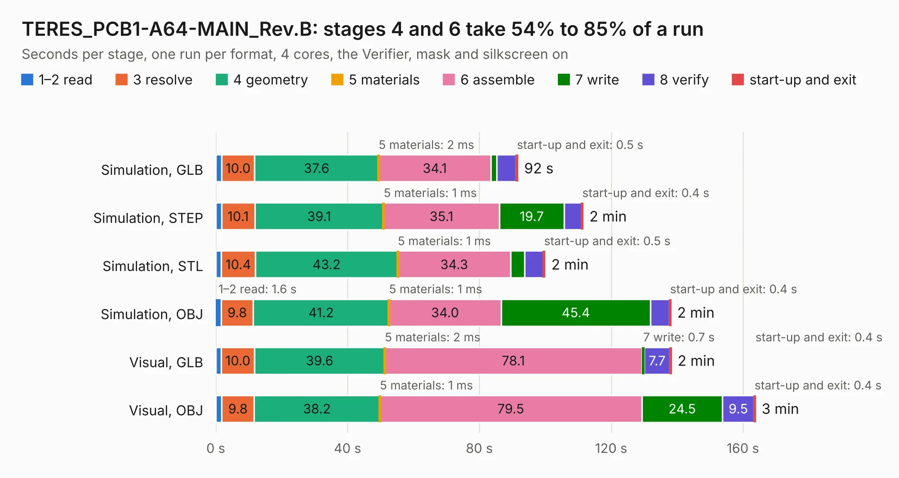

# 1783. TERES_PCB1-A64-MAIN_Rev.B

Board 1,783 of the 3,104 of [Corpus Testing](../Corpus-Testing.md), on [Corpus Page 17](../CorpusTestingPages/Corpus-Testing-17.md#1783-teres_pcb1-a64-main_revb).

| Mode and format | 1–2 read | 3 resolve | 4 geometry | 5 materials | 6 assemble | 7 write | 8 verify | start-up and exit | Total |
|---|---:|---:|---:|---:|---:|---:|---:|---:|---:|
| Simulation, GLB | 1.7 | 10.0 | 37.6 | 2&nbsp;ms | 34.1 | 1.8 | 5.9 | 0.5 | 91.7 |
| Simulation, STEP | 1.7 | 10.1 | 39.1 | 1&nbsp;ms | 35.1 | 19.7 | 5.3 | 0.4 | 111.4 |
| Simulation, STL | 1.6 | 10.4 | 43.2 | 1&nbsp;ms | 34.3 | 4.2 | 5.7 | 0.5 | 99.9 |
| Simulation, OBJ | 1.6 | 9.8 | 41.2 | 1&nbsp;ms | 34.0 | 45.4 | 5.7 | 0.4 | 138.1 |
| Visual, GLB | 1.7 | 10.0 | 39.6 | 2&nbsp;ms | 78.1 | 0.7 | 7.7 | 0.4 | 138.2 |
| Visual, OBJ | 1.8 | 9.8 | 38.2 | 1&nbsp;ms | 79.5 | 24.5 | 9.5 | 0.4 | 163.7 |

<table align="center"><tr><td valign="top">

| Board | Repo: [OLIMEX/DIY-LAPTOP](https://github.com/OLIMEX/DIY-LAPTOP) Board: `TERES_PCB1-A64-MAIN_Rev.B.kicad_pcb` |
|---|---|
| Folder | HARDWARE / A64-TERES / TERES-PCB1-A64-MAIN / Rev.B |
| Complexity | 381&nbsp;/&nbsp;1000 (size&nbsp;336, features&nbsp;45) |
| KESE&nbsp;features | through vias, slotted holes, filled zones |
| Tested | 9th November 2026 |
| Copper&nbsp;layers | 6 |
| File&nbsp;format | KiCad 5 (20160815) |
| Parts,&nbsp;tracks,&nbsp;vias | 400, 13,060, 1,291 |
| Triangles,&nbsp;simulation | 9,712,620 in 480 parts |
| Verifier | PASS in all six runs |

</td><td valign="top">

<table>
<tr><th>File type</th><th>File size</th><th>Peak memory used</th></tr>
<tr><th colspan="3" align="left">Simulation</th></tr>
<tr><td>GLB</td><td align="right">337&nbsp;MB</td><td align="right">2.4&nbsp;GB</td></tr>
<tr><td>STEP</td><td align="right">1.3&nbsp;GB</td><td align="right">3.1&nbsp;GB</td></tr>
<tr><td>STL</td><td align="right">486&nbsp;MB</td><td align="right">2.4&nbsp;GB</td></tr>
<tr><td>OBJ</td><td align="right">1.1&nbsp;GB</td><td align="right">6.2&nbsp;GB</td></tr>
<tr><th colspan="3" align="left">Visual</th></tr>
<tr><td>GLB</td><td align="right">186&nbsp;MB</td><td align="right">2.9&nbsp;GB</td></tr>
<tr><td>OBJ</td><td align="right">607&nbsp;MB</td><td align="right">4.0&nbsp;GB</td></tr>
</table>

</td></tr></table>

| Previous | Next |
|:---|---:|
| [1782. DCDC-50-5-12_Rev_A1](b1782b_DCDC-50-5-12_DCDC-50-5-12-Rev-A1.md) | [1784. TERES_PCB1-A64-MAIN_Rev.C](b1784b_DIY-LAPTOP_TERES-PCB1-A64-MAIN-Rev-C.md) |
