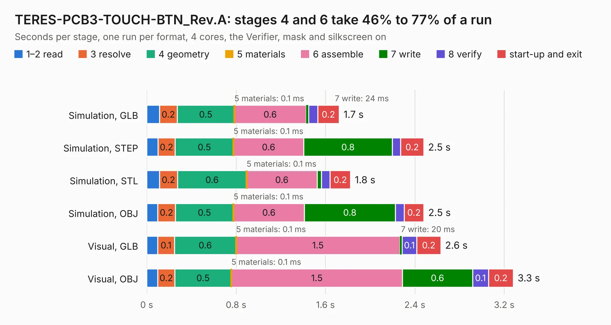

# 1783. TERES-PCB3-TOUCH-BTN_Rev.A

Board 1,783 of the 3,101 of [Corpus Testing](../Corpus-Testing.md), on [Corpus Page 17](../CorpusTestingPages/Corpus-Testing-17.md#1783-teres-pcb3-touch-btn_reva).

| Mode and format | 1–2 read | 3 resolve | 4 geometry | 5 materials | 6 assemble | 7 write | 8 verify | start-up and exit | Total |
|---|---:|---:|---:|---:|---:|---:|---:|---:|---:|
| Simulation, GLB | 0.1 | 0.2 | 0.5 | 0.1&nbsp;ms | 0.6 | 24&nbsp;ms | 80&nbsp;ms | 0.2 | 1.7 |
| Simulation, STEP | 0.1 | 0.2 | 0.5 | 0.1&nbsp;ms | 0.6 | 0.8 | 74&nbsp;ms | 0.2 | 2.5 |
| Simulation, STL | 0.1 | 0.2 | 0.6 | 0.1&nbsp;ms | 0.6 | 38&nbsp;ms | 78&nbsp;ms | 0.2 | 1.8 |
| Simulation, OBJ | 99&nbsp;ms | 0.2 | 0.5 | 0.1&nbsp;ms | 0.6 | 0.8 | 78&nbsp;ms | 0.2 | 2.5 |
| Visual, GLB | 98&nbsp;ms | 0.1 | 0.6 | 0.1&nbsp;ms | 1.5 | 20&nbsp;ms | 0.1 | 0.2 | 2.6 |
| Visual, OBJ | 0.1 | 0.2 | 0.5 | 0.1&nbsp;ms | 1.5 | 0.6 | 0.1 | 0.2 | 3.3 |

<table align="center"><tr><td valign="top">

| Board | Repo: [OLIMEX/DIY-LAPTOP](https://github.com/OLIMEX/DIY-LAPTOP) Board: `TERES-PCB3-TOUCH-BTN_Rev.A.kicad_pcb` |
|---|---|
| Folder | HARDWARE / A64-TERES / TERES-PCB3-TOUCH-BTN / Rev.A |
| Complexity | 153&nbsp;/&nbsp;1000 (size&nbsp;118, features&nbsp;35) |
| KESE&nbsp;features | through vias, filled zones |
| Tested | 9th November 2026 |
| Copper&nbsp;layers | 2 |
| File&nbsp;format | KiCad 5 (20160815) |
| Parts,&nbsp;tracks,&nbsp;vias | 6, 87, 14 |
| Triangles,&nbsp;simulation | 150,842 in 20 parts |
| Verifier | PASS in all six runs |

</td><td valign="top">

<table>
<tr><th>File type</th><th>File size</th><th>Peak memory used</th></tr>
<tr><th colspan="3" align="left">Simulation</th></tr>
<tr><td>GLB</td><td align="right">5.4&nbsp;MB</td><td align="right">207&nbsp;MB</td></tr>
<tr><td>STEP</td><td align="right">26&nbsp;MB</td><td align="right">214&nbsp;MB</td></tr>
<tr><td>STL</td><td align="right">7.5&nbsp;MB</td><td align="right">202&nbsp;MB</td></tr>
<tr><td>OBJ</td><td align="right">15&nbsp;MB</td><td align="right">209&nbsp;MB</td></tr>
<tr><th colspan="3" align="left">Visual</th></tr>
<tr><td>GLB</td><td align="right">4.6&nbsp;MB</td><td align="right">177&nbsp;MB</td></tr>
<tr><td>OBJ</td><td align="right">13&nbsp;MB</td><td align="right">181&nbsp;MB</td></tr>
</table>

</td></tr></table>

| Previous | Next |
|:---|---:|
| [1782. TERES-PCB2-IO_Rev.B](b1782b_DIY-LAPTOP_TERES-PCB2-IO-Rev-B.md) | [1784. PCB4-PWR-BTN_Rev.A](b1784b_DIY-LAPTOP_PCB4-PWR-BTN-Rev-A.md) |
