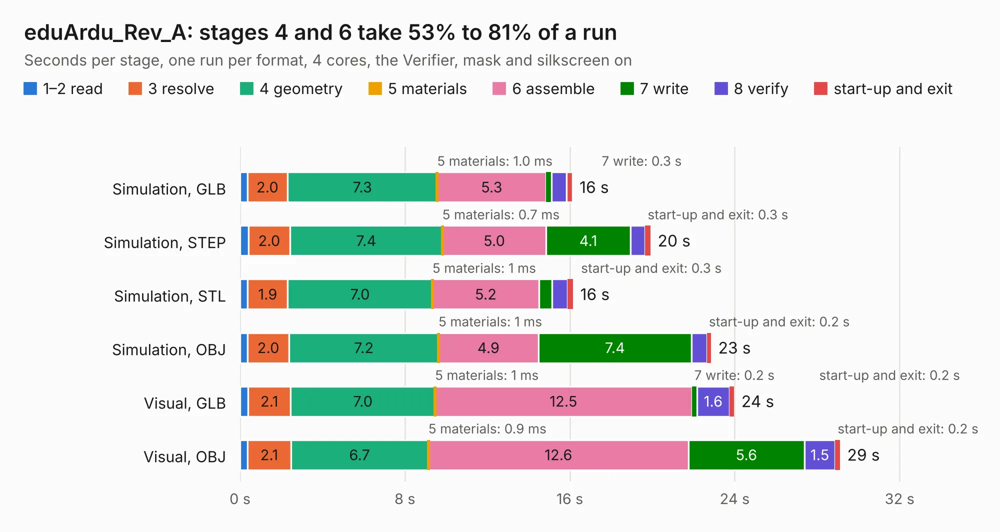

# 1785. eduArdu_Rev_A

Board 1,785 of the 3,100 of [Corpus Testing](../Corpus-Testing.md), on [Corpus Page 17](../CorpusTestingPages/Corpus-Testing-17.md#1785-eduardu_rev_a).

| Mode and format | 1–2 read | 3 resolve | 4 geometry | 5 materials | 6 assemble | 7 write | 8 verify | start-up and exit | Total |
|---|---:|---:|---:|---:|---:|---:|---:|---:|---:|
| Simulation, GLB | 0.4 | 2.0 | 7.3 | 1.0&nbsp;ms | 5.3 | 0.3 | 0.7 | 0.3 | 16.1 |
| Simulation, STEP | 0.4 | 2.0 | 7.4 | 0.7&nbsp;ms | 5.0 | 4.1 | 0.7 | 0.3 | 19.9 |
| Simulation, STL | 0.4 | 1.9 | 7.0 | 1&nbsp;ms | 5.2 | 0.6 | 0.7 | 0.3 | 16.2 |
| Simulation, OBJ | 0.4 | 2.0 | 7.2 | 1&nbsp;ms | 4.9 | 7.4 | 0.7 | 0.2 | 22.9 |
| Visual, GLB | 0.4 | 2.1 | 7.0 | 1&nbsp;ms | 12.5 | 0.2 | 1.6 | 0.2 | 24.0 |
| Visual, OBJ | 0.4 | 2.1 | 6.7 | 0.9&nbsp;ms | 12.6 | 5.6 | 1.5 | 0.2 | 29.1 |

<table align="center"><tr><td valign="top">

| Board | Repo: [OLIMEX/eduArdu](https://github.com/OLIMEX/eduArdu) Board: `eduArdu_Rev_A.kicad_pcb` |
|---|---|
| Folder | HARDWARE / eduArdu_Rev_A |
| Complexity | 285&nbsp;/&nbsp;1000 (size&nbsp;230, features&nbsp;55) |
| KESE&nbsp;features | through vias, slotted holes, filled zones, curved board outline |
| Tested | 9th November 2026 |
| Copper&nbsp;layers | 2 |
| File&nbsp;format | KiCad 5 (20171130) |
| Parts,&nbsp;tracks,&nbsp;vias | 101, 1,356, 158 |
| Triangles,&nbsp;simulation | 1,603,596 in 116 parts |
| Verifier | PASS in all six runs |

</td><td valign="top">

<table>
<tr><th>File type</th><th>File size</th><th>Peak memory used</th></tr>
<tr><th colspan="3" align="left">Simulation</th></tr>
<tr><td>GLB</td><td align="right">56&nbsp;MB</td><td align="right">624&nbsp;MB</td></tr>
<tr><td>STEP</td><td align="right">292&nbsp;MB</td><td align="right">728&nbsp;MB</td></tr>
<tr><td>STL</td><td align="right">80&nbsp;MB</td><td align="right">628&nbsp;MB</td></tr>
<tr><td>OBJ</td><td align="right">170&nbsp;MB</td><td align="right">1.1&nbsp;GB</td></tr>
<tr><th colspan="3" align="left">Visual</th></tr>
<tr><td>GLB</td><td align="right">42&nbsp;MB</td><td align="right">753&nbsp;MB</td></tr>
<tr><td>OBJ</td><td align="right">128&nbsp;MB</td><td align="right">950&nbsp;MB</td></tr>
</table>

</td></tr></table>

| Previous | Next |
|:---|---:|
| [1784. TERES-PCB5-KEYBOARD_Rev.A](b1784b_DIY-LAPTOP_TERES-PCB5-KEYBOARD-Rev-A.md) | [1786. eduArdu_Rev_B](b1786b_eduArdu_eduArdu-Rev-B.md) |
