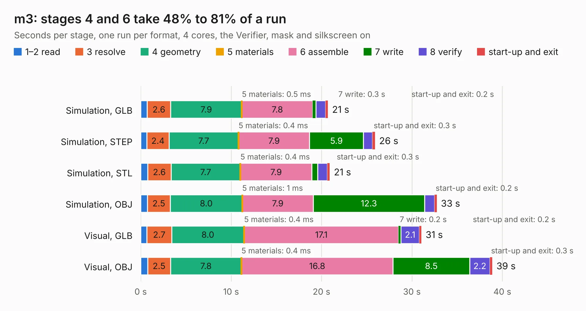

# 1785. m3

Board 1,785 of the 3,127 of [Corpus Testing](../Corpus-Testing.md), on [Corpus Page 17](../CorpusTestingPages/Corpus-Testing-17.md#1785-m3).

| Mode and format | 1–2 read | 3 resolve | 4 geometry | 5 materials | 6 assemble | 7 write | 8 verify | start-up and exit | Total |
|---|---:|---:|---:|---:|---:|---:|---:|---:|---:|
| Simulation, GLB | 0.7 | 2.6 | 7.9 | 0.5&nbsp;ms | 7.8 | 0.3 | 1.1 | 0.2 | 20.7 |
| Simulation, STEP | 0.7 | 2.4 | 7.7 | 0.4&nbsp;ms | 7.9 | 5.9 | 1.0 | 0.3 | 25.9 |
| Simulation, STL | 0.8 | 2.6 | 7.7 | 0.4&nbsp;ms | 7.9 | 0.6 | 1.1 | 0.3 | 20.9 |
| Simulation, OBJ | 0.7 | 2.5 | 8.0 | 1&nbsp;ms | 7.9 | 12.3 | 1.1 | 0.2 | 32.7 |
| Visual, GLB | 0.7 | 2.7 | 8.0 | 0.4&nbsp;ms | 17.1 | 0.2 | 2.1 | 0.2 | 31.1 |
| Visual, OBJ | 0.8 | 2.5 | 7.8 | 0.4&nbsp;ms | 16.8 | 8.5 | 2.2 | 0.3 | 38.9 |

<table align="center"><tr><td valign="top">

| Board | Repo: [oak-wjr/rocket-flight-computer](https://github.com/oak-wjr/rocket-flight-computer) Board: `m3.kicad_pcb` |
|---|---|
| Folder | reference / m3_assy_r1 |
| Complexity | 322&nbsp;/&nbsp;1000 (size&nbsp;257, features&nbsp;65) |
| KESE&nbsp;features | through vias, slotted holes, rounded, trapezoid or chamfered pads, filled zones, curved board outline |
| Tested | 9th November 2026 |
| Copper&nbsp;layers | 4 |
| File&nbsp;format | KiCad 10 (20260206) |
| Parts,&nbsp;tracks,&nbsp;vias | 115, 1,707, 494 |
| Triangles,&nbsp;simulation | 2,125,432 in 151 parts |
| Verifier | PASS in all six runs |

</td><td valign="top">

<table>
<tr><th>File type</th><th>File size</th><th>Peak memory used</th></tr>
<tr><th colspan="3" align="left">Simulation</th></tr>
<tr><td>GLB</td><td align="right">72&nbsp;MB</td><td align="right">882&nbsp;MB</td></tr>
<tr><td>STEP</td><td align="right">277&nbsp;MB</td><td align="right">1.0&nbsp;GB</td></tr>
<tr><td>STL</td><td align="right">106&nbsp;MB</td><td align="right">810&nbsp;MB</td></tr>
<tr><td>OBJ</td><td align="right">220&nbsp;MB</td><td align="right">1.4&nbsp;GB</td></tr>
<tr><th colspan="3" align="left">Visual</th></tr>
<tr><td>GLB</td><td align="right">49&nbsp;MB</td><td align="right">944&nbsp;MB</td></tr>
<tr><td>OBJ</td><td align="right">151&nbsp;MB</td><td align="right">1.1&nbsp;GB</td></tr>
</table>

</td></tr></table>

| Previous | Next |
|:---|---:|
| [1784. m1](b1784b_rocket-flight-computer_m1.md) | [1786. A20-CAN_Rev_A](b1786b_A20-CAN_A20-CAN-Rev-A.md) |
