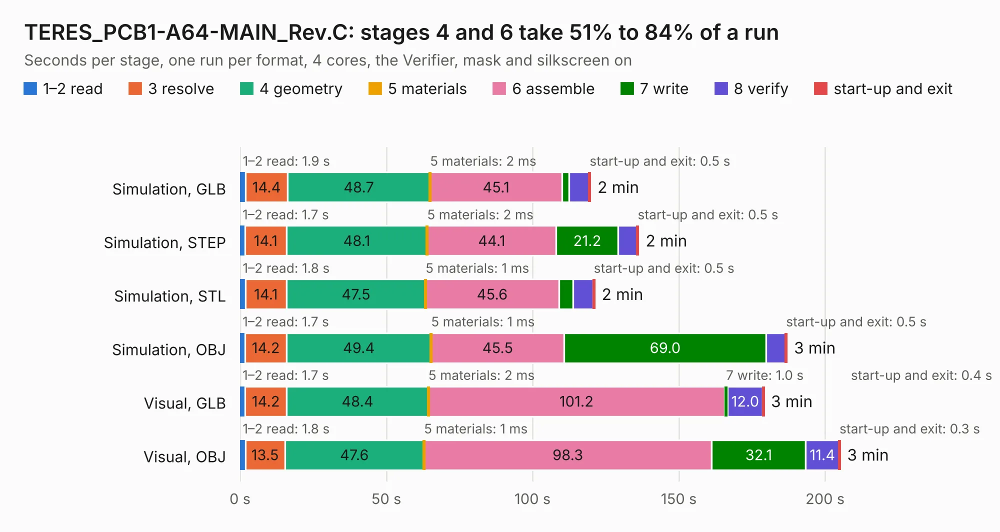

# 1787. TERES_PCB1-A64-MAIN_Rev.C

Board 1,787 of the 3,107 of [Corpus Testing](../Corpus-Testing.md), on [Corpus Page 17](../CorpusTestingPages/Corpus-Testing-17.md#1787-teres_pcb1-a64-main_revc).

| Mode and format | 1–2 read | 3 resolve | 4 geometry | 5 materials | 6 assemble | 7 write | 8 verify | start-up and exit | Total |
|---|---:|---:|---:|---:|---:|---:|---:|---:|---:|
| Simulation, GLB | 1.9 | 14.4 | 48.7 | 2&nbsp;ms | 45.1 | 2.3 | 6.9 | 0.5 | 119.8 |
| Simulation, STEP | 1.7 | 14.1 | 48.1 | 2&nbsp;ms | 44.1 | 21.2 | 6.4 | 0.5 | 136.2 |
| Simulation, STL | 1.8 | 14.1 | 47.5 | 1&nbsp;ms | 45.6 | 4.8 | 6.9 | 0.5 | 121.2 |
| Simulation, OBJ | 1.7 | 14.2 | 49.4 | 1&nbsp;ms | 45.5 | 69.0 | 6.6 | 0.5 | 186.9 |
| Visual, GLB | 1.7 | 14.2 | 48.4 | 2&nbsp;ms | 101.2 | 1.0 | 12.0 | 0.4 | 179.1 |
| Visual, OBJ | 1.8 | 13.5 | 47.6 | 1&nbsp;ms | 98.3 | 32.1 | 11.4 | 0.3 | 205.1 |

<table align="center"><tr><td valign="top">

| Board | Repo: [OLIMEX/DIY-LAPTOP](https://github.com/OLIMEX/DIY-LAPTOP) Board: `TERES_PCB1-A64-MAIN_Rev.C.kicad_pcb` |
|---|---|
| Folder | HARDWARE / A64-TERES / TERES-PCB1-A64-MAIN / Rev.C |
| Complexity | 364&nbsp;/&nbsp;1000 (size&nbsp;339, features&nbsp;25) |
| KESE&nbsp;features | through vias, slotted holes |
| Tested | 9th November 2026 |
| Copper&nbsp;layers | 6 |
| File&nbsp;format | KiCad 5 (20171114) |
| Parts,&nbsp;tracks,&nbsp;vias | 416, 15,612, 1,594 |
| Triangles,&nbsp;simulation | 10,472,450 in 492 parts |
| Verifier | PASS in all six runs |

</td><td valign="top">

<table>
<tr><th>File type</th><th>File size</th><th>Peak memory used</th></tr>
<tr><th colspan="3" align="left">Simulation</th></tr>
<tr><td>GLB</td><td align="right">362&nbsp;MB</td><td align="right">2.3&nbsp;GB</td></tr>
<tr><td>STEP</td><td align="right">1.3&nbsp;GB</td><td align="right">3.3&nbsp;GB</td></tr>
<tr><td>STL</td><td align="right">524&nbsp;MB</td><td align="right">2.4&nbsp;GB</td></tr>
<tr><td>OBJ</td><td align="right">1.1&nbsp;GB</td><td align="right">6.5&nbsp;GB</td></tr>
<tr><th colspan="3" align="left">Visual</th></tr>
<tr><td>GLB</td><td align="right">197&nbsp;MB</td><td align="right">3.2&nbsp;GB</td></tr>
<tr><td>OBJ</td><td align="right">648&nbsp;MB</td><td align="right">4.3&nbsp;GB</td></tr>
</table>

</td></tr></table>

| Previous | Next |
|:---|---:|
| [1786. TERES_PCB1-A64-MAIN_Rev.B](b1786b_DIY-LAPTOP_TERES-PCB1-A64-MAIN-Rev-B.md) | [1788. TERES-PCB2-IO_Rev.B](b1788b_DIY-LAPTOP_TERES-PCB2-IO-Rev-B.md) |
