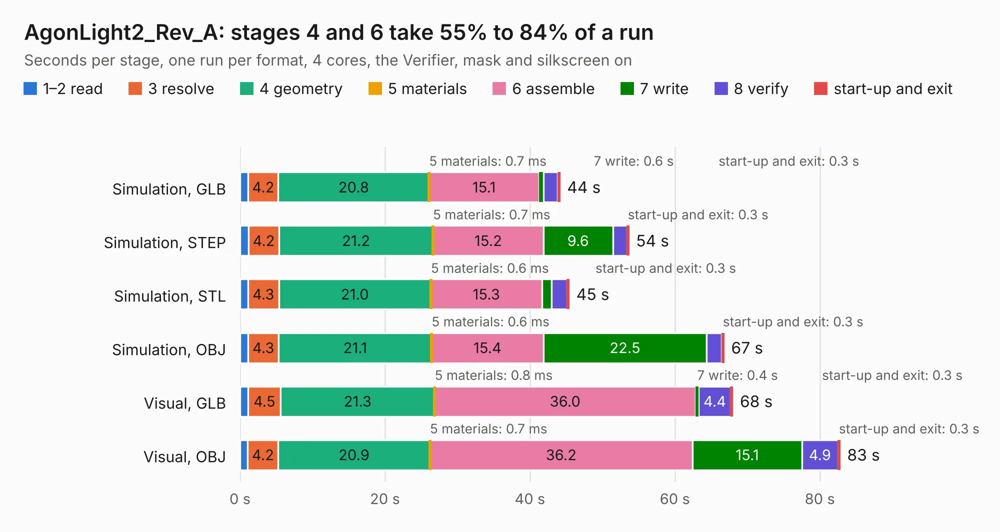

# 1788. AgonLight2_Rev_A

Board 1,788 of the 3,127 of [Corpus Testing](../Corpus-Testing.md), on [Corpus Page 17](../CorpusTestingPages/Corpus-Testing-17.md#1788-agonlight2_rev_a).

| Mode and format | 1–2 read | 3 resolve | 4 geometry | 5 materials | 6 assemble | 7 write | 8 verify | start-up and exit | Total |
|---|---:|---:|---:|---:|---:|---:|---:|---:|---:|
| Simulation, GLB | 1.1 | 4.2 | 20.8 | 0.7&nbsp;ms | 15.1 | 0.6 | 2.0 | 0.3 | 44.1 |
| Simulation, STEP | 1.2 | 4.2 | 21.2 | 0.7&nbsp;ms | 15.2 | 9.6 | 1.9 | 0.3 | 53.7 |
| Simulation, STL | 1.1 | 4.3 | 21.0 | 0.6&nbsp;ms | 15.3 | 1.4 | 2.1 | 0.3 | 45.4 |
| Simulation, OBJ | 1.1 | 4.3 | 21.1 | 0.6&nbsp;ms | 15.4 | 22.5 | 2.1 | 0.3 | 66.8 |
| Visual, GLB | 1.1 | 4.5 | 21.3 | 0.8&nbsp;ms | 36.0 | 0.4 | 4.4 | 0.3 | 68.0 |
| Visual, OBJ | 1.1 | 4.2 | 20.9 | 0.7&nbsp;ms | 36.2 | 15.1 | 4.9 | 0.3 | 82.8 |

<table align="center"><tr><td valign="top">

| Board | Repo: [OLIMEX/AgonLight2](https://github.com/OLIMEX/AgonLight2) Board: `AgonLight2_Rev_A.kicad_pcb` |
|---|---|
| Folder | HARDWARE / AgonLight2_Rev_A |
| Complexity | 313&nbsp;/&nbsp;1000 (size&nbsp;268, features&nbsp;45) |
| KESE&nbsp;features | through vias, slotted holes, filled zones |
| Tested | 9th November 2026 |
| Copper&nbsp;layers | 4 |
| File&nbsp;format | KiCad 5 (20171130) |
| Parts,&nbsp;tracks,&nbsp;vias | 229, 2,772, 400 |
| Triangles,&nbsp;simulation | 3,712,430 in 227 parts |
| Verifier | PASS in all six runs |

</td><td valign="top">

<table>
<tr><th>File type</th><th>File size</th><th>Peak memory used</th></tr>
<tr><th colspan="3" align="left">Simulation</th></tr>
<tr><td>GLB</td><td align="right">130&nbsp;MB</td><td align="right">1.3&nbsp;GB</td></tr>
<tr><td>STEP</td><td align="right">559&nbsp;MB</td><td align="right">1.5&nbsp;GB</td></tr>
<tr><td>STL</td><td align="right">186&nbsp;MB</td><td align="right">1.3&nbsp;GB</td></tr>
<tr><td>OBJ</td><td align="right">400&nbsp;MB</td><td align="right">2.5&nbsp;GB</td></tr>
<tr><th colspan="3" align="left">Visual</th></tr>
<tr><td>GLB</td><td align="right">88&nbsp;MB</td><td align="right">1.4&nbsp;GB</td></tr>
<tr><td>OBJ</td><td align="right">275&nbsp;MB</td><td align="right">1.8&nbsp;GB</td></tr>
</table>

</td></tr></table>

| Previous | Next |
|:---|---:|
| [1787. A20-CAN-ISO_Rev_B](b1787b_A20-CAN-ISO_A20-CAN-ISO-Rev-B.md) | [1789. AgonLight2_Rev_B](b1789b_AgonLight2_AgonLight2-Rev-B.md) |
