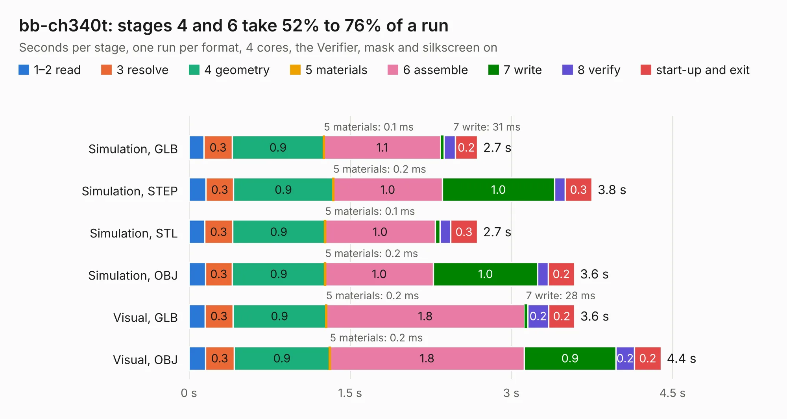

# 1789. bb-ch340t

Board 1,789 of the 3,119 of [Corpus Testing](../Corpus-Testing.md), on [Corpus Page 17](../CorpusTestingPages/Corpus-Testing-17.md#1789-bb-ch340t).

| Mode and format | 1–2 read | 3 resolve | 4 geometry | 5 materials | 6 assemble | 7 write | 8 verify | start-up and exit | Total |
|---|---:|---:|---:|---:|---:|---:|---:|---:|---:|
| Simulation, GLB | 0.1 | 0.3 | 0.9 | 0.1&nbsp;ms | 1.1 | 31&nbsp;ms | 0.1 | 0.2 | 2.7 |
| Simulation, STEP | 0.2 | 0.3 | 0.9 | 0.2&nbsp;ms | 1.0 | 1.0 | 97&nbsp;ms | 0.3 | 3.8 |
| Simulation, STL | 0.1 | 0.3 | 0.9 | 0.1&nbsp;ms | 1.0 | 45&nbsp;ms | 99&nbsp;ms | 0.3 | 2.7 |
| Simulation, OBJ | 0.2 | 0.3 | 0.9 | 0.2&nbsp;ms | 1.0 | 1.0 | 97&nbsp;ms | 0.2 | 3.6 |
| Visual, GLB | 0.1 | 0.3 | 0.9 | 0.2&nbsp;ms | 1.8 | 28&nbsp;ms | 0.2 | 0.2 | 3.6 |
| Visual, OBJ | 0.2 | 0.3 | 0.9 | 0.2&nbsp;ms | 1.8 | 0.9 | 0.2 | 0.2 | 4.4 |

<table align="center"><tr><td valign="top">

| Board | Repo: [OLIMEX/BB-CH340T](https://github.com/OLIMEX/BB-CH340T) Board: `bb-ch340t.kicad_pcb` |
|---|---|
| Folder | HARDWARE / BB-CH340T-Rev.A |
| Complexity | 179&nbsp;/&nbsp;1000 (size&nbsp;124, features&nbsp;55) |
| KESE&nbsp;features | through vias, filled zones, copper text, curved board outline |
| Tested | 9th November 2026 |
| Copper&nbsp;layers | 2 |
| File&nbsp;format | KiCad 4 (4) |
| Parts,&nbsp;tracks,&nbsp;vias | 10, 109, 12 |
| Triangles,&nbsp;simulation | 159,360 in 31 parts |
| Verifier | PASS in all six runs |

</td><td valign="top">

<table>
<tr><th>File type</th><th>File size</th><th>Peak memory used</th></tr>
<tr><th colspan="3" align="left">Simulation</th></tr>
<tr><td>GLB</td><td align="right">5.8&nbsp;MB</td><td align="right">202&nbsp;MB</td></tr>
<tr><td>STEP</td><td align="right">30&nbsp;MB</td><td align="right">219&nbsp;MB</td></tr>
<tr><td>STL</td><td align="right">8.0&nbsp;MB</td><td align="right">202&nbsp;MB</td></tr>
<tr><td>OBJ</td><td align="right">16&nbsp;MB</td><td align="right">202&nbsp;MB</td></tr>
<tr><th colspan="3" align="left">Visual</th></tr>
<tr><td>GLB</td><td align="right">5.0&nbsp;MB</td><td align="right">192&nbsp;MB</td></tr>
<tr><td>OBJ</td><td align="right">14&nbsp;MB</td><td align="right">191&nbsp;MB</td></tr>
</table>

</td></tr></table>

| Previous | Next |
|:---|---:|
| [1788. BB-ADS1262-Rev.A](b1788b_BB-ADS1262_BB-ADS1262-Rev-A.md) | [1790. bb-ch340t](b1790b_BB-CH340T_HARDWARE-BB-CH340T-Rev-B_bb-ch340t.md) |
