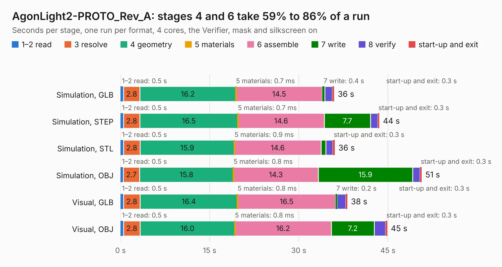

# 1790. AgonLight2-PROTO_Rev_A

Board 1,790 of the 3,123 of [Corpus Testing](../Corpus-Testing.md), on [Corpus Page 17](../CorpusTestingPages/Corpus-Testing-17.md#1790-agonlight2-proto_rev_a).

| Mode and format | 1–2 read | 3 resolve | 4 geometry | 5 materials | 6 assemble | 7 write | 8 verify | start-up and exit | Total |
|---|---:|---:|---:|---:|---:|---:|---:|---:|---:|
| Simulation, GLB | 0.5 | 2.8 | 16.2 | 0.7&nbsp;ms | 14.5 | 0.4 | 1.3 | 0.3 | 36.0 |
| Simulation, STEP | 0.5 | 2.8 | 16.5 | 0.7&nbsp;ms | 14.6 | 7.7 | 1.2 | 0.3 | 43.6 |
| Simulation, STL | 0.5 | 2.8 | 15.9 | 0.9&nbsp;ms | 14.6 | 0.8 | 1.2 | 0.3 | 36.1 |
| Simulation, OBJ | 0.5 | 2.7 | 15.8 | 0.8&nbsp;ms | 14.3 | 15.9 | 1.2 | 0.3 | 50.7 |
| Visual, GLB | 0.5 | 2.8 | 16.4 | 0.8&nbsp;ms | 16.5 | 0.2 | 1.5 | 0.3 | 38.2 |
| Visual, OBJ | 0.5 | 2.8 | 16.0 | 0.8&nbsp;ms | 16.2 | 7.2 | 1.9 | 0.3 | 44.9 |

<table align="center"><tr><td valign="top">

| Board | Repo: [OLIMEX/AgonLight2-Proto](https://github.com/OLIMEX/AgonLight2-Proto) Board: `AgonLight2-PROTO_Rev_A.kicad_pcb` |
|---|---|
| Folder | HARDWARE / AgonLight2-PROTO_Rev_A |
| Complexity | 224&nbsp;/&nbsp;1000 (size&nbsp;149, features&nbsp;75) |
| KESE&nbsp;features | through vias, filled zones, copper text, stack-up, dielectric εr and tanδ |
| Tested | 9th November 2026 |
| Copper&nbsp;layers | 2 |
| File&nbsp;format | KiCad 7 (20221018) |
| Parts,&nbsp;tracks,&nbsp;vias | 6, 649, 71 |
| Triangles,&nbsp;simulation | 2,595,312 in 45 parts |
| Verifier | PASS in all six runs |

</td><td valign="top">

<table>
<tr><th>File type</th><th>File size</th><th>Peak memory used</th></tr>
<tr><th colspan="3" align="left">Simulation</th></tr>
<tr><td>GLB</td><td align="right">89&nbsp;MB</td><td align="right">885&nbsp;MB</td></tr>
<tr><td>STEP</td><td align="right">320&nbsp;MB</td><td align="right">1.2&nbsp;GB</td></tr>
<tr><td>STL</td><td align="right">130&nbsp;MB</td><td align="right">891&nbsp;MB</td></tr>
<tr><td>OBJ</td><td align="right">275&nbsp;MB</td><td align="right">1.7&nbsp;GB</td></tr>
<tr><th colspan="3" align="left">Visual</th></tr>
<tr><td>GLB</td><td align="right">42&nbsp;MB</td><td align="right">1.1&nbsp;GB</td></tr>
<tr><td>OBJ</td><td align="right">129&nbsp;MB</td><td align="right">994&nbsp;MB</td></tr>
</table>

</td></tr></table>

| Previous | Next |
|:---|---:|
| [1789. AgonLight2-HvIO_Rev_A1](b1789b_AgonLight2-HvIO_AgonLight2-HvIO-Rev-A1.md) | [1791. bb-ads1220](b1791b_BB-ADS1220_bb-ads1220.md) |
