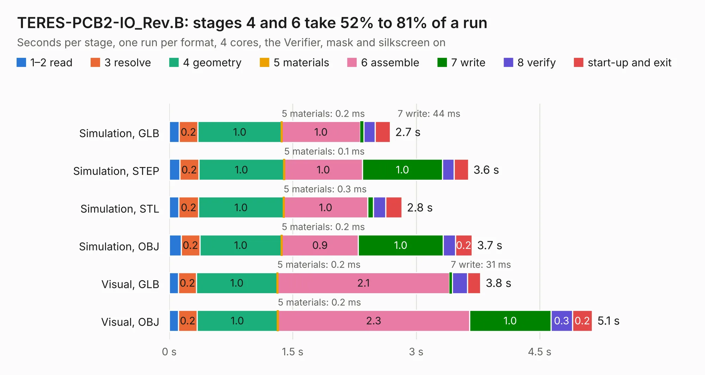

# 1790. TERES-PCB2-IO_Rev.B

Board 1,790 of the 3,109 of [Corpus Testing](../Corpus-Testing.md), on [Corpus Page 17](../CorpusTestingPages/Corpus-Testing-17.md#1790-teres-pcb2-io_revb).

| Mode and format | 1–2 read | 3 resolve | 4 geometry | 5 materials | 6 assemble | 7 write | 8 verify | start-up and exit | Total |
|---|---:|---:|---:|---:|---:|---:|---:|---:|---:|
| Simulation, GLB | 0.1 | 0.2 | 1.0 | 0.2&nbsp;ms | 1.0 | 44&nbsp;ms | 0.1 | 0.2 | 2.7 |
| Simulation, STEP | 0.1 | 0.2 | 1.0 | 0.1&nbsp;ms | 1.0 | 1.0 | 0.1 | 0.2 | 3.6 |
| Simulation, STL | 0.1 | 0.2 | 1.0 | 0.3&nbsp;ms | 1.0 | 71&nbsp;ms | 0.2 | 0.2 | 2.8 |
| Simulation, OBJ | 0.1 | 0.2 | 1.0 | 0.2&nbsp;ms | 0.9 | 1.0 | 0.1 | 0.2 | 3.7 |
| Visual, GLB | 0.1 | 0.2 | 1.0 | 0.2&nbsp;ms | 2.1 | 31&nbsp;ms | 0.2 | 0.2 | 3.8 |
| Visual, OBJ | 0.1 | 0.2 | 1.0 | 0.2&nbsp;ms | 2.3 | 1.0 | 0.3 | 0.2 | 5.1 |

<table align="center"><tr><td valign="top">

| Board | Repo: [OLIMEX/DIY-LAPTOP](https://github.com/OLIMEX/DIY-LAPTOP) Board: `TERES-PCB2-IO_Rev.B.kicad_pcb` |
|---|---|
| Folder | HARDWARE / A64-TERES / TERES-PCB2-IO / Rev.B |
| Complexity | 194&nbsp;/&nbsp;1000 (size&nbsp;149, features&nbsp;45) |
| KESE&nbsp;features | through vias, slotted holes, filled zones |
| Tested | 9th November 2026 |
| Copper&nbsp;layers | 2 |
| File&nbsp;format | KiCad 5 (20160815) |
| Parts,&nbsp;tracks,&nbsp;vias | 18, 379, 24 |
| Triangles,&nbsp;simulation | 271,896 in 41 parts |
| Verifier | PASS in all six runs |

</td><td valign="top">

<table>
<tr><th>File type</th><th>File size</th><th>Peak memory used</th></tr>
<tr><th colspan="3" align="left">Simulation</th></tr>
<tr><td>GLB</td><td align="right">9.8&nbsp;MB</td><td align="right">236&nbsp;MB</td></tr>
<tr><td>STEP</td><td align="right">51&nbsp;MB</td><td align="right">264&nbsp;MB</td></tr>
<tr><td>STL</td><td align="right">14&nbsp;MB</td><td align="right">235&nbsp;MB</td></tr>
<tr><td>OBJ</td><td align="right">28&nbsp;MB</td><td align="right">236&nbsp;MB</td></tr>
<tr><th colspan="3" align="left">Visual</th></tr>
<tr><td>GLB</td><td align="right">7.9&nbsp;MB</td><td align="right">248&nbsp;MB</td></tr>
<tr><td>OBJ</td><td align="right">23&nbsp;MB</td><td align="right">244&nbsp;MB</td></tr>
</table>

</td></tr></table>

| Previous | Next |
|:---|---:|
| [1789. TERES_PCB1-A64-MAIN_Rev.C](b1789b_DIY-LAPTOP_TERES-PCB1-A64-MAIN-Rev-C.md) | [1791. TERES-PCB3-TOUCH-BTN_Rev.A](b1791b_DIY-LAPTOP_TERES-PCB3-TOUCH-BTN-Rev-A.md) |
