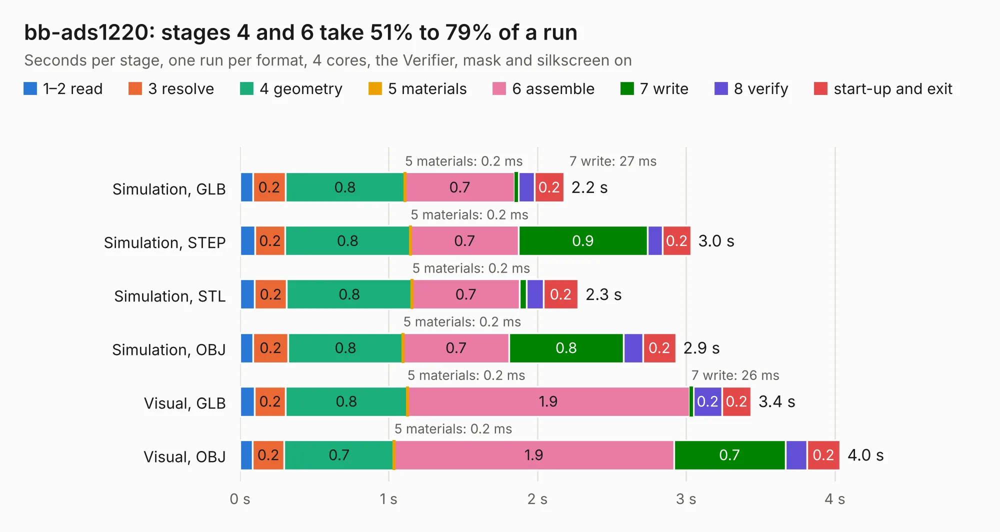

# 1794. bb-ads1220

Board 1,794 of the 3,129 of [Corpus Testing](../Corpus-Testing.md), on [Corpus Page 17](../CorpusTestingPages/Corpus-Testing-17.md#1794-bb-ads1220).

| Mode and format | 1–2 read | 3 resolve | 4 geometry | 5 materials | 6 assemble | 7 write | 8 verify | start-up and exit | Total |
|---|---:|---:|---:|---:|---:|---:|---:|---:|---:|
| Simulation, GLB | 88&nbsp;ms | 0.2 | 0.8 | 0.2&nbsp;ms | 0.7 | 27&nbsp;ms | 0.1 | 0.2 | 2.2 |
| Simulation, STEP | 0.1 | 0.2 | 0.8 | 0.2&nbsp;ms | 0.7 | 0.9 | 0.1 | 0.2 | 3.0 |
| Simulation, STL | 99&nbsp;ms | 0.2 | 0.8 | 0.2&nbsp;ms | 0.7 | 45&nbsp;ms | 0.1 | 0.2 | 2.3 |
| Simulation, OBJ | 88&nbsp;ms | 0.2 | 0.8 | 0.2&nbsp;ms | 0.7 | 0.8 | 0.1 | 0.2 | 2.9 |
| Visual, GLB | 98&nbsp;ms | 0.2 | 0.8 | 0.2&nbsp;ms | 1.9 | 26&nbsp;ms | 0.2 | 0.2 | 3.4 |
| Visual, OBJ | 86&nbsp;ms | 0.2 | 0.7 | 0.2&nbsp;ms | 1.9 | 0.7 | 0.1 | 0.2 | 4.0 |

<table align="center"><tr><td valign="top">

| Board | Repo: [OLIMEX/BB-ADS1220](https://github.com/OLIMEX/BB-ADS1220) Board: `bb-ads1220.kicad_pcb` |
|---|---|
| Folder | HARDWARE / BB-ADS1220_Rev.A |
| Complexity | 153&nbsp;/&nbsp;1000 (size&nbsp;118, features&nbsp;35) |
| KESE&nbsp;features | through vias, filled zones |
| Tested | 9th November 2026 |
| Copper&nbsp;layers | 2 |
| File&nbsp;format | KiCad 4 (4) |
| Parts,&nbsp;tracks,&nbsp;vias | 6, 101, 10 |
| Triangles,&nbsp;simulation | 190,968 in 27 parts |
| Verifier | PASS in all six runs |

</td><td valign="top">

<table>
<tr><th>File type</th><th>File size</th><th>Peak memory used</th></tr>
<tr><th colspan="3" align="left">Simulation</th></tr>
<tr><td>GLB</td><td align="right">6.8&nbsp;MB</td><td align="right">208&nbsp;MB</td></tr>
<tr><td>STEP</td><td align="right">35&nbsp;MB</td><td align="right">215&nbsp;MB</td></tr>
<tr><td>STL</td><td align="right">9.6&nbsp;MB</td><td align="right">203&nbsp;MB</td></tr>
<tr><td>OBJ</td><td align="right">19&nbsp;MB</td><td align="right">200&nbsp;MB</td></tr>
<tr><th colspan="3" align="left">Visual</th></tr>
<tr><td>GLB</td><td align="right">5.3&nbsp;MB</td><td align="right">188&nbsp;MB</td></tr>
<tr><td>OBJ</td><td align="right">15&nbsp;MB</td><td align="right">187&nbsp;MB</td></tr>
</table>

</td></tr></table>

| Previous | Next |
|:---|---:|
| [1793. AgonLight2-PROTO_Rev_A](b1793b_AgonLight2-Proto_AgonLight2-PROTO-Rev-A.md) | [1795. BB-ADS1262-Rev.A](b1795b_BB-ADS1262_BB-ADS1262-Rev-A.md) |
