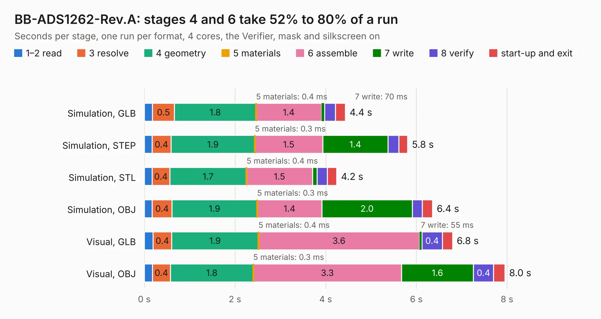

# 1794. BB-ADS1262-Rev.A

Board 1,794 of the 3,126 of [Corpus Testing](../Corpus-Testing.md), on [Corpus Page 17](../CorpusTestingPages/Corpus-Testing-17.md#1794-bb-ads1262-reva).

| Mode and format | 1–2 read | 3 resolve | 4 geometry | 5 materials | 6 assemble | 7 write | 8 verify | start-up and exit | Total |
|---|---:|---:|---:|---:|---:|---:|---:|---:|---:|
| Simulation, GLB | 0.2 | 0.5 | 1.8 | 0.4&nbsp;ms | 1.4 | 70&nbsp;ms | 0.2 | 0.2 | 4.4 |
| Simulation, STEP | 0.2 | 0.4 | 1.9 | 0.3&nbsp;ms | 1.5 | 1.4 | 0.2 | 0.2 | 5.8 |
| Simulation, STL | 0.2 | 0.4 | 1.7 | 0.4&nbsp;ms | 1.5 | 0.1 | 0.2 | 0.2 | 4.2 |
| Simulation, OBJ | 0.2 | 0.4 | 1.9 | 0.3&nbsp;ms | 1.4 | 2.0 | 0.2 | 0.2 | 6.4 |
| Visual, GLB | 0.2 | 0.4 | 1.9 | 0.4&nbsp;ms | 3.6 | 55&nbsp;ms | 0.4 | 0.2 | 6.8 |
| Visual, OBJ | 0.2 | 0.4 | 1.8 | 0.3&nbsp;ms | 3.3 | 1.6 | 0.4 | 0.2 | 8.0 |

<table align="center"><tr><td valign="top">

| Board | Repo: [OLIMEX/BB-ADS1262](https://github.com/OLIMEX/BB-ADS1262) Board: `BB-ADS1262-Rev.A.kicad_pcb` |
|---|---|
| Folder | HARDWARE / BB-ADS1262_Rev.A1 |
| Complexity | 184&nbsp;/&nbsp;1000 (size&nbsp;149, features&nbsp;35) |
| KESE&nbsp;features | through vias, filled zones |
| Tested | 9th November 2026 |
| Copper&nbsp;layers | 2 |
| File&nbsp;format | KiCad 5 (20171114) |
| Parts,&nbsp;tracks,&nbsp;vias | 27, 326, 9 |
| Triangles,&nbsp;simulation | 402,106 in 51 parts |
| Verifier | PASS in all six runs |

</td><td valign="top">

<table>
<tr><th>File type</th><th>File size</th><th>Peak memory used</th></tr>
<tr><th colspan="3" align="left">Simulation</th></tr>
<tr><td>GLB</td><td align="right">14&nbsp;MB</td><td align="right">279&nbsp;MB</td></tr>
<tr><td>STEP</td><td align="right">75&nbsp;MB</td><td align="right">310&nbsp;MB</td></tr>
<tr><td>STL</td><td align="right">20&nbsp;MB</td><td align="right">275&nbsp;MB</td></tr>
<tr><td>OBJ</td><td align="right">42&nbsp;MB</td><td align="right">333&nbsp;MB</td></tr>
<tr><th colspan="3" align="left">Visual</th></tr>
<tr><td>GLB</td><td align="right">12&nbsp;MB</td><td align="right">310&nbsp;MB</td></tr>
<tr><td>OBJ</td><td align="right">34&nbsp;MB</td><td align="right">305&nbsp;MB</td></tr>
</table>

</td></tr></table>

| Previous | Next |
|:---|---:|
| [1793. bb-ads1220](b1793b_BB-ADS1220_bb-ads1220.md) | [1795. bb-ch340t](b1795b_BB-CH340T_HARDWARE-BB-CH340T-Rev-A_bb-ch340t.md) |
