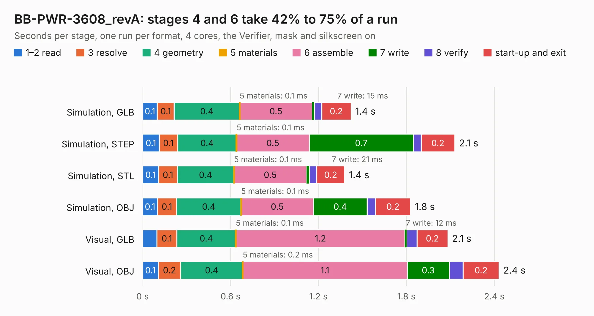

# 1797. BB-PWR-3608_revA

Board 1,797 of the 3,124 of [Corpus Testing](../Corpus-Testing.md), on [Corpus Page 17](../CorpusTestingPages/Corpus-Testing-17.md#1797-bb-pwr-3608_reva).

| Mode and format | 1–2 read | 3 resolve | 4 geometry | 5 materials | 6 assemble | 7 write | 8 verify | start-up and exit | Total |
|---|---:|---:|---:|---:|---:|---:|---:|---:|---:|
| Simulation, GLB | 0.1 | 0.1 | 0.4 | 0.1&nbsp;ms | 0.5 | 15&nbsp;ms | 49&nbsp;ms | 0.2 | 1.4 |
| Simulation, STEP | 0.1 | 0.1 | 0.4 | 0.1&nbsp;ms | 0.5 | 0.7 | 51&nbsp;ms | 0.2 | 2.1 |
| Simulation, STL | 0.1 | 0.1 | 0.4 | 0.1&nbsp;ms | 0.5 | 21&nbsp;ms | 49&nbsp;ms | 0.2 | 1.4 |
| Simulation, OBJ | 0.1 | 0.1 | 0.4 | 0.1&nbsp;ms | 0.5 | 0.4 | 56&nbsp;ms | 0.2 | 1.8 |
| Visual, GLB | 97&nbsp;ms | 0.1 | 0.4 | 0.1&nbsp;ms | 1.2 | 12&nbsp;ms | 70&nbsp;ms | 0.2 | 2.1 |
| Visual, OBJ | 0.1 | 0.2 | 0.4 | 0.2&nbsp;ms | 1.1 | 0.3 | 94&nbsp;ms | 0.2 | 2.4 |

<table align="center"><tr><td valign="top">

| Board | Repo: [OLIMEX/BB-PWR-3608](https://github.com/OLIMEX/BB-PWR-3608) Board: `BB-PWR-3608_revA.kicad_pcb` |
|---|---|
| Complexity | 163&nbsp;/&nbsp;1000 (size&nbsp;118, features&nbsp;45) |
| KESE&nbsp;features | through vias, rounded, trapezoid or chamfered pads, filled zones |
| Tested | 9th November 2026 |
| Copper&nbsp;layers | 2 |
| File&nbsp;format | KiCad 4 (4) |
| Parts,&nbsp;tracks,&nbsp;vias | 13, 73, 3 |
| Triangles,&nbsp;simulation | 76,018 in 19 parts |
| Verifier | PASS in all six runs |

</td><td valign="top">

<table>
<tr><th>File type</th><th>File size</th><th>Peak memory used</th></tr>
<tr><th colspan="3" align="left">Simulation</th></tr>
<tr><td>GLB</td><td align="right">2.8&nbsp;MB</td><td align="right">179&nbsp;MB</td></tr>
<tr><td>STEP</td><td align="right">13&nbsp;MB</td><td align="right">179&nbsp;MB</td></tr>
<tr><td>STL</td><td align="right">3.8&nbsp;MB</td><td align="right">175&nbsp;MB</td></tr>
<tr><td>OBJ</td><td align="right">7.7&nbsp;MB</td><td align="right">174&nbsp;MB</td></tr>
<tr><th colspan="3" align="left">Visual</th></tr>
<tr><td>GLB</td><td align="right">2.1&nbsp;MB</td><td align="right">156&nbsp;MB</td></tr>
<tr><td>OBJ</td><td align="right">5.8&nbsp;MB</td><td align="right">156&nbsp;MB</td></tr>
</table>

</td></tr></table>

| Previous | Next |
|:---|---:|
| [1796. BB-LVL-SHIFT_Rev_A](b1796b_BB-LVL-SHIFT_BB-LVL-SHIFT-Rev-A.md) | [1798. BB-PWR-8009_revA](b1798b_BB-PWR-8009_BB-PWR-8009-revA.md) |
