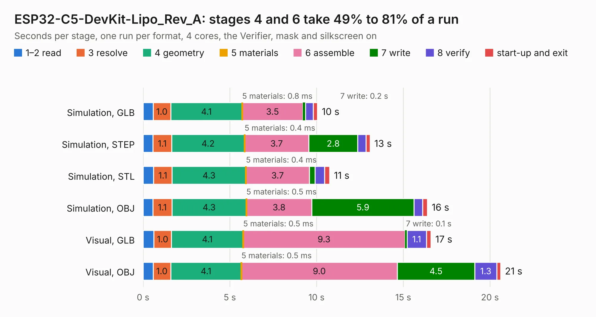

# 1801. ESP32-C5-DevKit-Lipo_Rev_A

Board 1,801 of the 3,109 of [Corpus Testing](../Corpus-Testing.md), on [Corpus Page 17](../CorpusTestingPages/Corpus-Testing-17.md#1801-esp32-c5-devkit-lipo_rev_a).

| Mode and format | 1–2 read | 3 resolve | 4 geometry | 5 materials | 6 assemble | 7 write | 8 verify | start-up and exit | Total |
|---|---:|---:|---:|---:|---:|---:|---:|---:|---:|
| Simulation, GLB | 0.6 | 1.0 | 4.1 | 0.8&nbsp;ms | 3.5 | 0.2 | 0.4 | 0.3 | 10.1 |
| Simulation, STEP | 0.6 | 1.1 | 4.2 | 0.4&nbsp;ms | 3.7 | 2.8 | 0.5 | 0.2 | 13.1 |
| Simulation, STL | 0.6 | 1.1 | 4.3 | 0.4&nbsp;ms | 3.7 | 0.3 | 0.6 | 0.3 | 10.8 |
| Simulation, OBJ | 0.6 | 1.1 | 4.3 | 0.5&nbsp;ms | 3.8 | 5.9 | 0.5 | 0.3 | 16.4 |
| Visual, GLB | 0.6 | 1.0 | 4.1 | 0.5&nbsp;ms | 9.3 | 0.1 | 1.1 | 0.3 | 16.6 |
| Visual, OBJ | 0.6 | 1.0 | 4.1 | 0.5&nbsp;ms | 9.0 | 4.5 | 1.3 | 0.2 | 20.6 |

<table align="center"><tr><td valign="top">

| Board | Repo: [OLIMEX/ESP32-C5-DevKit-Lipo](https://github.com/OLIMEX/ESP32-C5-DevKit-Lipo) Board: `ESP32-C5-DevKit-Lipo_Rev_A.kicad_pcb` |
|---|---|
| Folder | HARDWARE / ESP32-C5-DevKit-Lipo-Rev.A |
| Complexity | 296&nbsp;/&nbsp;1000 (size&nbsp;191, features&nbsp;105) |
| KESE&nbsp;features | through vias, slotted holes, rounded, trapezoid or chamfered pads, filled zones, knockout text, stack-up, dielectric εr and tanδ, mask and silkscreen colours |
| Tested | 9th November 2026 |
| Copper&nbsp;layers | 2 |
| File&nbsp;format | KiCad 7 (20221018) |
| Parts,&nbsp;tracks,&nbsp;vias | 72, 2,143, 108 |
| Triangles,&nbsp;simulation | 906,752 in 84 parts |
| Verifier | PASS in all six runs |

</td><td valign="top">

<table>
<tr><th>File type</th><th>File size</th><th>Peak memory used</th></tr>
<tr><th colspan="3" align="left">Simulation</th></tr>
<tr><td>GLB</td><td align="right">32&nbsp;MB</td><td align="right">457&nbsp;MB</td></tr>
<tr><td>STEP</td><td align="right">175&nbsp;MB</td><td align="right">509&nbsp;MB</td></tr>
<tr><td>STL</td><td align="right">45&nbsp;MB</td><td align="right">449&nbsp;MB</td></tr>
<tr><td>OBJ</td><td align="right">95&nbsp;MB</td><td align="right">670&nbsp;MB</td></tr>
<tr><th colspan="3" align="left">Visual</th></tr>
<tr><td>GLB</td><td align="right">26&nbsp;MB</td><td align="right">592&nbsp;MB</td></tr>
<tr><td>OBJ</td><td align="right">76&nbsp;MB</td><td align="right">598&nbsp;MB</td></tr>
</table>

</td></tr></table>

| Previous | Next |
|:---|---:|
| [1800. ESP32-C3-DevKit-Lipo_Rev_D](b1800b_ESP32-C3-DevKit-Lipo_ESP32-C3-DevKit-Lipo-Rev-D.md) | [1802. ESP32-C5-EVB_Rev_A](b1802b_ESP32-C5-EVB_ESP32-C5-EVB-Rev-A.md) |
