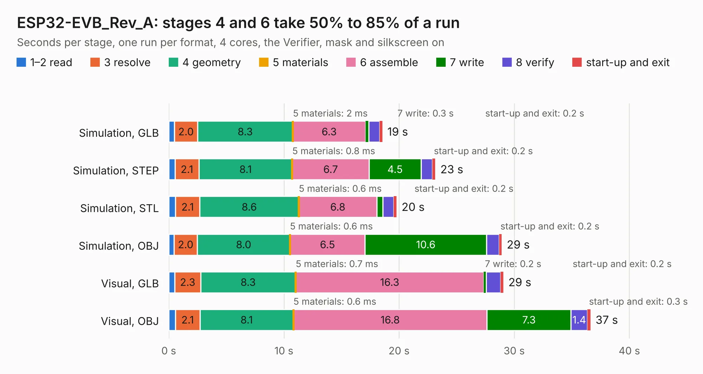

# 1801. ESP32-EVB_Rev_A

Board 1,801 of the 3,100 of [Corpus Testing](../Corpus-Testing.md), on [Corpus Page 17](../CorpusTestingPages/Corpus-Testing-17.md#1801-esp32-evb_rev_a).

| Mode and format | 1–2 read | 3 resolve | 4 geometry | 5 materials | 6 assemble | 7 write | 8 verify | start-up and exit | Total |
|---|---:|---:|---:|---:|---:|---:|---:|---:|---:|
| Simulation, GLB | 0.5 | 2.0 | 8.3 | 2&nbsp;ms | 6.3 | 0.3 | 1.0 | 0.2 | 18.6 |
| Simulation, STEP | 0.5 | 2.1 | 8.1 | 0.8&nbsp;ms | 6.7 | 4.5 | 1.0 | 0.2 | 23.1 |
| Simulation, STL | 0.6 | 2.1 | 8.6 | 0.6&nbsp;ms | 6.8 | 0.5 | 0.9 | 0.2 | 19.8 |
| Simulation, OBJ | 0.5 | 2.0 | 8.0 | 0.6&nbsp;ms | 6.5 | 10.6 | 1.1 | 0.2 | 28.9 |
| Visual, GLB | 0.5 | 2.3 | 8.3 | 0.7&nbsp;ms | 16.3 | 0.2 | 1.2 | 0.2 | 29.1 |
| Visual, OBJ | 0.6 | 2.1 | 8.1 | 0.6&nbsp;ms | 16.8 | 7.3 | 1.4 | 0.3 | 36.6 |

<table align="center"><tr><td valign="top">

| Board | Repo: [OLIMEX/ESP32-EVB](https://github.com/OLIMEX/ESP32-EVB) Board: `ESP32-EVB_Rev_A.kicad_pcb` |
|---|---|
| Folder | HARDWARE / REV-A |
| Complexity | 269&nbsp;/&nbsp;1000 (size&nbsp;234, features&nbsp;35) |
| KESE&nbsp;features | through vias, slotted holes, copper text |
| Tested | 9th November 2026 |
| Copper&nbsp;layers | 2 |
| File&nbsp;format | KiCad 5 (20160815) |
| Parts,&nbsp;tracks,&nbsp;vias | 106, 1,818, 162 |
| Triangles,&nbsp;simulation | 1,854,502 in 105 parts |
| Verifier | PASS in all six runs |

</td><td valign="top">

<table>
<tr><th>File type</th><th>File size</th><th>Peak memory used</th></tr>
<tr><th colspan="3" align="left">Simulation</th></tr>
<tr><td>GLB</td><td align="right">65&nbsp;MB</td><td align="right">617&nbsp;MB</td></tr>
<tr><td>STEP</td><td align="right">284&nbsp;MB</td><td align="right">725&nbsp;MB</td></tr>
<tr><td>STL</td><td align="right">93&nbsp;MB</td><td align="right">622&nbsp;MB</td></tr>
<tr><td>OBJ</td><td align="right">200&nbsp;MB</td><td align="right">1.3&nbsp;GB</td></tr>
<tr><th colspan="3" align="left">Visual</th></tr>
<tr><td>GLB</td><td align="right">42&nbsp;MB</td><td align="right">763&nbsp;MB</td></tr>
<tr><td>OBJ</td><td align="right">128&nbsp;MB</td><td align="right">938&nbsp;MB</td></tr>
</table>

</td></tr></table>

| Previous | Next |
|:---|---:|
| [1800. ESP32-DevKit-Lipo_Rev_D](b1800b_ESP32-DevKit-LiPo_ESP32-DevKit-Lipo-Rev-D.md) | [1802. ESP32-EVB_Rev_B](b1802b_ESP32-EVB_ESP32-EVB-Rev-B.md) |
