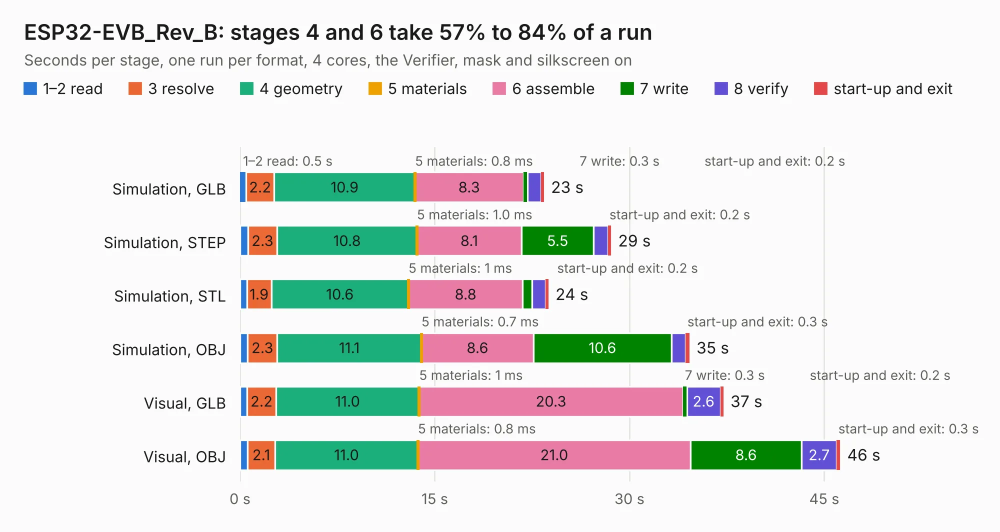

# 1802. ESP32-EVB_Rev_B

Board 1,802 of the 3,100 of [Corpus Testing](../Corpus-Testing.md), on [Corpus Page 17](../CorpusTestingPages/Corpus-Testing-17.md#1802-esp32-evb_rev_b).

| Mode and format | 1–2 read | 3 resolve | 4 geometry | 5 materials | 6 assemble | 7 write | 8 verify | start-up and exit | Total |
|---|---:|---:|---:|---:|---:|---:|---:|---:|---:|
| Simulation, GLB | 0.5 | 2.2 | 10.9 | 0.8&nbsp;ms | 8.3 | 0.3 | 1.0 | 0.2 | 23.4 |
| Simulation, STEP | 0.6 | 2.3 | 10.8 | 1.0&nbsp;ms | 8.1 | 5.5 | 1.1 | 0.2 | 28.6 |
| Simulation, STL | 0.5 | 1.9 | 10.6 | 1&nbsp;ms | 8.8 | 0.7 | 1.1 | 0.2 | 23.8 |
| Simulation, OBJ | 0.6 | 2.3 | 11.1 | 0.7&nbsp;ms | 8.6 | 10.6 | 1.1 | 0.3 | 34.6 |
| Visual, GLB | 0.5 | 2.2 | 11.0 | 1&nbsp;ms | 20.3 | 0.3 | 2.6 | 0.2 | 37.2 |
| Visual, OBJ | 0.6 | 2.1 | 11.0 | 0.8&nbsp;ms | 21.0 | 8.6 | 2.7 | 0.3 | 46.2 |

<table align="center"><tr><td valign="top">

| Board | Repo: [OLIMEX/ESP32-EVB](https://github.com/OLIMEX/ESP32-EVB) Board: `ESP32-EVB_Rev_B.kicad_pcb` |
|---|---|
| Folder | HARDWARE / REV-B |
| Complexity | 300&nbsp;/&nbsp;1000 (size&nbsp;245, features&nbsp;55) |
| KESE&nbsp;features | through vias, slotted holes, filled zones, copper text |
| Tested | 9th November 2026 |
| Copper&nbsp;layers | 2 |
| File&nbsp;format | KiCad 5 (20170123) |
| Parts,&nbsp;tracks,&nbsp;vias | 144, 2,751, 310 |
| Triangles,&nbsp;simulation | 2,202,244 in 143 parts |
| Verifier | PASS in all six runs |

</td><td valign="top">

<table>
<tr><th>File type</th><th>File size</th><th>Peak memory used</th></tr>
<tr><th colspan="3" align="left">Simulation</th></tr>
<tr><td>GLB</td><td align="right">78&nbsp;MB</td><td align="right">918&nbsp;MB</td></tr>
<tr><td>STEP</td><td align="right">424&nbsp;MB</td><td align="right">965&nbsp;MB</td></tr>
<tr><td>STL</td><td align="right">110&nbsp;MB</td><td align="right">872&nbsp;MB</td></tr>
<tr><td>OBJ</td><td align="right">237&nbsp;MB</td><td align="right">1.5&nbsp;GB</td></tr>
<tr><th colspan="3" align="left">Visual</th></tr>
<tr><td>GLB</td><td align="right">61&nbsp;MB</td><td align="right">1.0&nbsp;GB</td></tr>
<tr><td>OBJ</td><td align="right">188&nbsp;MB</td><td align="right">1.3&nbsp;GB</td></tr>
</table>

</td></tr></table>

| Previous | Next |
|:---|---:|
| [1801. ESP32-EVB_Rev_A](b1801b_ESP32-EVB_ESP32-EVB-Rev-A.md) | [1803. ESP32-EVB_Rev_C](b1803b_ESP32-EVB_ESP32-EVB-Rev-C.md) |
