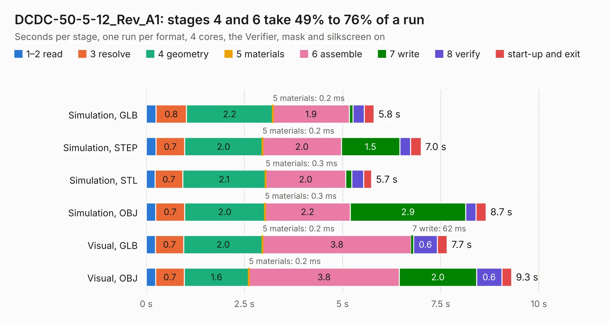

# 1803. DCDC-50-5-12_Rev_A1

Board 1,803 of the 3,127 of [Corpus Testing](../Corpus-Testing.md), on [Corpus Page 17](../CorpusTestingPages/Corpus-Testing-17.md#1803-dcdc-50-5-12_rev_a1).

| Mode and format | 1–2 read | 3 resolve | 4 geometry | 5 materials | 6 assemble | 7 write | 8 verify | start-up and exit | Total |
|---|---:|---:|---:|---:|---:|---:|---:|---:|---:|
| Simulation, GLB | 0.3 | 0.8 | 2.2 | 0.2&nbsp;ms | 1.9 | 94&nbsp;ms | 0.3 | 0.3 | 5.8 |
| Simulation, STEP | 0.3 | 0.7 | 2.0 | 0.2&nbsp;ms | 2.0 | 1.5 | 0.3 | 0.3 | 7.0 |
| Simulation, STL | 0.2 | 0.7 | 2.1 | 0.3&nbsp;ms | 2.0 | 0.2 | 0.3 | 0.2 | 5.7 |
| Simulation, OBJ | 0.2 | 0.7 | 2.0 | 0.3&nbsp;ms | 2.2 | 2.9 | 0.3 | 0.3 | 8.7 |
| Visual, GLB | 0.2 | 0.7 | 2.0 | 0.2&nbsp;ms | 3.8 | 62&nbsp;ms | 0.6 | 0.3 | 7.7 |
| Visual, OBJ | 0.2 | 0.7 | 1.6 | 0.2&nbsp;ms | 3.8 | 2.0 | 0.6 | 0.2 | 9.3 |

<table align="center"><tr><td valign="top">

| Board | Repo: [OLIMEX/DCDC-50-5-12](https://github.com/OLIMEX/DCDC-50-5-12) Board: `DCDC-50-5-12_Rev_A1.kicad_pcb` |
|---|---|
| Folder | HARDWARE / DCDC50-5-12-Rev.A1 |
| Complexity | 233&nbsp;/&nbsp;1000 (size&nbsp;178, features&nbsp;55) |
| KESE&nbsp;features | through vias, slotted holes, filled zones, copper text |
| Tested | 9th November 2026 |
| Copper&nbsp;layers | 4 |
| File&nbsp;format | KiCad 5 (20171130) |
| Parts,&nbsp;tracks,&nbsp;vias | 28, 295, 142 |
| Triangles,&nbsp;simulation | 636,148 in 35 parts |
| Verifier | PASS in all six runs |

</td><td valign="top">

<table>
<tr><th>File type</th><th>File size</th><th>Peak memory used</th></tr>
<tr><th colspan="3" align="left">Simulation</th></tr>
<tr><td>GLB</td><td align="right">22&nbsp;MB</td><td align="right">337&nbsp;MB</td></tr>
<tr><td>STEP</td><td align="right">68&nbsp;MB</td><td align="right">410&nbsp;MB</td></tr>
<tr><td>STL</td><td align="right">32&nbsp;MB</td><td align="right">351&nbsp;MB</td></tr>
<tr><td>OBJ</td><td align="right">65&nbsp;MB</td><td align="right">467&nbsp;MB</td></tr>
<tr><th colspan="3" align="left">Visual</th></tr>
<tr><td>GLB</td><td align="right">13&nbsp;MB</td><td align="right">346&nbsp;MB</td></tr>
<tr><td>OBJ</td><td align="right">40&nbsp;MB</td><td align="right">359&nbsp;MB</td></tr>
</table>

</td></tr></table>

| Previous | Next |
|:---|---:|
| [1802. Bike-TSL-Kit_RevA](b1802b_Bike-TSL-Kit_Bike-TSL-Kit-RevA.md) | [1804. TERES_PCB1-A64-MAIN_Rev.B](b1804b_DIY-LAPTOP_TERES-PCB1-A64-MAIN-Rev-B.md) |
