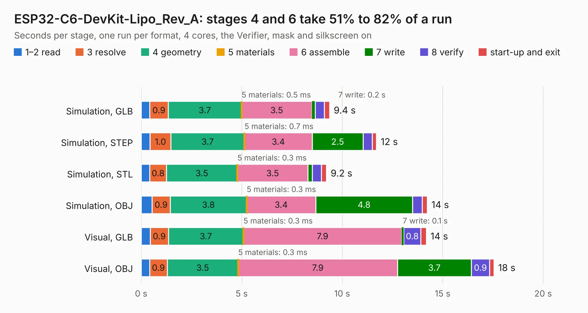

# 1806. ESP32-C6-DevKit-Lipo_Rev_A

Board 1,806 of the 3,112 of [Corpus Testing](../Corpus-Testing.md), on [Corpus Page 17](../CorpusTestingPages/Corpus-Testing-17.md#1806-esp32-c6-devkit-lipo_rev_a).

| Mode and format | 1–2 read | 3 resolve | 4 geometry | 5 materials | 6 assemble | 7 write | 8 verify | start-up and exit | Total |
|---|---:|---:|---:|---:|---:|---:|---:|---:|---:|
| Simulation, GLB | 0.4 | 0.9 | 3.7 | 0.5&nbsp;ms | 3.5 | 0.2 | 0.5 | 0.3 | 9.4 |
| Simulation, STEP | 0.4 | 1.0 | 3.7 | 0.7&nbsp;ms | 3.4 | 2.5 | 0.5 | 0.2 | 11.7 |
| Simulation, STL | 0.4 | 0.8 | 3.5 | 0.3&nbsp;ms | 3.5 | 0.2 | 0.5 | 0.2 | 9.2 |
| Simulation, OBJ | 0.5 | 0.9 | 3.8 | 0.3&nbsp;ms | 3.4 | 4.8 | 0.5 | 0.2 | 14.2 |
| Visual, GLB | 0.4 | 0.9 | 3.7 | 0.3&nbsp;ms | 7.9 | 0.1 | 0.8 | 0.3 | 14.2 |
| Visual, OBJ | 0.4 | 0.9 | 3.5 | 0.3&nbsp;ms | 7.9 | 3.7 | 0.9 | 0.2 | 17.6 |

<table align="center"><tr><td valign="top">

| Board | Repo: [OLIMEX/ESP32-C6-DevKit-Lipo](https://github.com/OLIMEX/ESP32-C6-DevKit-Lipo) Board: `ESP32-C6-DevKit-Lipo_Rev_A.kicad_pcb` |
|---|---|
| Folder | HARDWARE / ESP32-C6-DevKit-Lipo.Rev.A |
| Complexity | 250&nbsp;/&nbsp;1000 (size&nbsp;180, features&nbsp;70) |
| KESE&nbsp;features | through vias, slotted holes, rounded, trapezoid or chamfered pads, filled zones, knockout text |
| Tested | 9th November 2026 |
| Copper&nbsp;layers | 2 |
| File&nbsp;format | KiCad 7 (20221018) |
| Parts,&nbsp;tracks,&nbsp;vias | 71, 924, 115 |
| Triangles,&nbsp;simulation | 791,576 in 88 parts |
| Verifier | PASS in all six runs |

</td><td valign="top">

<table>
<tr><th>File type</th><th>File size</th><th>Peak memory used</th></tr>
<tr><th colspan="3" align="left">Simulation</th></tr>
<tr><td>GLB</td><td align="right">28&nbsp;MB</td><td align="right">400&nbsp;MB</td></tr>
<tr><td>STEP</td><td align="right">156&nbsp;MB</td><td align="right">464&nbsp;MB</td></tr>
<tr><td>STL</td><td align="right">40&nbsp;MB</td><td align="right">433&nbsp;MB</td></tr>
<tr><td>OBJ</td><td align="right">83&nbsp;MB</td><td align="right">578&nbsp;MB</td></tr>
<tr><th colspan="3" align="left">Visual</th></tr>
<tr><td>GLB</td><td align="right">22&nbsp;MB</td><td align="right">517&nbsp;MB</td></tr>
<tr><td>OBJ</td><td align="right">67&nbsp;MB</td><td align="right">519&nbsp;MB</td></tr>
</table>

</td></tr></table>

| Previous | Next |
|:---|---:|
| [1805. ESP32-C5-EVB_Rev_A](b1805b_ESP32-C5-EVB_ESP32-C5-EVB-Rev-A.md) | [1807. ESP32-C6-EVB_DIMM_Rev_A](b1807b_ESP32-C6-EVB_ESP32-C6-EVB-DIMM-Rev-A.md) |
