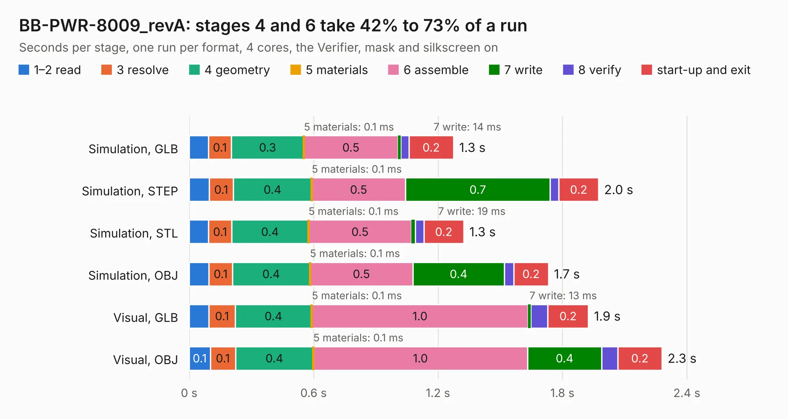

# 1807. BB-PWR-8009_revA

Board 1,807 of the 3,138 of [Corpus Testing](../Corpus-Testing.md), on [Corpus Page 17](../CorpusTestingPages/Corpus-Testing-17.md#1807-bb-pwr-8009_reva).

| Mode and format | 1–2 read | 3 resolve | 4 geometry | 5 materials | 6 assemble | 7 write | 8 verify | start-up and exit | Total |
|---|---:|---:|---:|---:|---:|---:|---:|---:|---:|
| Simulation, GLB | 93&nbsp;ms | 0.1 | 0.3 | 0.1&nbsp;ms | 0.5 | 14&nbsp;ms | 39&nbsp;ms | 0.2 | 1.3 |
| Simulation, STEP | 96&nbsp;ms | 0.1 | 0.4 | 0.1&nbsp;ms | 0.5 | 0.7 | 43&nbsp;ms | 0.2 | 2.0 |
| Simulation, STL | 94&nbsp;ms | 0.1 | 0.4 | 0.1&nbsp;ms | 0.5 | 19&nbsp;ms | 40&nbsp;ms | 0.2 | 1.3 |
| Simulation, OBJ | 95&nbsp;ms | 0.1 | 0.4 | 0.1&nbsp;ms | 0.5 | 0.4 | 46&nbsp;ms | 0.2 | 1.7 |
| Visual, GLB | 96&nbsp;ms | 0.1 | 0.4 | 0.1&nbsp;ms | 1.0 | 13&nbsp;ms | 82&nbsp;ms | 0.2 | 1.9 |
| Visual, OBJ | 0.1 | 0.1 | 0.4 | 0.1&nbsp;ms | 1.0 | 0.4 | 77&nbsp;ms | 0.2 | 2.3 |

<table align="center"><tr><td valign="top">

| Board | Repo: [OLIMEX/BB-PWR-8009](https://github.com/OLIMEX/BB-PWR-8009) Board: `BB-PWR-8009_revA.kicad_pcb` |
|---|---|
| Complexity | 149&nbsp;/&nbsp;1000 (size&nbsp;114, features&nbsp;35) |
| KESE&nbsp;features | through vias, filled zones |
| Tested | 9th November 2026 |
| Copper&nbsp;layers | 2 |
| File&nbsp;format | KiCad 4 (4) |
| Parts,&nbsp;tracks,&nbsp;vias | 12, 63, 2 |
| Triangles,&nbsp;simulation | 80,210 in 17 parts |
| Verifier | PASS in all six runs |

</td><td valign="top">

<table>
<tr><th>File type</th><th>File size</th><th>Peak memory used</th></tr>
<tr><th colspan="3" align="left">Simulation</th></tr>
<tr><td>GLB</td><td align="right">3.0&nbsp;MB</td><td align="right">182&nbsp;MB</td></tr>
<tr><td>STEP</td><td align="right">15&nbsp;MB</td><td align="right">186&nbsp;MB</td></tr>
<tr><td>STL</td><td align="right">4.0&nbsp;MB</td><td align="right">176&nbsp;MB</td></tr>
<tr><td>OBJ</td><td align="right">8.1&nbsp;MB</td><td align="right">180&nbsp;MB</td></tr>
<tr><th colspan="3" align="left">Visual</th></tr>
<tr><td>GLB</td><td align="right">2.4&nbsp;MB</td><td align="right">158&nbsp;MB</td></tr>
<tr><td>OBJ</td><td align="right">6.6&nbsp;MB</td><td align="right">158&nbsp;MB</td></tr>
</table>

</td></tr></table>

| Previous | Next |
|:---|---:|
| [1806. BB-PWR-3608_revA](b1806b_BB-PWR-3608_BB-PWR-3608-revA.md) | [1808. BB-PWR-8113_revA](b1808b_BB-PWR-8113_BB-PWR-8113-revA.md) |
