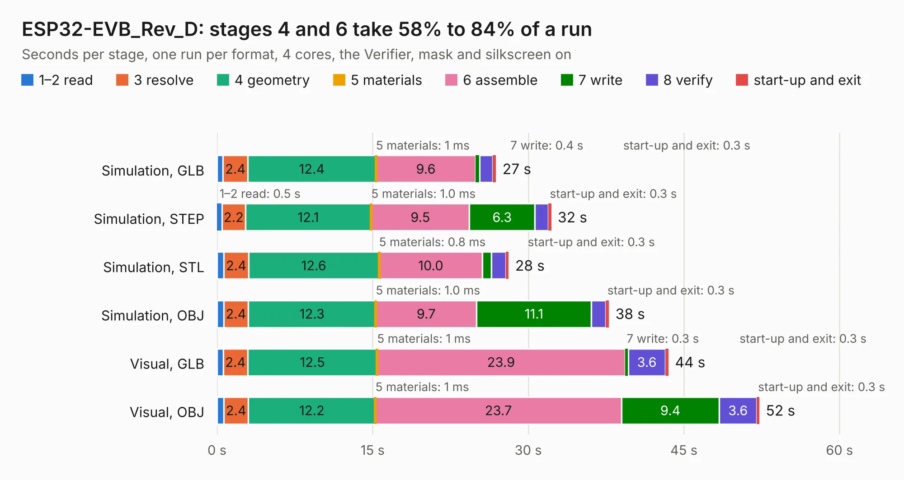

# 1807. ESP32-EVB_Rev_D

Board 1,807 of the 3,103 of [Corpus Testing](../Corpus-Testing.md), on [Corpus Page 17](../CorpusTestingPages/Corpus-Testing-17.md#1807-esp32-evb_rev_d).

| Mode and format | 1–2 read | 3 resolve | 4 geometry | 5 materials | 6 assemble | 7 write | 8 verify | start-up and exit | Total |
|---|---:|---:|---:|---:|---:|---:|---:|---:|---:|
| Simulation, GLB | 0.6 | 2.4 | 12.4 | 1&nbsp;ms | 9.6 | 0.4 | 1.3 | 0.3 | 26.9 |
| Simulation, STEP | 0.5 | 2.2 | 12.1 | 1.0&nbsp;ms | 9.5 | 6.3 | 1.3 | 0.3 | 32.2 |
| Simulation, STL | 0.7 | 2.4 | 12.6 | 0.8&nbsp;ms | 10.0 | 0.9 | 1.4 | 0.3 | 28.1 |
| Simulation, OBJ | 0.6 | 2.4 | 12.3 | 1.0&nbsp;ms | 9.7 | 11.1 | 1.4 | 0.3 | 37.8 |
| Visual, GLB | 0.6 | 2.4 | 12.5 | 1&nbsp;ms | 23.9 | 0.3 | 3.6 | 0.3 | 43.5 |
| Visual, OBJ | 0.7 | 2.4 | 12.2 | 1&nbsp;ms | 23.7 | 9.4 | 3.6 | 0.3 | 52.3 |

<table align="center"><tr><td valign="top">

| Board | Repo: [OLIMEX/ESP32-EVB](https://github.com/OLIMEX/ESP32-EVB) Board: `ESP32-EVB_Rev_D.kicad_pcb` |
|---|---|
| Folder | HARDWARE / REV-D |
| Complexity | 301&nbsp;/&nbsp;1000 (size&nbsp;246, features&nbsp;55) |
| KESE&nbsp;features | through vias, slotted holes, filled zones, copper text |
| Tested | 9th November 2026 |
| Copper&nbsp;layers | 2 |
| File&nbsp;format | KiCad 5 (20170123) |
| Parts,&nbsp;tracks,&nbsp;vias | 146, 2,818, 315 |
| Triangles,&nbsp;simulation | 2,219,460 in 143 parts |
| Verifier | PASS in all six runs |

</td><td valign="top">

<table>
<tr><th>File type</th><th>File size</th><th>Peak memory used</th></tr>
<tr><th colspan="3" align="left">Simulation</th></tr>
<tr><td>GLB</td><td align="right">78&nbsp;MB</td><td align="right">775&nbsp;MB</td></tr>
<tr><td>STEP</td><td align="right">428&nbsp;MB</td><td align="right">1.0&nbsp;GB</td></tr>
<tr><td>STL</td><td align="right">111&nbsp;MB</td><td align="right">801&nbsp;MB</td></tr>
<tr><td>OBJ</td><td align="right">239&nbsp;MB</td><td align="right">1.5&nbsp;GB</td></tr>
<tr><th colspan="3" align="left">Visual</th></tr>
<tr><td>GLB</td><td align="right">62&nbsp;MB</td><td align="right">1.1&nbsp;GB</td></tr>
<tr><td>OBJ</td><td align="right">190&nbsp;MB</td><td align="right">1.3&nbsp;GB</td></tr>
</table>

</td></tr></table>

| Previous | Next |
|:---|---:|
| [1806. ESP32-EVB_Rev_C](b1806b_ESP32-EVB_ESP32-EVB-Rev-C.md) | [1808. ESP32-EVB_Rev_F](b1808b_ESP32-EVB_ESP32-EVB-Rev-F.md) |
