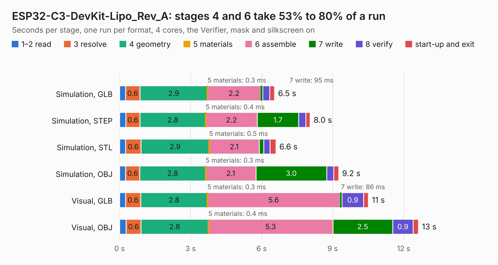

# 1808. ESP32-C3-DevKit-Lipo_Rev_A

Board 1,808 of the 3,120 of [Corpus Testing](../Corpus-Testing.md), on [Corpus Page 17](../CorpusTestingPages/Corpus-Testing-17.md#1808-esp32-c3-devkit-lipo_rev_a).

| Mode and format | 1–2 read | 3 resolve | 4 geometry | 5 materials | 6 assemble | 7 write | 8 verify | start-up and exit | Total |
|---|---:|---:|---:|---:|---:|---:|---:|---:|---:|
| Simulation, GLB | 0.2 | 0.6 | 2.9 | 0.3&nbsp;ms | 2.2 | 95&nbsp;ms | 0.3 | 0.2 | 6.5 |
| Simulation, STEP | 0.3 | 0.6 | 2.8 | 0.4&nbsp;ms | 2.2 | 1.7 | 0.3 | 0.2 | 8.0 |
| Simulation, STL | 0.3 | 0.6 | 2.9 | 0.5&nbsp;ms | 2.1 | 0.2 | 0.3 | 0.2 | 6.6 |
| Simulation, OBJ | 0.3 | 0.6 | 2.8 | 0.3&nbsp;ms | 2.1 | 3.0 | 0.3 | 0.2 | 9.2 |
| Visual, GLB | 0.3 | 0.6 | 2.8 | 0.3&nbsp;ms | 5.6 | 86&nbsp;ms | 0.9 | 0.2 | 10.5 |
| Visual, OBJ | 0.3 | 0.6 | 2.8 | 0.4&nbsp;ms | 5.3 | 2.5 | 0.9 | 0.2 | 12.6 |

<table align="center"><tr><td valign="top">

| Board | Repo: [OLIMEX/ESP32-C3-DevKit-Lipo](https://github.com/OLIMEX/ESP32-C3-DevKit-Lipo) Board: `ESP32-C3-DevKit-Lipo_Rev_A.kicad_pcb` |
|---|---|
| Folder | HARDWARE / ESP32-C3-DevKit-Lipo_Rev_A |
| Complexity | 224&nbsp;/&nbsp;1000 (size&nbsp;169, features&nbsp;55) |
| KESE&nbsp;features | through vias, slotted holes, filled zones, copper text |
| Tested | 9th November 2026 |
| Copper&nbsp;layers | 2 |
| File&nbsp;format | KiCad 5 (20171130) |
| Parts,&nbsp;tracks,&nbsp;vias | 41, 713, 63 |
| Triangles,&nbsp;simulation | 711,980 in 67 parts |
| Verifier | PASS in all six runs |

</td><td valign="top">

<table>
<tr><th>File type</th><th>File size</th><th>Peak memory used</th></tr>
<tr><th colspan="3" align="left">Simulation</th></tr>
<tr><td>GLB</td><td align="right">25&nbsp;MB</td><td align="right">372&nbsp;MB</td></tr>
<tr><td>STEP</td><td align="right">140&nbsp;MB</td><td align="right">455&nbsp;MB</td></tr>
<tr><td>STL</td><td align="right">36&nbsp;MB</td><td align="right">387&nbsp;MB</td></tr>
<tr><td>OBJ</td><td align="right">74&nbsp;MB</td><td align="right">537&nbsp;MB</td></tr>
<tr><th colspan="3" align="left">Visual</th></tr>
<tr><td>GLB</td><td align="right">21&nbsp;MB</td><td align="right">484&nbsp;MB</td></tr>
<tr><td>OBJ</td><td align="right">63&nbsp;MB</td><td align="right">475&nbsp;MB</td></tr>
</table>

</td></tr></table>

| Previous | Next |
|:---|---:|
| [1807. ESP-PROG_Rev.C](b1807b_ESP-PROG_ESP-PROG-Rev-C.md) | [1809. ESP32-C3-DevKit-Lipo_Rev_B](b1809b_ESP32-C3-DevKit-Lipo_ESP32-C3-DevKit-Lipo-Rev-B.md) |
