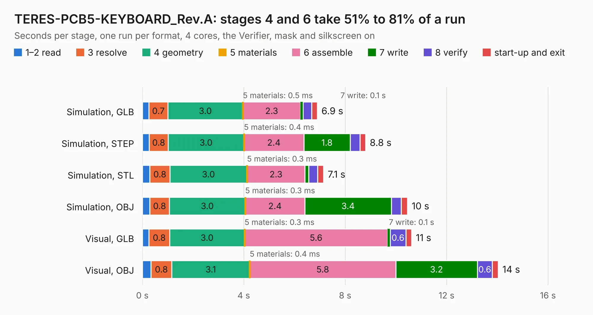

# 1809. TERES-PCB5-KEYBOARD_Rev.A

Board 1,809 of the 3,127 of [Corpus Testing](../Corpus-Testing.md), on [Corpus Page 17](../CorpusTestingPages/Corpus-Testing-17.md#1809-teres-pcb5-keyboard_reva).

| Mode and format | 1–2 read | 3 resolve | 4 geometry | 5 materials | 6 assemble | 7 write | 8 verify | start-up and exit | Total |
|---|---:|---:|---:|---:|---:|---:|---:|---:|---:|
| Simulation, GLB | 0.3 | 0.7 | 3.0 | 0.5&nbsp;ms | 2.3 | 0.1 | 0.3 | 0.2 | 6.9 |
| Simulation, STEP | 0.3 | 0.8 | 3.0 | 0.4&nbsp;ms | 2.4 | 1.8 | 0.4 | 0.2 | 8.8 |
| Simulation, STL | 0.3 | 0.8 | 3.0 | 0.3&nbsp;ms | 2.3 | 0.1 | 0.3 | 0.2 | 7.1 |
| Simulation, OBJ | 0.3 | 0.8 | 3.0 | 0.3&nbsp;ms | 2.4 | 3.4 | 0.4 | 0.2 | 10.5 |
| Visual, GLB | 0.3 | 0.8 | 3.0 | 0.3&nbsp;ms | 5.6 | 0.1 | 0.6 | 0.2 | 10.6 |
| Visual, OBJ | 0.3 | 0.8 | 3.1 | 0.4&nbsp;ms | 5.8 | 3.2 | 0.6 | 0.2 | 14.0 |

<table align="center"><tr><td valign="top">

| Board | Repo: [OLIMEX/DIY-LAPTOP](https://github.com/OLIMEX/DIY-LAPTOP) Board: `TERES-PCB5-KEYBOARD_Rev.A.kicad_pcb` |
|---|---|
| Folder | HARDWARE / A64-TERES / TERES-PCB5-KEYBOARD / Rev.A |
| Complexity | 247&nbsp;/&nbsp;1000 (size&nbsp;212, features&nbsp;35) |
| KESE&nbsp;features | through vias, filled zones |
| Tested | 9th November 2026 |
| Copper&nbsp;layers | 2 |
| File&nbsp;format | KiCad 5 (20170123) |
| Parts,&nbsp;tracks,&nbsp;vias | 46, 778, 76 |
| Triangles,&nbsp;simulation | 600,674 in 55 parts |
| Verifier | PASS in all six runs |

</td><td valign="top">

<table>
<tr><th>File type</th><th>File size</th><th>Peak memory used</th></tr>
<tr><th colspan="3" align="left">Simulation</th></tr>
<tr><td>GLB</td><td align="right">22&nbsp;MB</td><td align="right">350&nbsp;MB</td></tr>
<tr><td>STEP</td><td align="right">117&nbsp;MB</td><td align="right">421&nbsp;MB</td></tr>
<tr><td>STL</td><td align="right">30&nbsp;MB</td><td align="right">365&nbsp;MB</td></tr>
<tr><td>OBJ</td><td align="right">64&nbsp;MB</td><td align="right">460&nbsp;MB</td></tr>
<tr><th colspan="3" align="left">Visual</th></tr>
<tr><td>GLB</td><td align="right">20&nbsp;MB</td><td align="right">482&nbsp;MB</td></tr>
<tr><td>OBJ</td><td align="right">59&nbsp;MB</td><td align="right">482&nbsp;MB</td></tr>
</table>

</td></tr></table>

| Previous | Next |
|:---|---:|
| [1808. PCB4-PWR-BTN_Rev.A](b1808b_DIY-LAPTOP_PCB4-PWR-BTN-Rev-A.md) | [1810. eduArdu_Rev_A](b1810b_eduArdu_eduArdu-Rev-A.md) |
