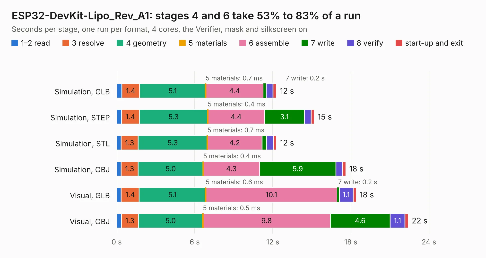

# 1809. ESP32-DevKit-Lipo_Rev_A1

Board 1,809 of the 3,112 of [Corpus Testing](../Corpus-Testing.md), on [Corpus Page 17](../CorpusTestingPages/Corpus-Testing-17.md#1809-esp32-devkit-lipo_rev_a1).

| Mode and format | 1–2 read | 3 resolve | 4 geometry | 5 materials | 6 assemble | 7 write | 8 verify | start-up and exit | Total |
|---|---:|---:|---:|---:|---:|---:|---:|---:|---:|
| Simulation, GLB | 0.4 | 1.4 | 5.1 | 0.7&nbsp;ms | 4.4 | 0.2 | 0.5 | 0.3 | 12.3 |
| Simulation, STEP | 0.4 | 1.4 | 5.3 | 0.4&nbsp;ms | 4.4 | 3.1 | 0.5 | 0.2 | 15.2 |
| Simulation, STL | 0.3 | 1.3 | 5.3 | 0.7&nbsp;ms | 4.2 | 0.4 | 0.5 | 0.2 | 12.3 |
| Simulation, OBJ | 0.3 | 1.3 | 5.0 | 0.4&nbsp;ms | 4.3 | 5.9 | 0.5 | 0.3 | 17.6 |
| Visual, GLB | 0.3 | 1.4 | 5.1 | 0.6&nbsp;ms | 10.1 | 0.2 | 1.1 | 0.2 | 18.4 |
| Visual, OBJ | 0.4 | 1.3 | 5.0 | 0.5&nbsp;ms | 9.8 | 4.6 | 1.1 | 0.3 | 22.4 |

<table align="center"><tr><td valign="top">

| Board | Repo: [OLIMEX/ESP32-DevKit-LiPo](https://github.com/OLIMEX/ESP32-DevKit-LiPo) Board: `ESP32-DevKit-Lipo_Rev_A1.kicad_pcb` |
|---|---|
| Folder | HARDWARE / ESP32-DevKit-LiPo-Rev.A1 |
| Complexity | 221&nbsp;/&nbsp;1000 (size&nbsp;176, features&nbsp;45) |
| KESE&nbsp;features | through vias, slotted holes, filled zones |
| Tested | 9th November 2026 |
| Copper&nbsp;layers | 2 |
| File&nbsp;format | KiCad 5 (20171130) |
| Parts,&nbsp;tracks,&nbsp;vias | 40, 1,154, 96 |
| Triangles,&nbsp;simulation | 957,920 in 79 parts |
| Verifier | PASS in all six runs |

</td><td valign="top">

<table>
<tr><th>File type</th><th>File size</th><th>Peak memory used</th></tr>
<tr><th colspan="3" align="left">Simulation</th></tr>
<tr><td>GLB</td><td align="right">34&nbsp;MB</td><td align="right">448&nbsp;MB</td></tr>
<tr><td>STEP</td><td align="right">194&nbsp;MB</td><td align="right">521&nbsp;MB</td></tr>
<tr><td>STL</td><td align="right">48&nbsp;MB</td><td align="right">433&nbsp;MB</td></tr>
<tr><td>OBJ</td><td align="right">100&nbsp;MB</td><td align="right">691&nbsp;MB</td></tr>
<tr><th colspan="3" align="left">Visual</th></tr>
<tr><td>GLB</td><td align="right">28&nbsp;MB</td><td align="right">619&nbsp;MB</td></tr>
<tr><td>OBJ</td><td align="right">82&nbsp;MB</td><td align="right">629&nbsp;MB</td></tr>
</table>

</td></tr></table>

| Previous | Next |
|:---|---:|
| [1808. ESP32-C6-EVB_Rev_A](b1808b_ESP32-C6-EVB_ESP32-C6-EVB-Rev-A.md) | [1810. ESP32-DevKit-Lipo_Rev_B](b1810b_ESP32-DevKit-LiPo_ESP32-DevKit-Lipo-Rev-B.md) |
