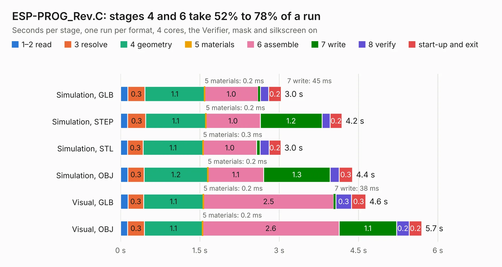

# 1811. ESP-PROG_Rev.C

Board 1,811 of the 3,124 of [Corpus Testing](../Corpus-Testing.md), on [Corpus Page 17](../CorpusTestingPages/Corpus-Testing-17.md#1811-esp-prog_revc).

| Mode and format | 1–2 read | 3 resolve | 4 geometry | 5 materials | 6 assemble | 7 write | 8 verify | start-up and exit | Total |
|---|---:|---:|---:|---:|---:|---:|---:|---:|---:|
| Simulation, GLB | 0.1 | 0.3 | 1.1 | 0.2&nbsp;ms | 1.0 | 45&nbsp;ms | 0.2 | 0.2 | 3.0 |
| Simulation, STEP | 0.1 | 0.3 | 1.1 | 0.2&nbsp;ms | 1.0 | 1.2 | 0.2 | 0.2 | 4.2 |
| Simulation, STL | 0.1 | 0.3 | 1.1 | 0.3&nbsp;ms | 1.0 | 69&nbsp;ms | 0.2 | 0.2 | 3.0 |
| Simulation, OBJ | 0.1 | 0.3 | 1.2 | 0.2&nbsp;ms | 1.1 | 1.3 | 0.2 | 0.3 | 4.4 |
| Visual, GLB | 0.1 | 0.3 | 1.1 | 0.2&nbsp;ms | 2.5 | 38&nbsp;ms | 0.3 | 0.3 | 4.6 |
| Visual, OBJ | 0.1 | 0.3 | 1.1 | 0.2&nbsp;ms | 2.6 | 1.1 | 0.2 | 0.2 | 5.7 |

<table align="center"><tr><td valign="top">

| Board | Repo: [OLIMEX/ESP-PROG](https://github.com/OLIMEX/ESP-PROG) Board: `ESP-PROG_Rev.C.kicad_pcb` |
|---|---|
| Folder | HARDWARE / ESP-PROG-Rev.C |
| Complexity | 184&nbsp;/&nbsp;1000 (size&nbsp;139, features&nbsp;45) |
| KESE&nbsp;features | through vias, slotted holes, filled zones |
| Tested | 9th November 2026 |
| Copper&nbsp;layers | 2 |
| File&nbsp;format | KiCad 5 (20171130) |
| Parts,&nbsp;tracks,&nbsp;vias | 16, 204, 19 |
| Triangles,&nbsp;simulation | 277,428 in 36 parts |
| Verifier | PASS in all six runs |

</td><td valign="top">

<table>
<tr><th>File type</th><th>File size</th><th>Peak memory used</th></tr>
<tr><th colspan="3" align="left">Simulation</th></tr>
<tr><td>GLB</td><td align="right">9.9&nbsp;MB</td><td align="right">245&nbsp;MB</td></tr>
<tr><td>STEP</td><td align="right">53&nbsp;MB</td><td align="right">256&nbsp;MB</td></tr>
<tr><td>STL</td><td align="right">14&nbsp;MB</td><td align="right">237&nbsp;MB</td></tr>
<tr><td>OBJ</td><td align="right">28&nbsp;MB</td><td align="right">243&nbsp;MB</td></tr>
<tr><th colspan="3" align="left">Visual</th></tr>
<tr><td>GLB</td><td align="right">7.9&nbsp;MB</td><td align="right">235&nbsp;MB</td></tr>
<tr><td>OBJ</td><td align="right">23&nbsp;MB</td><td align="right">234&nbsp;MB</td></tr>
</table>

</td></tr></table>

| Previous | Next |
|:---|---:|
| [1810. eduArdu_Rev_B](b1810b_eduArdu_eduArdu-Rev-B.md) | [1812. ESP32-C3-DevKit-Lipo_Rev_A](b1812b_ESP32-C3-DevKit-Lipo_ESP32-C3-DevKit-Lipo-Rev-A.md) |
