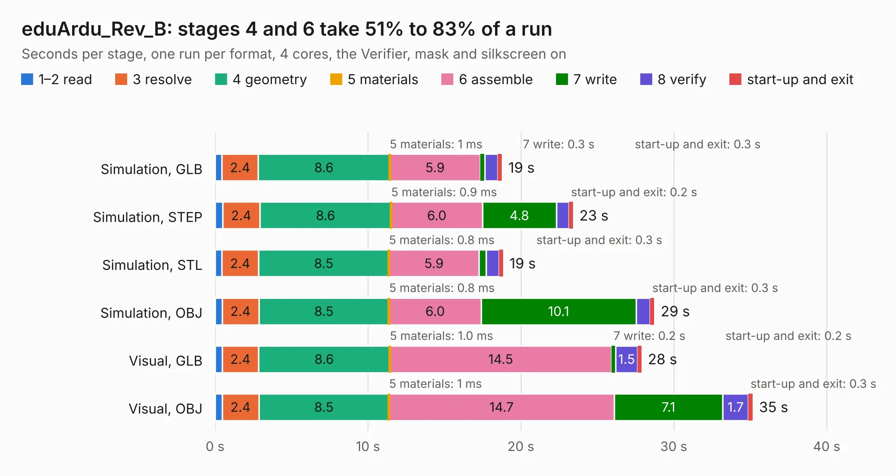

# 1811. eduArdu_Rev_B

Board 1,811 of the 3,127 of [Corpus Testing](../Corpus-Testing.md), on [Corpus Page 17](../CorpusTestingPages/Corpus-Testing-17.md#1811-eduardu_rev_b).

| Mode and format | 1–2 read | 3 resolve | 4 geometry | 5 materials | 6 assemble | 7 write | 8 verify | start-up and exit | Total |
|---|---:|---:|---:|---:|---:|---:|---:|---:|---:|
| Simulation, GLB | 0.4 | 2.4 | 8.6 | 1&nbsp;ms | 5.9 | 0.3 | 0.8 | 0.3 | 18.8 |
| Simulation, STEP | 0.5 | 2.4 | 8.6 | 0.9&nbsp;ms | 6.0 | 4.8 | 0.8 | 0.2 | 23.4 |
| Simulation, STL | 0.4 | 2.4 | 8.5 | 0.8&nbsp;ms | 5.9 | 0.5 | 0.8 | 0.3 | 18.8 |
| Simulation, OBJ | 0.5 | 2.4 | 8.5 | 0.8&nbsp;ms | 6.0 | 10.1 | 0.9 | 0.3 | 28.7 |
| Visual, GLB | 0.5 | 2.4 | 8.6 | 1.0&nbsp;ms | 14.5 | 0.2 | 1.5 | 0.2 | 27.9 |
| Visual, OBJ | 0.5 | 2.4 | 8.5 | 1&nbsp;ms | 14.7 | 7.1 | 1.7 | 0.3 | 35.2 |

<table align="center"><tr><td valign="top">

| Board | Repo: [OLIMEX/eduArdu](https://github.com/OLIMEX/eduArdu) Board: `eduArdu_Rev_B.kicad_pcb` |
|---|---|
| Folder | HARDWARE / eduArdu_Rev_B |
| Complexity | 285&nbsp;/&nbsp;1000 (size&nbsp;230, features&nbsp;55) |
| KESE&nbsp;features | through vias, slotted holes, filled zones, curved board outline |
| Tested | 9th November 2026 |
| Copper&nbsp;layers | 2 |
| File&nbsp;format | KiCad 5 (20171130) |
| Parts,&nbsp;tracks,&nbsp;vias | 101, 1,377, 168 |
| Triangles,&nbsp;simulation | 1,628,488 in 116 parts |
| Verifier | PASS in all six runs |

</td><td valign="top">

<table>
<tr><th>File type</th><th>File size</th><th>Peak memory used</th></tr>
<tr><th colspan="3" align="left">Simulation</th></tr>
<tr><td>GLB</td><td align="right">57&nbsp;MB</td><td align="right">646&nbsp;MB</td></tr>
<tr><td>STEP</td><td align="right">296&nbsp;MB</td><td align="right">754&nbsp;MB</td></tr>
<tr><td>STL</td><td align="right">81&nbsp;MB</td><td align="right">673&nbsp;MB</td></tr>
<tr><td>OBJ</td><td align="right">172&nbsp;MB</td><td align="right">1.1&nbsp;GB</td></tr>
<tr><th colspan="3" align="left">Visual</th></tr>
<tr><td>GLB</td><td align="right">43&nbsp;MB</td><td align="right">814&nbsp;MB</td></tr>
<tr><td>OBJ</td><td align="right">131&nbsp;MB</td><td align="right">979&nbsp;MB</td></tr>
</table>

</td></tr></table>

| Previous | Next |
|:---|---:|
| [1810. eduArdu_Rev_A](b1810b_eduArdu_eduArdu-Rev-A.md) | [1812. ESP-PROG_Rev.C](b1812b_ESP-PROG_ESP-PROG-Rev-C.md) |
