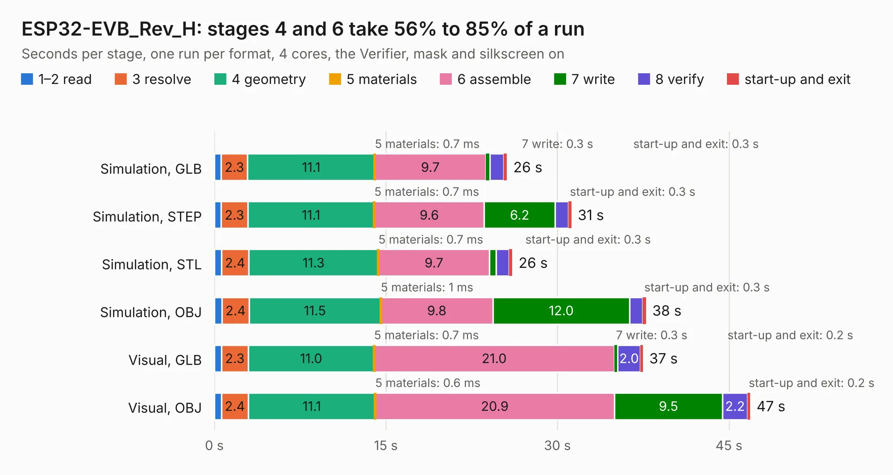

# 1814. ESP32-EVB_Rev_H

Board 1,814 of the 3,108 of [Corpus Testing](../Corpus-Testing.md), on [Corpus Page 17](../CorpusTestingPages/Corpus-Testing-17.md#1814-esp32-evb_rev_h).

| Mode and format | 1–2 read | 3 resolve | 4 geometry | 5 materials | 6 assemble | 7 write | 8 verify | start-up and exit | Total |
|---|---:|---:|---:|---:|---:|---:|---:|---:|---:|
| Simulation, GLB | 0.6 | 2.3 | 11.1 | 0.7&nbsp;ms | 9.7 | 0.3 | 1.2 | 0.3 | 25.6 |
| Simulation, STEP | 0.6 | 2.3 | 11.1 | 0.7&nbsp;ms | 9.6 | 6.2 | 1.2 | 0.3 | 31.2 |
| Simulation, STL | 0.6 | 2.4 | 11.3 | 0.7&nbsp;ms | 9.7 | 0.6 | 1.1 | 0.3 | 26.0 |
| Simulation, OBJ | 0.7 | 2.4 | 11.5 | 1&nbsp;ms | 9.8 | 12.0 | 1.1 | 0.3 | 37.7 |
| Visual, GLB | 0.6 | 2.3 | 11.0 | 0.7&nbsp;ms | 21.0 | 0.3 | 2.0 | 0.2 | 37.5 |
| Visual, OBJ | 0.6 | 2.4 | 11.1 | 0.6&nbsp;ms | 20.9 | 9.5 | 2.2 | 0.2 | 46.9 |

<table align="center"><tr><td valign="top">

| Board | Repo: [OLIMEX/ESP32-EVB](https://github.com/OLIMEX/ESP32-EVB) Board: `ESP32-EVB_Rev_H.kicad_pcb` |
|---|---|
| Folder | HARDWARE / REV-H |
| Complexity | 291&nbsp;/&nbsp;1000 (size&nbsp;246, features&nbsp;45) |
| KESE&nbsp;features | through vias, slotted holes, filled zones |
| Tested | 9th November 2026 |
| Copper&nbsp;layers | 2 |
| File&nbsp;format | KiCad 5 (20171130) |
| Parts,&nbsp;tracks,&nbsp;vias | 146, 2,965, 310 |
| Triangles,&nbsp;simulation | 2,248,598 in 140 parts |
| Verifier | PASS in all six runs |

</td><td valign="top">

<table>
<tr><th>File type</th><th>File size</th><th>Peak memory used</th></tr>
<tr><th colspan="3" align="left">Simulation</th></tr>
<tr><td>GLB</td><td align="right">79&nbsp;MB</td><td align="right">846&nbsp;MB</td></tr>
<tr><td>STEP</td><td align="right">430&nbsp;MB</td><td align="right">1.0&nbsp;GB</td></tr>
<tr><td>STL</td><td align="right">112&nbsp;MB</td><td align="right">936&nbsp;MB</td></tr>
<tr><td>OBJ</td><td align="right">242&nbsp;MB</td><td align="right">1.5&nbsp;GB</td></tr>
<tr><th colspan="3" align="left">Visual</th></tr>
<tr><td>GLB</td><td align="right">64&nbsp;MB</td><td align="right">1.1&nbsp;GB</td></tr>
<tr><td>OBJ</td><td align="right">197&nbsp;MB</td><td align="right">1.3&nbsp;GB</td></tr>
</table>

</td></tr></table>

| Previous | Next |
|:---|---:|
| [1813. ESP32-EVB_Rev_F](b1813b_ESP32-EVB_ESP32-EVB-Rev-F.md) | [1815. ESP32-EVB_Rev_I](b1815b_ESP32-EVB_ESP32-EVB-Rev-I.md) |
