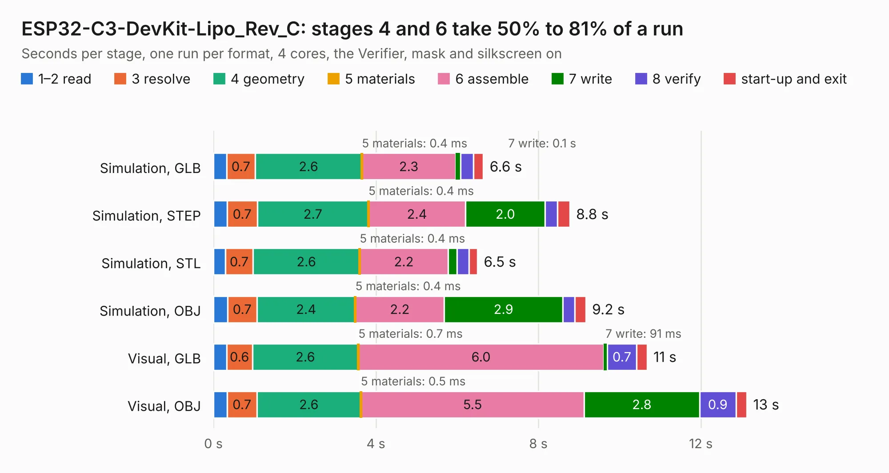

# 1815. ESP32-C3-DevKit-Lipo_Rev_C

Board 1,815 of the 3,127 of [Corpus Testing](../Corpus-Testing.md), on [Corpus Page 17](../CorpusTestingPages/Corpus-Testing-17.md#1815-esp32-c3-devkit-lipo_rev_c).

| Mode and format | 1–2 read | 3 resolve | 4 geometry | 5 materials | 6 assemble | 7 write | 8 verify | start-up and exit | Total |
|---|---:|---:|---:|---:|---:|---:|---:|---:|---:|
| Simulation, GLB | 0.3 | 0.7 | 2.6 | 0.4&nbsp;ms | 2.3 | 0.1 | 0.3 | 0.2 | 6.6 |
| Simulation, STEP | 0.3 | 0.7 | 2.7 | 0.4&nbsp;ms | 2.4 | 2.0 | 0.3 | 0.3 | 8.8 |
| Simulation, STL | 0.3 | 0.7 | 2.6 | 0.4&nbsp;ms | 2.2 | 0.2 | 0.3 | 0.2 | 6.5 |
| Simulation, OBJ | 0.3 | 0.7 | 2.4 | 0.4&nbsp;ms | 2.2 | 2.9 | 0.3 | 0.3 | 9.2 |
| Visual, GLB | 0.3 | 0.6 | 2.6 | 0.7&nbsp;ms | 6.0 | 91&nbsp;ms | 0.7 | 0.3 | 10.7 |
| Visual, OBJ | 0.3 | 0.7 | 2.6 | 0.5&nbsp;ms | 5.5 | 2.8 | 0.9 | 0.3 | 13.1 |

<table align="center"><tr><td valign="top">

| Board | Repo: [OLIMEX/ESP32-C3-DevKit-Lipo](https://github.com/OLIMEX/ESP32-C3-DevKit-Lipo) Board: `ESP32-C3-DevKit-Lipo_Rev_C.kicad_pcb` |
|---|---|
| Folder | HARDWARE / ESP32-C3-DevKit-Lipo_Rev_C |
| Complexity | 241&nbsp;/&nbsp;1000 (size&nbsp;171, features&nbsp;70) |
| KESE&nbsp;features | through vias, slotted holes, rounded, trapezoid or chamfered pads, filled zones, knockout text |
| Tested | 9th November 2026 |
| Copper&nbsp;layers | 2 |
| File&nbsp;format | KiCad 7 (20221018) |
| Parts,&nbsp;tracks,&nbsp;vias | 43, 768, 88 |
| Triangles,&nbsp;simulation | 667,752 in 67 parts |
| Verifier | PASS in all six runs |

</td><td valign="top">

<table>
<tr><th>File type</th><th>File size</th><th>Peak memory used</th></tr>
<tr><th colspan="3" align="left">Simulation</th></tr>
<tr><td>GLB</td><td align="right">24&nbsp;MB</td><td align="right">409&nbsp;MB</td></tr>
<tr><td>STEP</td><td align="right">135&nbsp;MB</td><td align="right">425&nbsp;MB</td></tr>
<tr><td>STL</td><td align="right">33&nbsp;MB</td><td align="right">410&nbsp;MB</td></tr>
<tr><td>OBJ</td><td align="right">70&nbsp;MB</td><td align="right">498&nbsp;MB</td></tr>
<tr><th colspan="3" align="left">Visual</th></tr>
<tr><td>GLB</td><td align="right">20&nbsp;MB</td><td align="right">479&nbsp;MB</td></tr>
<tr><td>OBJ</td><td align="right">60&nbsp;MB</td><td align="right">485&nbsp;MB</td></tr>
</table>

</td></tr></table>

| Previous | Next |
|:---|---:|
| [1814. ESP32-C3-DevKit-Lipo_Rev_B](b1814b_ESP32-C3-DevKit-Lipo_ESP32-C3-DevKit-Lipo-Rev-B.md) | [1816. ESP32-C3-DevKit-Lipo_Rev_D](b1816b_ESP32-C3-DevKit-Lipo_ESP32-C3-DevKit-Lipo-Rev-D.md) |
