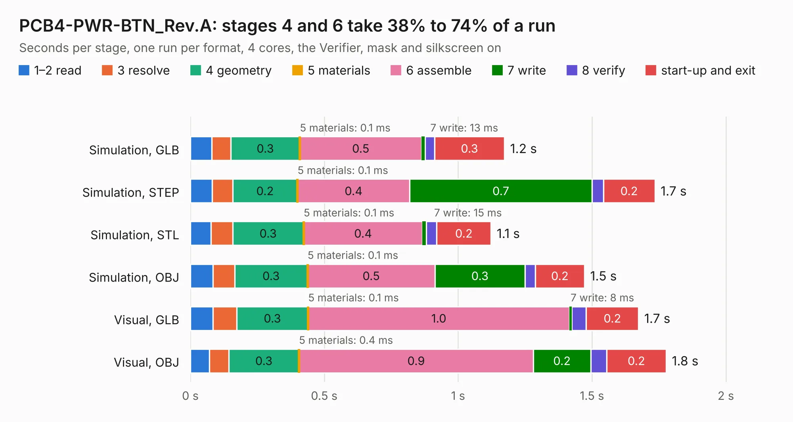

# 1816 PCB4-PWR-BTN_Rev.A

Board 1,816 of the 3,138 of [Corpus Testing](../Corpus-Testing.md), on [Corpus Page 17](../CorpusTestingPages/Corpus-Testing-17.md#1816-pcb4-pwr-btn_reva).

| Mode and format | 1–2 read | 3 resolve | 4 geometry | 5 materials | 6 assemble | 7 write | 8 verify | start-up and exit | Total |
|---|---:|---:|---:|---:|---:|---:|---:|---:|---:|
| Simulation, GLB | 79&nbsp;ms | 71&nbsp;ms | 0.3 | 0.1&nbsp;ms | 0.5 | 13&nbsp;ms | 35&nbsp;ms | 0.3 | 1.2 |
| Simulation, STEP | 82&nbsp;ms | 76&nbsp;ms | 0.2 | 0.1&nbsp;ms | 0.4 | 0.7 | 42&nbsp;ms | 0.2 | 1.7 |
| Simulation, STL | 77&nbsp;ms | 81&nbsp;ms | 0.3 | 0.1&nbsp;ms | 0.4 | 15&nbsp;ms | 39&nbsp;ms | 0.2 | 1.1 |
| Simulation, OBJ | 85&nbsp;ms | 80&nbsp;ms | 0.3 | 0.1&nbsp;ms | 0.5 | 0.3 | 38&nbsp;ms | 0.2 | 1.5 |
| Visual, GLB | 85&nbsp;ms | 88&nbsp;ms | 0.3 | 0.1&nbsp;ms | 1.0 | 8&nbsp;ms | 54&nbsp;ms | 0.2 | 1.7 |
| Visual, OBJ | 72&nbsp;ms | 72&nbsp;ms | 0.3 | 0.4&nbsp;ms | 0.9 | 0.2 | 60&nbsp;ms | 0.2 | 1.8 |

<table align="center"><tr><td valign="top">

| Board | Repo: [OLIMEX/DIY-LAPTOP](https://github.com/OLIMEX/DIY-LAPTOP) Board: `PCB4-PWR-BTN_Rev.A.kicad_pcb` |
|---|---|
| Folder | HARDWARE / A64-TERES / TERES-PCB4-PWR-BTN / Rev.A |
| Complexity | 137&nbsp;/&nbsp;1000 (size&nbsp;102, features&nbsp;35) |
| KESE&nbsp;features | through vias, filled zones |
| Tested | 9th November 2026 |
| Copper&nbsp;layers | 2 |
| File&nbsp;format | KiCad 5 (20160815) |
| Parts,&nbsp;tracks,&nbsp;vias | 2, 43, 14 |
| Triangles,&nbsp;simulation | 68,078 in 14 parts |
| Verifier | PASS in all six runs |

</td><td valign="top">

<table>
<tr><th>File type</th><th>File size</th><th>Peak memory used</th></tr>
<tr><th colspan="3" align="left">Simulation</th></tr>
<tr><td>GLB</td><td align="right">2.4&nbsp;MB</td><td align="right">171&nbsp;MB</td></tr>
<tr><td>STEP</td><td align="right">11&nbsp;MB</td><td align="right">176&nbsp;MB</td></tr>
<tr><td>STL</td><td align="right">3.4&nbsp;MB</td><td align="right">170&nbsp;MB</td></tr>
<tr><td>OBJ</td><td align="right">6.6&nbsp;MB</td><td align="right">170&nbsp;MB</td></tr>
<tr><th colspan="3" align="left">Visual</th></tr>
<tr><td>GLB</td><td align="right">2.0&nbsp;MB</td><td align="right">151&nbsp;MB</td></tr>
<tr><td>OBJ</td><td align="right">5.4&nbsp;MB</td><td align="right">152&nbsp;MB</td></tr>
</table>

</td></tr></table>

| Previous | Next |
|:---|---:|
| [1815 TERES-PCB3-TOUCH-BTN_Rev.A](b1815b_DIY-LAPTOP_TERES-PCB3-TOUCH-BTN-Rev-A.md) | [1817 TERES-PCB5-KEYBOARD_Rev.A](b1817b_DIY-LAPTOP_TERES-PCB5-KEYBOARD-Rev-A.md) |
