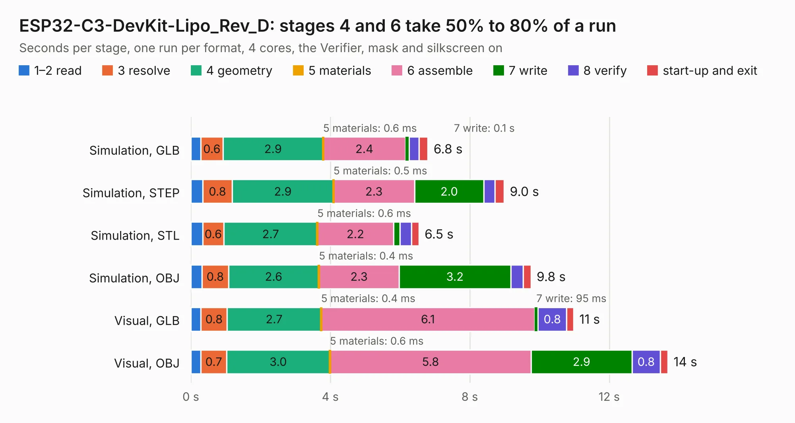

# 1816. ESP32-C3-DevKit-Lipo_Rev_D

Board 1,816 of the 3,126 of [Corpus Testing](../Corpus-Testing.md), on [Corpus Page 17](../CorpusTestingPages/Corpus-Testing-17.md#1816-esp32-c3-devkit-lipo_rev_d).

| Mode and format | 1–2 read | 3 resolve | 4 geometry | 5 materials | 6 assemble | 7 write | 8 verify | start-up and exit | Total |
|---|---:|---:|---:|---:|---:|---:|---:|---:|---:|
| Simulation, GLB | 0.3 | 0.6 | 2.9 | 0.6&nbsp;ms | 2.4 | 0.1 | 0.3 | 0.3 | 6.8 |
| Simulation, STEP | 0.3 | 0.8 | 2.9 | 0.5&nbsp;ms | 2.3 | 2.0 | 0.3 | 0.3 | 9.0 |
| Simulation, STL | 0.3 | 0.6 | 2.7 | 0.6&nbsp;ms | 2.2 | 0.2 | 0.3 | 0.2 | 6.5 |
| Simulation, OBJ | 0.3 | 0.8 | 2.6 | 0.4&nbsp;ms | 2.3 | 3.2 | 0.4 | 0.2 | 9.8 |
| Visual, GLB | 0.3 | 0.8 | 2.7 | 0.4&nbsp;ms | 6.1 | 95&nbsp;ms | 0.8 | 0.2 | 11.0 |
| Visual, OBJ | 0.3 | 0.7 | 3.0 | 0.6&nbsp;ms | 5.8 | 2.9 | 0.8 | 0.2 | 13.7 |

<table align="center"><tr><td valign="top">

| Board | Repo: [OLIMEX/ESP32-C3-DevKit-Lipo](https://github.com/OLIMEX/ESP32-C3-DevKit-Lipo) Board: `ESP32-C3-DevKit-Lipo_Rev_D.kicad_pcb` |
|---|---|
| Folder | HARDWARE / ESP32-C3-DevKit-Lipo_Rev_D |
| Complexity | 242&nbsp;/&nbsp;1000 (size&nbsp;172, features&nbsp;70) |
| KESE&nbsp;features | through vias, slotted holes, rounded, trapezoid or chamfered pads, filled zones, knockout text |
| Tested | 9th November 2026 |
| Copper&nbsp;layers | 2 |
| File&nbsp;format | KiCad 7 (20221018) |
| Parts,&nbsp;tracks,&nbsp;vias | 43, 799, 88 |
| Triangles,&nbsp;simulation | 676,008 in 67 parts |
| Verifier | PASS in all six runs |

</td><td valign="top">

<table>
<tr><th>File type</th><th>File size</th><th>Peak memory used</th></tr>
<tr><th colspan="3" align="left">Simulation</th></tr>
<tr><td>GLB</td><td align="right">24&nbsp;MB</td><td align="right">386&nbsp;MB</td></tr>
<tr><td>STEP</td><td align="right">138&nbsp;MB</td><td align="right">441&nbsp;MB</td></tr>
<tr><td>STL</td><td align="right">34&nbsp;MB</td><td align="right">421&nbsp;MB</td></tr>
<tr><td>OBJ</td><td align="right">71&nbsp;MB</td><td align="right">506&nbsp;MB</td></tr>
<tr><th colspan="3" align="left">Visual</th></tr>
<tr><td>GLB</td><td align="right">21&nbsp;MB</td><td align="right">508&nbsp;MB</td></tr>
<tr><td>OBJ</td><td align="right">61&nbsp;MB</td><td align="right">491&nbsp;MB</td></tr>
</table>

</td></tr></table>

| Previous | Next |
|:---|---:|
| [1815. ESP32-C3-DevKit-Lipo_Rev_C](b1815b_ESP32-C3-DevKit-Lipo_ESP32-C3-DevKit-Lipo-Rev-C.md) | [1817. ESP32-C5-DevKit-Lipo_Rev_A](b1817b_ESP32-C5-DevKit-Lipo_ESP32-C5-DevKit-Lipo-Rev-A.md) |
