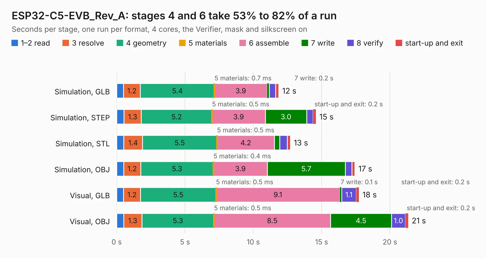

# 1816. ESP32-C5-EVB_Rev_A

Board 1,816 of the 3,123 of [Corpus Testing](../Corpus-Testing.md), on [Corpus Page 17](../CorpusTestingPages/Corpus-Testing-17.md#1816-esp32-c5-evb_rev_a).

| Mode and format | 1–2 read | 3 resolve | 4 geometry | 5 materials | 6 assemble | 7 write | 8 verify | start-up and exit | Total |
|---|---:|---:|---:|---:|---:|---:|---:|---:|---:|
| Simulation, GLB | 0.5 | 1.2 | 5.4 | 0.7&nbsp;ms | 3.9 | 0.2 | 0.5 | 0.2 | 11.9 |
| Simulation, STEP | 0.5 | 1.3 | 5.2 | 0.5&nbsp;ms | 3.9 | 3.0 | 0.5 | 0.2 | 14.6 |
| Simulation, STL | 0.5 | 1.4 | 5.5 | 0.5&nbsp;ms | 4.2 | 0.4 | 0.5 | 0.2 | 12.7 |
| Simulation, OBJ | 0.5 | 1.2 | 5.3 | 0.4&nbsp;ms | 3.9 | 5.7 | 0.5 | 0.2 | 17.4 |
| Visual, GLB | 0.5 | 1.2 | 5.5 | 0.5&nbsp;ms | 9.1 | 0.1 | 1.1 | 0.2 | 17.7 |
| Visual, OBJ | 0.5 | 1.3 | 5.3 | 0.5&nbsp;ms | 8.5 | 4.5 | 1.0 | 0.2 | 21.3 |

<table align="center"><tr><td valign="top">

| Board | Repo: [OLIMEX/ESP32-C5-EVB](https://github.com/OLIMEX/ESP32-C5-EVB) Board: `ESP32-C5-EVB_Rev_A.kicad_pcb` |
|---|---|
| Folder | HARDWARE / ESP32-C5-EVB-Rev.A |
| Complexity | 291&nbsp;/&nbsp;1000 (size&nbsp;191, features&nbsp;100) |
| KESE&nbsp;features | through vias, slotted holes, rounded, trapezoid or chamfered pads, filled zones, knockout text, stack-up, dielectric εr and tanδ |
| Tested | 9th November 2026 |
| Copper&nbsp;layers | 2 |
| File&nbsp;format | KiCad 7 (20221018) |
| Parts,&nbsp;tracks,&nbsp;vias | 113, 1,157, 208 |
| Triangles,&nbsp;simulation | 1,127,592 in 105 parts |
| Verifier | PASS in all six runs |

</td><td valign="top">

<table>
<tr><th>File type</th><th>File size</th><th>Peak memory used</th></tr>
<tr><th colspan="3" align="left">Simulation</th></tr>
<tr><td>GLB</td><td align="right">40&nbsp;MB</td><td align="right">502&nbsp;MB</td></tr>
<tr><td>STEP</td><td align="right">212&nbsp;MB</td><td align="right">602&nbsp;MB</td></tr>
<tr><td>STL</td><td align="right">56&nbsp;MB</td><td align="right">492&nbsp;MB</td></tr>
<tr><td>OBJ</td><td align="right">118&nbsp;MB</td><td align="right">798&nbsp;MB</td></tr>
<tr><th colspan="3" align="left">Visual</th></tr>
<tr><td>GLB</td><td align="right">32&nbsp;MB</td><td align="right">630&nbsp;MB</td></tr>
<tr><td>OBJ</td><td align="right">95&nbsp;MB</td><td align="right">687&nbsp;MB</td></tr>
</table>

</td></tr></table>

| Previous | Next |
|:---|---:|
| [1815. ESP32-C5-DevKit-Lipo_Rev_A](b1815b_ESP32-C5-DevKit-Lipo_ESP32-C5-DevKit-Lipo-Rev-A.md) | [1817. ESP32-C6-DevKit-Lipo_Rev_A](b1817b_ESP32-C6-DevKit-Lipo_ESP32-C6-DevKit-Lipo-Rev-A.md) |
