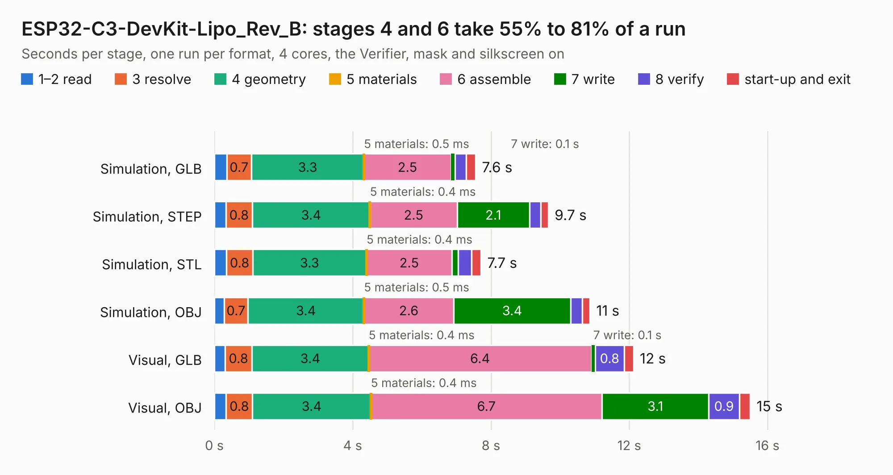

# 1822. ESP32-C3-DevKit-Lipo_Rev_B

Board 1,822 of the 3,138 of [Corpus Testing](../Corpus-Testing.md), on [Corpus Page 17](../CorpusTestingPages/Corpus-Testing-17.md#1822-esp32-c3-devkit-lipo_rev_b).

| Mode and format | 1–2 read | 3 resolve | 4 geometry | 5 materials | 6 assemble | 7 write | 8 verify | start-up and exit | Total |
|---|---:|---:|---:|---:|---:|---:|---:|---:|---:|
| Simulation, GLB | 0.4 | 0.7 | 3.3 | 0.5&nbsp;ms | 2.5 | 0.1 | 0.3 | 0.3 | 7.6 |
| Simulation, STEP | 0.3 | 0.8 | 3.4 | 0.4&nbsp;ms | 2.5 | 2.1 | 0.3 | 0.2 | 9.7 |
| Simulation, STL | 0.4 | 0.8 | 3.3 | 0.4&nbsp;ms | 2.5 | 0.2 | 0.4 | 0.3 | 7.7 |
| Simulation, OBJ | 0.3 | 0.7 | 3.4 | 0.5&nbsp;ms | 2.6 | 3.4 | 0.3 | 0.2 | 10.9 |
| Visual, GLB | 0.3 | 0.8 | 3.4 | 0.4&nbsp;ms | 6.4 | 0.1 | 0.8 | 0.3 | 12.1 |
| Visual, OBJ | 0.3 | 0.8 | 3.4 | 0.4&nbsp;ms | 6.7 | 3.1 | 0.9 | 0.3 | 15.5 |

<table align="center"><tr><td valign="top">

| Board | Repo: [OLIMEX/ESP32-C3-DevKit-Lipo](https://github.com/OLIMEX/ESP32-C3-DevKit-Lipo) Board: `ESP32-C3-DevKit-Lipo_Rev_B.kicad_pcb` |
|---|---|
| Folder | HARDWARE / ESP32-C3-DevKit-Lipo_Rev_B |
| Complexity | 224&nbsp;/&nbsp;1000 (size&nbsp;169, features&nbsp;55) |
| KESE&nbsp;features | through vias, slotted holes, filled zones, copper text |
| Tested | 9th November 2026 |
| Copper&nbsp;layers | 2 |
| File&nbsp;format | KiCad 5 (20171130) |
| Parts,&nbsp;tracks,&nbsp;vias | 42, 740, 61 |
| Triangles,&nbsp;simulation | 712,360 in 68 parts |
| Verifier | PASS in all six runs |

</td><td valign="top">

<table>
<tr><th>File type</th><th>File size</th><th>Peak memory used</th></tr>
<tr><th colspan="3" align="left">Simulation</th></tr>
<tr><td>GLB</td><td align="right">25&nbsp;MB</td><td align="right">367&nbsp;MB</td></tr>
<tr><td>STEP</td><td align="right">141&nbsp;MB</td><td align="right">452&nbsp;MB</td></tr>
<tr><td>STL</td><td align="right">36&nbsp;MB</td><td align="right">388&nbsp;MB</td></tr>
<tr><td>OBJ</td><td align="right">74&nbsp;MB</td><td align="right">525&nbsp;MB</td></tr>
<tr><th colspan="3" align="left">Visual</th></tr>
<tr><td>GLB</td><td align="right">21&nbsp;MB</td><td align="right">502&nbsp;MB</td></tr>
<tr><td>OBJ</td><td align="right">63&nbsp;MB</td><td align="right">499&nbsp;MB</td></tr>
</table>

</td></tr></table>

| Previous | Next |
|:---|---:|
| [1821. ESP32-C3-DevKit-Lipo_Rev_A](b1821b_ESP32-C3-DevKit-Lipo_ESP32-C3-DevKit-Lipo-Rev-A.md) | [1823. ESP32-C3-DevKit-Lipo_Rev_C](b1823b_ESP32-C3-DevKit-Lipo_ESP32-C3-DevKit-Lipo-Rev-C.md) |
