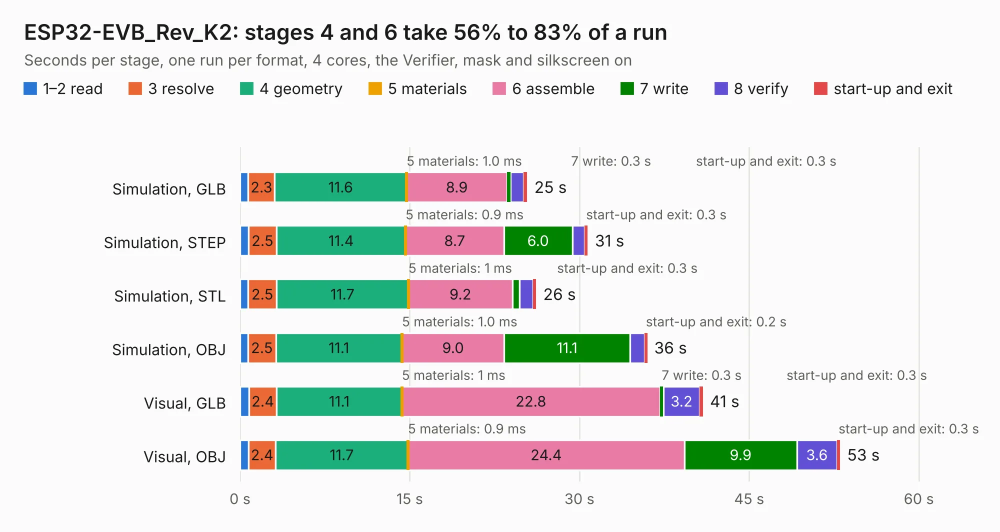

# 1822. ESP32-EVB_Rev_K2

Board 1,822 of the 3,111 of [Corpus Testing](../Corpus-Testing.md), on [Corpus Page 17](../CorpusTestingPages/Corpus-Testing-17.md#1822-esp32-evb_rev_k2).

| Mode and format | 1–2 read | 3 resolve | 4 geometry | 5 materials | 6 assemble | 7 write | 8 verify | start-up and exit | Total |
|---|---:|---:|---:|---:|---:|---:|---:|---:|---:|
| Simulation, GLB | 0.7 | 2.3 | 11.6 | 1.0&nbsp;ms | 8.9 | 0.3 | 1.1 | 0.3 | 25.4 |
| Simulation, STEP | 0.7 | 2.5 | 11.4 | 0.9&nbsp;ms | 8.7 | 6.0 | 1.1 | 0.3 | 30.7 |
| Simulation, STL | 0.7 | 2.5 | 11.7 | 1&nbsp;ms | 9.2 | 0.6 | 1.2 | 0.3 | 26.2 |
| Simulation, OBJ | 0.7 | 2.5 | 11.1 | 1.0&nbsp;ms | 9.0 | 11.1 | 1.3 | 0.2 | 36.0 |
| Visual, GLB | 0.8 | 2.4 | 11.1 | 1&nbsp;ms | 22.8 | 0.3 | 3.2 | 0.3 | 40.9 |
| Visual, OBJ | 0.8 | 2.4 | 11.7 | 0.9&nbsp;ms | 24.4 | 9.9 | 3.6 | 0.3 | 53.0 |

<table align="center"><tr><td valign="top">

| Board | Repo: [OLIMEX/ESP32-EVB](https://github.com/OLIMEX/ESP32-EVB) Board: `ESP32-EVB_Rev_K2.kicad_pcb` |
|---|---|
| Folder | HARDWARE / REV-K2 |
| Complexity | 293&nbsp;/&nbsp;1000 (size&nbsp;248, features&nbsp;45) |
| KESE&nbsp;features | through vias, slotted holes, filled zones |
| Tested | 9th November 2026 |
| Copper&nbsp;layers | 2 |
| File&nbsp;format | KiCad 5 (20171130) |
| Parts,&nbsp;tracks,&nbsp;vias | 157, 3,236, 315 |
| Triangles,&nbsp;simulation | 2,292,312 in 145 parts |
| Verifier | PASS in all six runs |

</td><td valign="top">

<table>
<tr><th>File type</th><th>File size</th><th>Peak memory used</th></tr>
<tr><th colspan="3" align="left">Simulation</th></tr>
<tr><td>GLB</td><td align="right">81&nbsp;MB</td><td align="right">972&nbsp;MB</td></tr>
<tr><td>STEP</td><td align="right">430&nbsp;MB</td><td align="right">1.1&nbsp;GB</td></tr>
<tr><td>STL</td><td align="right">115&nbsp;MB</td><td align="right">900&nbsp;MB</td></tr>
<tr><td>OBJ</td><td align="right">247&nbsp;MB</td><td align="right">1.6&nbsp;GB</td></tr>
<tr><th colspan="3" align="left">Visual</th></tr>
<tr><td>GLB</td><td align="right">66&nbsp;MB</td><td align="right">1.1&nbsp;GB</td></tr>
<tr><td>OBJ</td><td align="right">203&nbsp;MB</td><td align="right">1.3&nbsp;GB</td></tr>
</table>

</td></tr></table>

| Previous | Next |
|:---|---:|
| [1821. ESP32-EVB_Rev_K1](b1821b_ESP32-EVB_ESP32-EVB-Rev-K1.md) | [1823. ESP32-EVB_Rev_L](b1823b_ESP32-EVB_ESP32-EVB-Rev-L.md) |
