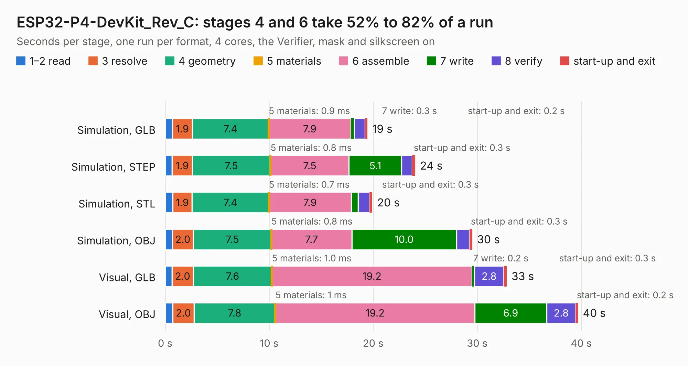

# 1824. ESP32-P4-DevKit_Rev_C

Board 1,824 of the 3,100 of [Corpus Testing](../Corpus-Testing.md), on [Corpus Page 17](../CorpusTestingPages/Corpus-Testing-17.md#1824-esp32-p4-devkit_rev_c).

| Mode and format | 1–2 read | 3 resolve | 4 geometry | 5 materials | 6 assemble | 7 write | 8 verify | start-up and exit | Total |
|---|---:|---:|---:|---:|---:|---:|---:|---:|---:|
| Simulation, GLB | 0.7 | 1.9 | 7.4 | 0.9&nbsp;ms | 7.9 | 0.3 | 1.0 | 0.2 | 19.4 |
| Simulation, STEP | 0.7 | 1.9 | 7.5 | 0.8&nbsp;ms | 7.5 | 5.1 | 1.0 | 0.3 | 24.0 |
| Simulation, STL | 0.7 | 1.9 | 7.4 | 0.7&nbsp;ms | 7.9 | 0.7 | 1.1 | 0.3 | 19.9 |
| Simulation, OBJ | 0.7 | 2.0 | 7.5 | 0.8&nbsp;ms | 7.7 | 10.0 | 1.3 | 0.3 | 29.5 |
| Visual, GLB | 0.7 | 2.0 | 7.6 | 1.0&nbsp;ms | 19.2 | 0.2 | 2.8 | 0.3 | 32.8 |
| Visual, OBJ | 0.7 | 2.0 | 7.8 | 1&nbsp;ms | 19.2 | 6.9 | 2.8 | 0.2 | 39.7 |

<table align="center"><tr><td valign="top">

| Board | Repo: [OLIMEX/ESP32-P4-DevKit](https://github.com/OLIMEX/ESP32-P4-DevKit) Board: `ESP32-P4-DevKit_Rev_C.kicad_pcb` |
|---|---|
| Folder | HARDWARE / ESP32-P4-DevKit-Rev.C |
| Complexity | 374&nbsp;/&nbsp;1000 (size&nbsp;269, features&nbsp;105) |
| KESE&nbsp;features | through vias, slotted holes, filled zones, copper text, knockout text, stack-up, dielectric εr and tanδ, mask and silkscreen colours |
| Tested | 9th November 2026 |
| Copper&nbsp;layers | 4 |
| File&nbsp;format | KiCad 7 (20221018) |
| Parts,&nbsp;tracks,&nbsp;vias | 138, 3,235, 216 |
| Triangles,&nbsp;simulation | 2,286,940 in 189 parts |
| Verifier | PASS in all six runs |

</td><td valign="top">

<table>
<tr><th>File type</th><th>File size</th><th>Peak memory used</th></tr>
<tr><th colspan="3" align="left">Simulation</th></tr>
<tr><td>GLB</td><td align="right">82&nbsp;MB</td><td align="right">859&nbsp;MB</td></tr>
<tr><td>STEP</td><td align="right">413&nbsp;MB</td><td align="right">978&nbsp;MB</td></tr>
<tr><td>STL</td><td align="right">114&nbsp;MB</td><td align="right">820&nbsp;MB</td></tr>
<tr><td>OBJ</td><td align="right">249&nbsp;MB</td><td align="right">1.6&nbsp;GB</td></tr>
<tr><th colspan="3" align="left">Visual</th></tr>
<tr><td>GLB</td><td align="right">57&nbsp;MB</td><td align="right">1.0&nbsp;GB</td></tr>
<tr><td>OBJ</td><td align="right">177&nbsp;MB</td><td align="right">1.2&nbsp;GB</td></tr>
</table>

</td></tr></table>

| Previous | Next |
|:---|---:|
| [1823. ESP32-P4-DevKit_Rev_B](b1823b_ESP32-P4-DevKit_ESP32-P4-DevKit-Rev-B.md) | [1825. ESP32-P4-DevKit_Rev_D](b1825b_ESP32-P4-DevKit_ESP32-P4-DevKit-Rev-D.md) |
