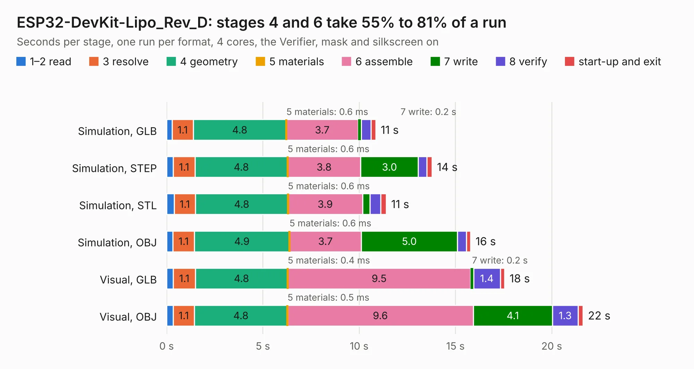

# 1825. ESP32-DevKit-Lipo_Rev_D

Board 1,825 of the 3,127 of [Corpus Testing](../Corpus-Testing.md), on [Corpus Page 17](../CorpusTestingPages/Corpus-Testing-17.md#1825-esp32-devkit-lipo_rev_d).

| Mode and format | 1–2 read | 3 resolve | 4 geometry | 5 materials | 6 assemble | 7 write | 8 verify | start-up and exit | Total |
|---|---:|---:|---:|---:|---:|---:|---:|---:|---:|
| Simulation, GLB | 0.3 | 1.1 | 4.8 | 0.6&nbsp;ms | 3.7 | 0.2 | 0.5 | 0.2 | 10.9 |
| Simulation, STEP | 0.3 | 1.1 | 4.8 | 0.6&nbsp;ms | 3.8 | 3.0 | 0.4 | 0.3 | 13.8 |
| Simulation, STL | 0.4 | 1.1 | 4.8 | 0.6&nbsp;ms | 3.9 | 0.4 | 0.6 | 0.3 | 11.4 |
| Simulation, OBJ | 0.3 | 1.1 | 4.9 | 0.6&nbsp;ms | 3.7 | 5.0 | 0.5 | 0.2 | 15.8 |
| Visual, GLB | 0.3 | 1.1 | 4.8 | 0.4&nbsp;ms | 9.5 | 0.2 | 1.4 | 0.2 | 17.6 |
| Visual, OBJ | 0.3 | 1.1 | 4.8 | 0.5&nbsp;ms | 9.6 | 4.1 | 1.3 | 0.3 | 21.6 |

<table align="center"><tr><td valign="top">

| Board | Repo: [OLIMEX/ESP32-DevKit-LiPo](https://github.com/OLIMEX/ESP32-DevKit-LiPo) Board: `ESP32-DevKit-Lipo_Rev_D.kicad_pcb` |
|---|---|
| Folder | HARDWARE / ESP32-DevKit-LiPo-Rev.D |
| Complexity | 223&nbsp;/&nbsp;1000 (size&nbsp;178, features&nbsp;45) |
| KESE&nbsp;features | through vias, slotted holes, filled zones |
| Tested | 9th November 2026 |
| Copper&nbsp;layers | 2 |
| File&nbsp;format | KiCad 5 (20171130) |
| Parts,&nbsp;tracks,&nbsp;vias | 44, 1,221, 108 |
| Triangles,&nbsp;simulation | 989,400 in 76 parts |
| Verifier | PASS in all six runs |

</td><td valign="top">

<table>
<tr><th>File type</th><th>File size</th><th>Peak memory used</th></tr>
<tr><th colspan="3" align="left">Simulation</th></tr>
<tr><td>GLB</td><td align="right">35&nbsp;MB</td><td align="right">504&nbsp;MB</td></tr>
<tr><td>STEP</td><td align="right">195&nbsp;MB</td><td align="right">559&nbsp;MB</td></tr>
<tr><td>STL</td><td align="right">49&nbsp;MB</td><td align="right">474&nbsp;MB</td></tr>
<tr><td>OBJ</td><td align="right">103&nbsp;MB</td><td align="right">697&nbsp;MB</td></tr>
<tr><th colspan="3" align="left">Visual</th></tr>
<tr><td>GLB</td><td align="right">30&nbsp;MB</td><td align="right">653&nbsp;MB</td></tr>
<tr><td>OBJ</td><td align="right">89&nbsp;MB</td><td align="right">676&nbsp;MB</td></tr>
</table>

</td></tr></table>

| Previous | Next |
|:---|---:|
| [1824. ESP32-DevKit-Lipo_Rev_C](b1824b_ESP32-DevKit-LiPo_ESP32-DevKit-Lipo-Rev-C.md) | [1826. ESP32-EVB_Rev_A](b1826b_ESP32-EVB_ESP32-EVB-Rev-A.md) |
