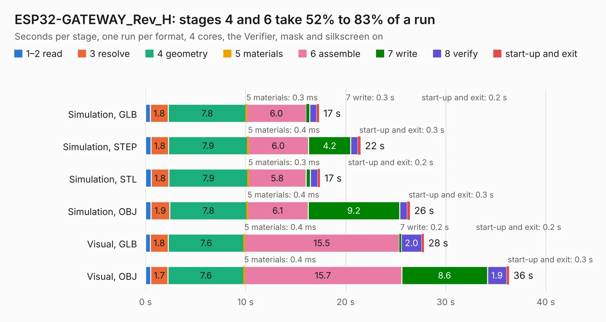

# 1826. ESP32-GATEWAY_Rev_H

Board 1,826 of the 3,106 of [Corpus Testing](../Corpus-Testing.md), on [Corpus Page 17](../CorpusTestingPages/Corpus-Testing-17.md#1826-esp32-gateway_rev_h).

| Mode and format | 1–2 read | 3 resolve | 4 geometry | 5 materials | 6 assemble | 7 write | 8 verify | start-up and exit | Total |
|---|---:|---:|---:|---:|---:|---:|---:|---:|---:|
| Simulation, GLB | 0.5 | 1.8 | 7.8 | 0.3&nbsp;ms | 6.0 | 0.3 | 0.7 | 0.2 | 17.3 |
| Simulation, STEP | 0.5 | 1.8 | 7.9 | 0.4&nbsp;ms | 6.0 | 4.2 | 0.7 | 0.3 | 21.5 |
| Simulation, STL | 0.6 | 1.8 | 7.9 | 0.3&nbsp;ms | 5.8 | 0.4 | 0.8 | 0.2 | 17.4 |
| Simulation, OBJ | 0.5 | 1.9 | 7.8 | 0.4&nbsp;ms | 6.1 | 9.2 | 0.8 | 0.3 | 26.4 |
| Visual, GLB | 0.5 | 1.8 | 7.6 | 0.4&nbsp;ms | 15.5 | 0.2 | 2.0 | 0.2 | 27.8 |
| Visual, OBJ | 0.5 | 1.7 | 7.6 | 0.4&nbsp;ms | 15.7 | 8.6 | 1.9 | 0.3 | 36.3 |

<table align="center"><tr><td valign="top">

| Board | Repo: [OLIMEX/ESP32-GATEWAY](https://github.com/OLIMEX/ESP32-GATEWAY) Board: `ESP32-GATEWAY_Rev_H.kicad_pcb` |
|---|---|
| Folder | HARDWARE / Hardware revision H |
| Complexity | 281&nbsp;/&nbsp;1000 (size&nbsp;236, features&nbsp;45) |
| KESE&nbsp;features | through vias, slotted holes, filled zones |
| Tested | 9th November 2026 |
| Copper&nbsp;layers | 2 |
| File&nbsp;format | KiCad 5 (20171130) |
| Parts,&nbsp;tracks,&nbsp;vias | 97, 1,920, 287 |
| Triangles,&nbsp;simulation | 1,463,584 in 110 parts |
| Verifier | PASS in all six runs |

</td><td valign="top">

<table>
<tr><th>File type</th><th>File size</th><th>Peak memory used</th></tr>
<tr><th colspan="3" align="left">Simulation</th></tr>
<tr><td>GLB</td><td align="right">52&nbsp;MB</td><td align="right">604&nbsp;MB</td></tr>
<tr><td>STEP</td><td align="right">256&nbsp;MB</td><td align="right">724&nbsp;MB</td></tr>
<tr><td>STL</td><td align="right">73&nbsp;MB</td><td align="right">651&nbsp;MB</td></tr>
<tr><td>OBJ</td><td align="right">154&nbsp;MB</td><td align="right">1.0&nbsp;GB</td></tr>
<tr><th colspan="3" align="left">Visual</th></tr>
<tr><td>GLB</td><td align="right">43&nbsp;MB</td><td align="right">788&nbsp;MB</td></tr>
<tr><td>OBJ</td><td align="right">130&nbsp;MB</td><td align="right">920&nbsp;MB</td></tr>
</table>

</td></tr></table>

| Previous | Next |
|:---|---:|
| [1825. ESP32-GATEWAY_Rev_G](b1825b_ESP32-GATEWAY_ESP32-GATEWAY-Rev-G.md) | [1827. ESP32-GATEWAY_Rev_I](b1827b_ESP32-GATEWAY_ESP32-GATEWAY-Rev-I.md) |
