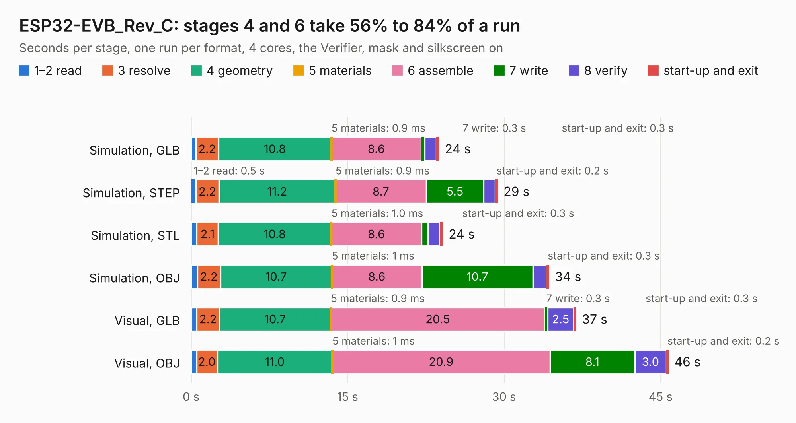

# 1827. ESP32-EVB_Rev_C

Board 1,827 of the 3,124 of [Corpus Testing](../Corpus-Testing.md), on [Corpus Page 17](../CorpusTestingPages/Corpus-Testing-17.md#1827-esp32-evb_rev_c).

| Mode and format | 1–2 read | 3 resolve | 4 geometry | 5 materials | 6 assemble | 7 write | 8 verify | start-up and exit | Total |
|---|---:|---:|---:|---:|---:|---:|---:|---:|---:|
| Simulation, GLB | 0.5 | 2.2 | 10.8 | 0.9&nbsp;ms | 8.6 | 0.3 | 1.1 | 0.3 | 23.8 |
| Simulation, STEP | 0.5 | 2.2 | 11.2 | 0.9&nbsp;ms | 8.7 | 5.5 | 1.1 | 0.2 | 29.4 |
| Simulation, STL | 0.6 | 2.1 | 10.8 | 1.0&nbsp;ms | 8.6 | 0.6 | 1.2 | 0.3 | 24.1 |
| Simulation, OBJ | 0.6 | 2.2 | 10.7 | 1&nbsp;ms | 8.6 | 10.7 | 1.3 | 0.3 | 34.3 |
| Visual, GLB | 0.5 | 2.2 | 10.7 | 0.9&nbsp;ms | 20.5 | 0.3 | 2.5 | 0.3 | 36.9 |
| Visual, OBJ | 0.5 | 2.0 | 11.0 | 1&nbsp;ms | 20.9 | 8.1 | 3.0 | 0.2 | 45.8 |

<table align="center"><tr><td valign="top">

| Board | Repo: [OLIMEX/ESP32-EVB](https://github.com/OLIMEX/ESP32-EVB) Board: `ESP32-EVB_Rev_C.kicad_pcb` |
|---|---|
| Folder | HARDWARE / REV-C |
| Complexity | 300&nbsp;/&nbsp;1000 (size&nbsp;245, features&nbsp;55) |
| KESE&nbsp;features | through vias, slotted holes, filled zones, copper text |
| Tested | 9th November 2026 |
| Copper&nbsp;layers | 2 |
| File&nbsp;format | KiCad 5 (20170123) |
| Parts,&nbsp;tracks,&nbsp;vias | 144, 2,790, 317 |
| Triangles,&nbsp;simulation | 2,217,096 in 143 parts |
| Verifier | PASS in all six runs |

</td><td valign="top">

<table>
<tr><th>File type</th><th>File size</th><th>Peak memory used</th></tr>
<tr><th colspan="3" align="left">Simulation</th></tr>
<tr><td>GLB</td><td align="right">78&nbsp;MB</td><td align="right">774&nbsp;MB</td></tr>
<tr><td>STEP</td><td align="right">427&nbsp;MB</td><td align="right">995&nbsp;MB</td></tr>
<tr><td>STL</td><td align="right">111&nbsp;MB</td><td align="right">836&nbsp;MB</td></tr>
<tr><td>OBJ</td><td align="right">238&nbsp;MB</td><td align="right">1.5&nbsp;GB</td></tr>
<tr><th colspan="3" align="left">Visual</th></tr>
<tr><td>GLB</td><td align="right">62&nbsp;MB</td><td align="right">1.2&nbsp;GB</td></tr>
<tr><td>OBJ</td><td align="right">190&nbsp;MB</td><td align="right">1.3&nbsp;GB</td></tr>
</table>

</td></tr></table>

| Previous | Next |
|:---|---:|
| [1826. ESP32-EVB_Rev_B](b1826b_ESP32-EVB_ESP32-EVB-Rev-B.md) | [1828. ESP32-EVB_Rev_D](b1828b_ESP32-EVB_ESP32-EVB-Rev-D.md) |
