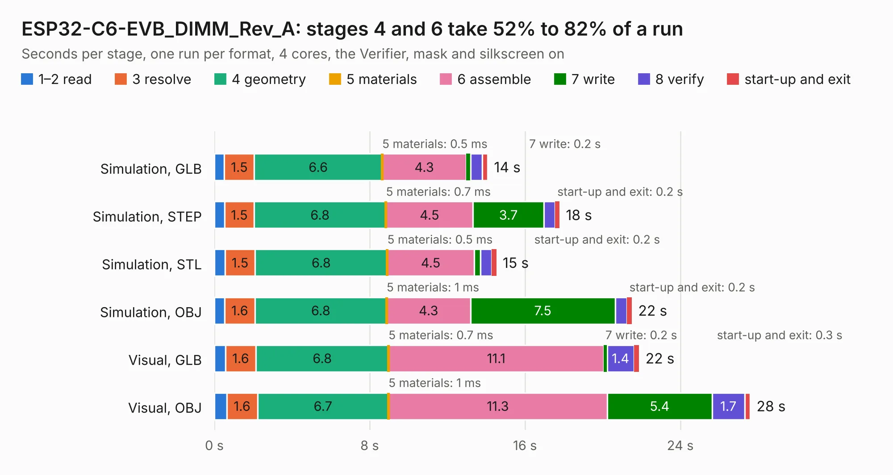

# 1828. ESP32-C6-EVB_DIMM_Rev_A

Board 1,828 of the 3,139 of [Corpus Testing](../Corpus-Testing.md), on [Corpus Page 17](../CorpusTestingPages/Corpus-Testing-17.md#1828-esp32-c6-evb_dimm_rev_a).

| Mode and format | 1–2 read | 3 resolve | 4 geometry | 5 materials | 6 assemble | 7 write | 8 verify | start-up and exit | Total |
|---|---:|---:|---:|---:|---:|---:|---:|---:|---:|
| Simulation, GLB | 0.5 | 1.5 | 6.6 | 0.5&nbsp;ms | 4.3 | 0.2 | 0.6 | 0.3 | 14.1 |
| Simulation, STEP | 0.5 | 1.5 | 6.8 | 0.7&nbsp;ms | 4.5 | 3.7 | 0.6 | 0.2 | 17.8 |
| Simulation, STL | 0.5 | 1.5 | 6.8 | 0.5&nbsp;ms | 4.5 | 0.3 | 0.6 | 0.2 | 14.5 |
| Simulation, OBJ | 0.5 | 1.6 | 6.8 | 1&nbsp;ms | 4.3 | 7.5 | 0.6 | 0.2 | 21.5 |
| Visual, GLB | 0.6 | 1.6 | 6.8 | 0.7&nbsp;ms | 11.1 | 0.2 | 1.4 | 0.3 | 21.9 |
| Visual, OBJ | 0.6 | 1.6 | 6.7 | 1&nbsp;ms | 11.3 | 5.4 | 1.7 | 0.3 | 27.6 |

<table align="center"><tr><td valign="top">

| Board | Repo: [OLIMEX/ESP32-C6-EVB](https://github.com/OLIMEX/ESP32-C6-EVB) Board: `ESP32-C6-EVB_DIMM_Rev_A.kicad_pcb` |
|---|---|
| Folder | HARDWARE / Dimensions |
| Complexity | 252&nbsp;/&nbsp;1000 (size&nbsp;187, features&nbsp;65) |
| KESE&nbsp;features | through vias, slotted holes, rounded, trapezoid or chamfered pads, filled zones, curved board outline |
| Tested | 9th November 2026 |
| Copper&nbsp;layers | 2 |
| File&nbsp;format | KiCad 7 (20221018) |
| Parts,&nbsp;tracks,&nbsp;vias | 102, 1,162, 124 |
| Triangles,&nbsp;simulation | 1,212,336 in 99 parts |
| Verifier | PASS in all six runs |

</td><td valign="top">

<table>
<tr><th>File type</th><th>File size</th><th>Peak memory used</th></tr>
<tr><th colspan="3" align="left">Simulation</th></tr>
<tr><td>GLB</td><td align="right">43&nbsp;MB</td><td align="right">563&nbsp;MB</td></tr>
<tr><td>STEP</td><td align="right">226&nbsp;MB</td><td align="right">643&nbsp;MB</td></tr>
<tr><td>STL</td><td align="right">61&nbsp;MB</td><td align="right">512&nbsp;MB</td></tr>
<tr><td>OBJ</td><td align="right">128&nbsp;MB</td><td align="right">846&nbsp;MB</td></tr>
<tr><th colspan="3" align="left">Visual</th></tr>
<tr><td>GLB</td><td align="right">34&nbsp;MB</td><td align="right">644&nbsp;MB</td></tr>
<tr><td>OBJ</td><td align="right">102&nbsp;MB</td><td align="right">736&nbsp;MB</td></tr>
</table>

</td></tr></table>

| Previous | Next |
|:---|---:|
| [1827. ESP32-C6-DevKit-Lipo_Rev_A](b1827b_ESP32-C6-DevKit-Lipo_ESP32-C6-DevKit-Lipo-Rev-A.md) | [1829. ESP32-C6-EVB_Rev_A](b1829b_ESP32-C6-EVB_ESP32-C6-EVB-Rev-A.md) |
