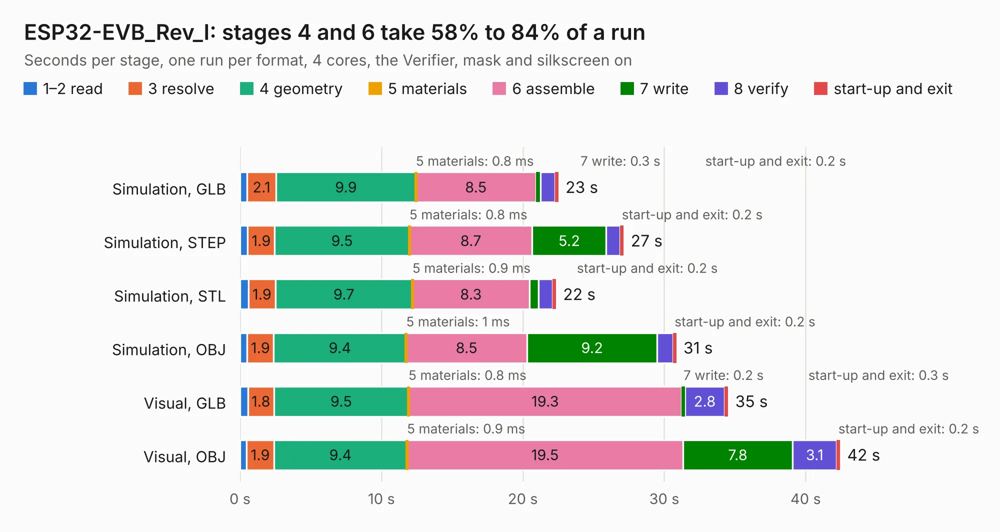

# 1829. ESP32-EVB_Rev_I

Board 1,829 of the 3,122 of [Corpus Testing](../Corpus-Testing.md), on [Corpus Page 17](../CorpusTestingPages/Corpus-Testing-17.md#1829-esp32-evb_rev_i).

| Mode and format | 1–2 read | 3 resolve | 4 geometry | 5 materials | 6 assemble | 7 write | 8 verify | start-up and exit | Total |
|---|---:|---:|---:|---:|---:|---:|---:|---:|---:|
| Simulation, GLB | 0.5 | 2.1 | 9.9 | 0.8&nbsp;ms | 8.5 | 0.3 | 1.0 | 0.2 | 22.5 |
| Simulation, STEP | 0.5 | 1.9 | 9.5 | 0.8&nbsp;ms | 8.7 | 5.2 | 1.0 | 0.2 | 27.1 |
| Simulation, STL | 0.6 | 1.9 | 9.7 | 0.9&nbsp;ms | 8.3 | 0.6 | 1.0 | 0.2 | 22.3 |
| Simulation, OBJ | 0.5 | 1.9 | 9.4 | 1&nbsp;ms | 8.5 | 9.2 | 1.1 | 0.2 | 30.9 |
| Visual, GLB | 0.6 | 1.8 | 9.5 | 0.8&nbsp;ms | 19.3 | 0.2 | 2.8 | 0.3 | 34.5 |
| Visual, OBJ | 0.5 | 1.9 | 9.4 | 0.9&nbsp;ms | 19.5 | 7.8 | 3.1 | 0.2 | 42.4 |

<table align="center"><tr><td valign="top">

| Board | Repo: [OLIMEX/ESP32-EVB](https://github.com/OLIMEX/ESP32-EVB) Board: `ESP32-EVB_Rev_I.kicad_pcb` |
|---|---|
| Folder | HARDWARE / REV-I |
| Complexity | 301&nbsp;/&nbsp;1000 (size&nbsp;246, features&nbsp;55) |
| KESE&nbsp;features | through vias, slotted holes, filled zones, copper text |
| Tested | 9th November 2026 |
| Copper&nbsp;layers | 2 |
| File&nbsp;format | KiCad 5 (20171130) |
| Parts,&nbsp;tracks,&nbsp;vias | 147, 2,960, 310 |
| Triangles,&nbsp;simulation | 2,199,014 in 140 parts |
| Verifier | PASS in all six runs |

</td><td valign="top">

<table>
<tr><th>File type</th><th>File size</th><th>Peak memory used</th></tr>
<tr><th colspan="3" align="left">Simulation</th></tr>
<tr><td>GLB</td><td align="right">78&nbsp;MB</td><td align="right">858&nbsp;MB</td></tr>
<tr><td>STEP</td><td align="right">417&nbsp;MB</td><td align="right">1.0&nbsp;GB</td></tr>
<tr><td>STL</td><td align="right">110&nbsp;MB</td><td align="right">899&nbsp;MB</td></tr>
<tr><td>OBJ</td><td align="right">236&nbsp;MB</td><td align="right">1.5&nbsp;GB</td></tr>
<tr><th colspan="3" align="left">Visual</th></tr>
<tr><td>GLB</td><td align="right">63&nbsp;MB</td><td align="right">1.1&nbsp;GB</td></tr>
<tr><td>OBJ</td><td align="right">193&nbsp;MB</td><td align="right">1.4&nbsp;GB</td></tr>
</table>

</td></tr></table>

| Previous | Next |
|:---|---:|
| [1828. ESP32-EVB_Rev_H](b1828b_ESP32-EVB_ESP32-EVB-Rev-H.md) | [1830. ESP32-EVB_Rev_J](b1830b_ESP32-EVB_ESP32-EVB-Rev-J.md) |
