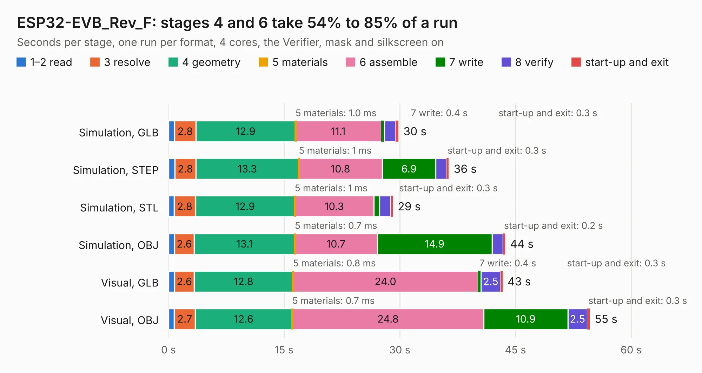

# 1830. ESP32-EVB_Rev_F

Board 1,830 of the 3,126 of [Corpus Testing](../Corpus-Testing.md), on [Corpus Page 17](../CorpusTestingPages/Corpus-Testing-17.md#1830-esp32-evb_rev_f).

| Mode and format | 1–2 read | 3 resolve | 4 geometry | 5 materials | 6 assemble | 7 write | 8 verify | start-up and exit | Total |
|---|---:|---:|---:|---:|---:|---:|---:|---:|---:|
| Simulation, GLB | 0.8 | 2.8 | 12.9 | 1.0&nbsp;ms | 11.1 | 0.4 | 1.5 | 0.3 | 29.8 |
| Simulation, STEP | 0.8 | 2.8 | 13.3 | 1&nbsp;ms | 10.8 | 6.9 | 1.4 | 0.3 | 36.3 |
| Simulation, STL | 0.7 | 2.8 | 12.9 | 1&nbsp;ms | 10.3 | 0.7 | 1.4 | 0.3 | 29.1 |
| Simulation, OBJ | 0.8 | 2.6 | 13.1 | 0.7&nbsp;ms | 10.7 | 14.9 | 1.4 | 0.2 | 43.6 |
| Visual, GLB | 0.8 | 2.6 | 12.8 | 0.8&nbsp;ms | 24.0 | 0.4 | 2.5 | 0.3 | 43.3 |
| Visual, OBJ | 0.7 | 2.7 | 12.6 | 0.7&nbsp;ms | 24.8 | 10.9 | 2.5 | 0.3 | 54.6 |

<table align="center"><tr><td valign="top">

| Board | Repo: [OLIMEX/ESP32-EVB](https://github.com/OLIMEX/ESP32-EVB) Board: `ESP32-EVB_Rev_F.kicad_pcb` |
|---|---|
| Folder | HARDWARE / REV-F |
| Complexity | 301&nbsp;/&nbsp;1000 (size&nbsp;246, features&nbsp;55) |
| KESE&nbsp;features | through vias, slotted holes, filled zones, copper text |
| Tested | 9th November 2026 |
| Copper&nbsp;layers | 2 |
| File&nbsp;format | KiCad 5 (20171130) |
| Parts,&nbsp;tracks,&nbsp;vias | 148, 2,880, 303 |
| Triangles,&nbsp;simulation | 2,246,438 in 143 parts |
| Verifier | PASS in all six runs |

</td><td valign="top">

<table>
<tr><th>File type</th><th>File size</th><th>Peak memory used</th></tr>
<tr><th colspan="3" align="left">Simulation</th></tr>
<tr><td>GLB</td><td align="right">79&nbsp;MB</td><td align="right">931&nbsp;MB</td></tr>
<tr><td>STEP</td><td align="right">438&nbsp;MB</td><td align="right">1.0&nbsp;GB</td></tr>
<tr><td>STL</td><td align="right">112&nbsp;MB</td><td align="right">916&nbsp;MB</td></tr>
<tr><td>OBJ</td><td align="right">242&nbsp;MB</td><td align="right">1.5&nbsp;GB</td></tr>
<tr><th colspan="3" align="left">Visual</th></tr>
<tr><td>GLB</td><td align="right">63&nbsp;MB</td><td align="right">1.1&nbsp;GB</td></tr>
<tr><td>OBJ</td><td align="right">193&nbsp;MB</td><td align="right">1.4&nbsp;GB</td></tr>
</table>

</td></tr></table>

| Previous | Next |
|:---|---:|
| [1829. ESP32-EVB_Rev_D](b1829b_ESP32-EVB_ESP32-EVB-Rev-D.md) | [1831. ESP32-EVB_Rev_H](b1831b_ESP32-EVB_ESP32-EVB-Rev-H.md) |
