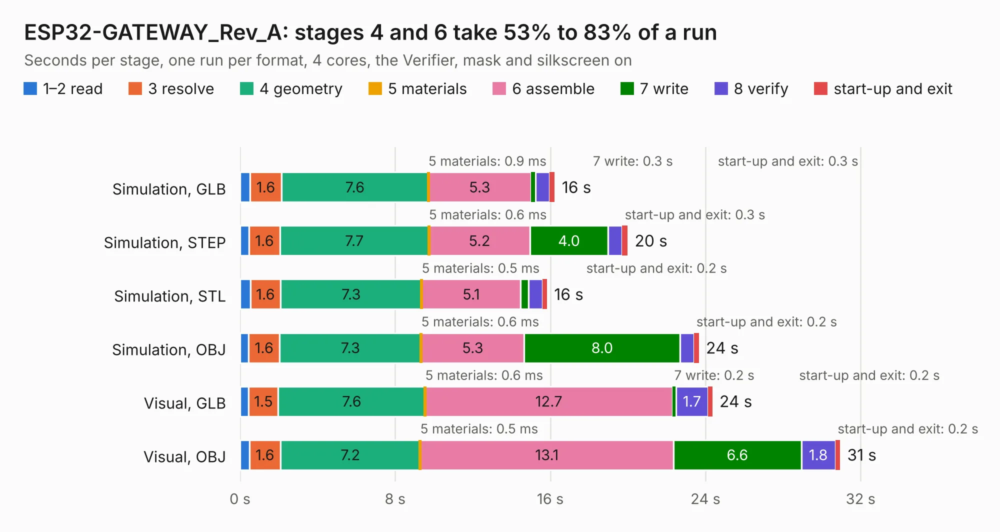

# 1830. ESP32-GATEWAY_Rev_A

Board 1,830 of the 3,117 of [Corpus Testing](../Corpus-Testing.md), on [Corpus Page 17](../CorpusTestingPages/Corpus-Testing-17.md#1830-esp32-gateway_rev_a).

| Mode and format | 1–2 read | 3 resolve | 4 geometry | 5 materials | 6 assemble | 7 write | 8 verify | start-up and exit | Total |
|---|---:|---:|---:|---:|---:|---:|---:|---:|---:|
| Simulation, GLB | 0.5 | 1.6 | 7.6 | 0.9&nbsp;ms | 5.3 | 0.3 | 0.7 | 0.3 | 16.2 |
| Simulation, STEP | 0.5 | 1.6 | 7.7 | 0.6&nbsp;ms | 5.2 | 4.0 | 0.7 | 0.3 | 20.0 |
| Simulation, STL | 0.5 | 1.6 | 7.3 | 0.5&nbsp;ms | 5.1 | 0.4 | 0.7 | 0.2 | 15.8 |
| Simulation, OBJ | 0.4 | 1.6 | 7.3 | 0.6&nbsp;ms | 5.3 | 8.0 | 0.7 | 0.2 | 23.7 |
| Visual, GLB | 0.4 | 1.5 | 7.6 | 0.6&nbsp;ms | 12.7 | 0.2 | 1.7 | 0.2 | 24.4 |
| Visual, OBJ | 0.5 | 1.6 | 7.2 | 0.5&nbsp;ms | 13.1 | 6.6 | 1.8 | 0.2 | 30.9 |

<table align="center"><tr><td valign="top">

| Board | Repo: [OLIMEX/ESP32-GATEWAY](https://github.com/OLIMEX/ESP32-GATEWAY) Board: `ESP32-GATEWAY_Rev_A.kicad_pcb` |
|---|---|
| Folder | HARDWARE / Hardware revision A |
| Complexity | 288&nbsp;/&nbsp;1000 (size&nbsp;233, features&nbsp;55) |
| KESE&nbsp;features | through vias, slotted holes, filled zones, copper text |
| Tested | 9th November 2026 |
| Copper&nbsp;layers | 2 |
| File&nbsp;format | KiCad 5 (20170123) |
| Parts,&nbsp;tracks,&nbsp;vias | 82, 1,876, 230 |
| Triangles,&nbsp;simulation | 1,311,668 in 104 parts |
| Verifier | PASS in all six runs |

</td><td valign="top">

<table>
<tr><th>File type</th><th>File size</th><th>Peak memory used</th></tr>
<tr><th colspan="3" align="left">Simulation</th></tr>
<tr><td>GLB</td><td align="right">47&nbsp;MB</td><td align="right">544&nbsp;MB</td></tr>
<tr><td>STEP</td><td align="right">241&nbsp;MB</td><td align="right">642&nbsp;MB</td></tr>
<tr><td>STL</td><td align="right">66&nbsp;MB</td><td align="right">551&nbsp;MB</td></tr>
<tr><td>OBJ</td><td align="right">139&nbsp;MB</td><td align="right">933&nbsp;MB</td></tr>
<tr><th colspan="3" align="left">Visual</th></tr>
<tr><td>GLB</td><td align="right">38&nbsp;MB</td><td align="right">716&nbsp;MB</td></tr>
<tr><td>OBJ</td><td align="right">114&nbsp;MB</td><td align="right">783&nbsp;MB</td></tr>
</table>

</td></tr></table>

| Previous | Next |
|:---|---:|
| [1829. ESP32-EVB_Rev_L](b1829b_ESP32-EVB_ESP32-EVB-Rev-L.md) | [1831. ESP32-GATEWAY_Rev_B](b1831b_ESP32-GATEWAY_ESP32-GATEWAY-Rev-B.md) |
