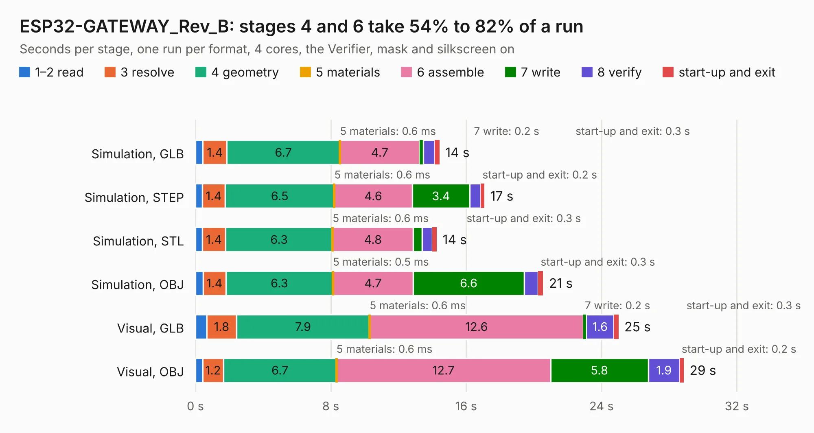

# 1830. ESP32-GATEWAY_Rev_B

Board 1,830 of the 3,116 of [Corpus Testing](../Corpus-Testing.md), on [Corpus Page 17](../CorpusTestingPages/Corpus-Testing-17.md#1830-esp32-gateway_rev_b).

| Mode and format | 1–2 read | 3 resolve | 4 geometry | 5 materials | 6 assemble | 7 write | 8 verify | start-up and exit | Total |
|---|---:|---:|---:|---:|---:|---:|---:|---:|---:|
| Simulation, GLB | 0.4 | 1.4 | 6.7 | 0.6&nbsp;ms | 4.7 | 0.2 | 0.7 | 0.3 | 14.4 |
| Simulation, STEP | 0.4 | 1.4 | 6.5 | 0.6&nbsp;ms | 4.6 | 3.4 | 0.6 | 0.2 | 17.1 |
| Simulation, STL | 0.4 | 1.4 | 6.3 | 0.6&nbsp;ms | 4.8 | 0.5 | 0.6 | 0.3 | 14.3 |
| Simulation, OBJ | 0.5 | 1.4 | 6.3 | 0.5&nbsp;ms | 4.7 | 6.6 | 0.8 | 0.3 | 20.6 |
| Visual, GLB | 0.7 | 1.8 | 7.9 | 0.6&nbsp;ms | 12.6 | 0.2 | 1.6 | 0.3 | 25.0 |
| Visual, OBJ | 0.4 | 1.2 | 6.7 | 0.6&nbsp;ms | 12.7 | 5.8 | 1.9 | 0.2 | 28.9 |

<table align="center"><tr><td valign="top">

| Board | Repo: [OLIMEX/ESP32-GATEWAY](https://github.com/OLIMEX/ESP32-GATEWAY) Board: `ESP32-GATEWAY_Rev_B.kicad_pcb` |
|---|---|
| Folder | HARDWARE / Hardware revision B |
| Complexity | 288&nbsp;/&nbsp;1000 (size&nbsp;233, features&nbsp;55) |
| KESE&nbsp;features | through vias, slotted holes, filled zones, copper text |
| Tested | 9th November 2026 |
| Copper&nbsp;layers | 2 |
| File&nbsp;format | KiCad 5 (20170123) |
| Parts,&nbsp;tracks,&nbsp;vias | 83, 1,858, 229 |
| Triangles,&nbsp;simulation | 1,306,382 in 104 parts |
| Verifier | PASS in all six runs |

</td><td valign="top">

<table>
<tr><th>File type</th><th>File size</th><th>Peak memory used</th></tr>
<tr><th colspan="3" align="left">Simulation</th></tr>
<tr><td>GLB</td><td align="right">46&nbsp;MB</td><td align="right">547&nbsp;MB</td></tr>
<tr><td>STEP</td><td align="right">240&nbsp;MB</td><td align="right">637&nbsp;MB</td></tr>
<tr><td>STL</td><td align="right">65&nbsp;MB</td><td align="right">535&nbsp;MB</td></tr>
<tr><td>OBJ</td><td align="right">138&nbsp;MB</td><td align="right">942&nbsp;MB</td></tr>
<tr><th colspan="3" align="left">Visual</th></tr>
<tr><td>GLB</td><td align="right">38&nbsp;MB</td><td align="right">685&nbsp;MB</td></tr>
<tr><td>OBJ</td><td align="right">114&nbsp;MB</td><td align="right">796&nbsp;MB</td></tr>
</table>

</td></tr></table>

| Previous | Next |
|:---|---:|
| [1829. ESP32-GATEWAY_Rev_A](b1829b_ESP32-GATEWAY_ESP32-GATEWAY-Rev-A.md) | [1831. ESP32-GATEWAY_Rev_C](b1831b_ESP32-GATEWAY_ESP32-GATEWAY-Rev-C.md) |
