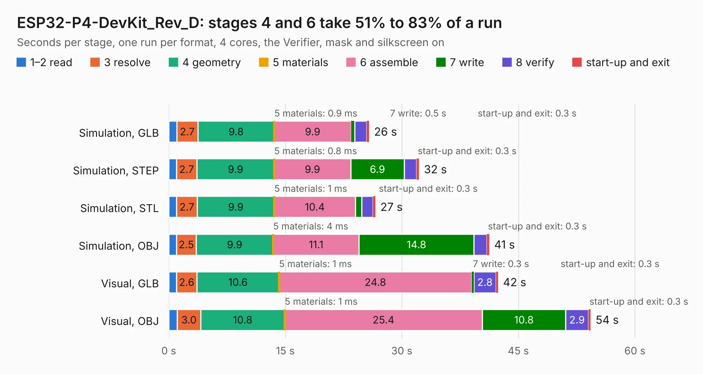

# 1830. ESP32-P4-DevKit_Rev_D

Board 1,830 of the 3,105 of [Corpus Testing](../Corpus-Testing.md), on [Corpus Page 17](../CorpusTestingPages/Corpus-Testing-17.md#1830-esp32-p4-devkit_rev_d).

| Mode and format | 1–2 read | 3 resolve | 4 geometry | 5 materials | 6 assemble | 7 write | 8 verify | start-up and exit | Total |
|---|---:|---:|---:|---:|---:|---:|---:|---:|---:|
| Simulation, GLB | 1.0 | 2.7 | 9.8 | 0.9&nbsp;ms | 9.9 | 0.5 | 1.5 | 0.3 | 25.8 |
| Simulation, STEP | 1.0 | 2.7 | 9.9 | 0.8&nbsp;ms | 9.9 | 6.9 | 1.6 | 0.3 | 32.2 |
| Simulation, STL | 1.0 | 2.7 | 9.9 | 1&nbsp;ms | 10.4 | 0.8 | 1.5 | 0.3 | 26.6 |
| Simulation, OBJ | 1.0 | 2.5 | 9.9 | 4&nbsp;ms | 11.1 | 14.8 | 1.7 | 0.3 | 41.2 |
| Visual, GLB | 1.0 | 2.6 | 10.6 | 1&nbsp;ms | 24.8 | 0.3 | 2.8 | 0.3 | 42.4 |
| Visual, OBJ | 1.1 | 3.0 | 10.8 | 1&nbsp;ms | 25.4 | 10.8 | 2.9 | 0.3 | 54.3 |

<table align="center"><tr><td valign="top">

| Board | Repo: [OLIMEX/ESP32-P4-DevKit](https://github.com/OLIMEX/ESP32-P4-DevKit) Board: `ESP32-P4-DevKit_Rev_D.kicad_pcb` |
|---|---|
| Folder | HARDWARE / ESP32-P4-DevKit-Rev.D |
| Complexity | 375&nbsp;/&nbsp;1000 (size&nbsp;270, features&nbsp;105) |
| KESE&nbsp;features | through vias, slotted holes, filled zones, copper text, knockout text, stack-up, dielectric εr and tanδ, mask and silkscreen colours |
| Tested | 9th November 2026 |
| Copper&nbsp;layers | 4 |
| File&nbsp;format | KiCad 7 (20221018) |
| Parts,&nbsp;tracks,&nbsp;vias | 142, 3,494, 216 |
| Triangles,&nbsp;simulation | 2,292,888 in 191 parts |
| Verifier | PASS in all six runs |

</td><td valign="top">

<table>
<tr><th>File type</th><th>File size</th><th>Peak memory used</th></tr>
<tr><th colspan="3" align="left">Simulation</th></tr>
<tr><td>GLB</td><td align="right">82&nbsp;MB</td><td align="right">831&nbsp;MB</td></tr>
<tr><td>STEP</td><td align="right">414&nbsp;MB</td><td align="right">951&nbsp;MB</td></tr>
<tr><td>STL</td><td align="right">115&nbsp;MB</td><td align="right">779&nbsp;MB</td></tr>
<tr><td>OBJ</td><td align="right">249&nbsp;MB</td><td align="right">1.6&nbsp;GB</td></tr>
<tr><th colspan="3" align="left">Visual</th></tr>
<tr><td>GLB</td><td align="right">58&nbsp;MB</td><td align="right">1.0&nbsp;GB</td></tr>
<tr><td>OBJ</td><td align="right">178&nbsp;MB</td><td align="right">1.3&nbsp;GB</td></tr>
</table>

</td></tr></table>

| Previous | Next |
|:---|---:|
| [1829. ESP32-P4-DevKit_Rev_C](b1829b_ESP32-P4-DevKit_ESP32-P4-DevKit-Rev-C.md) | [1831. ESP32-P4-DevKit_Rev_D1](b1831b_ESP32-P4-DevKit_ESP32-P4-DevKit-Rev-D1.md) |
