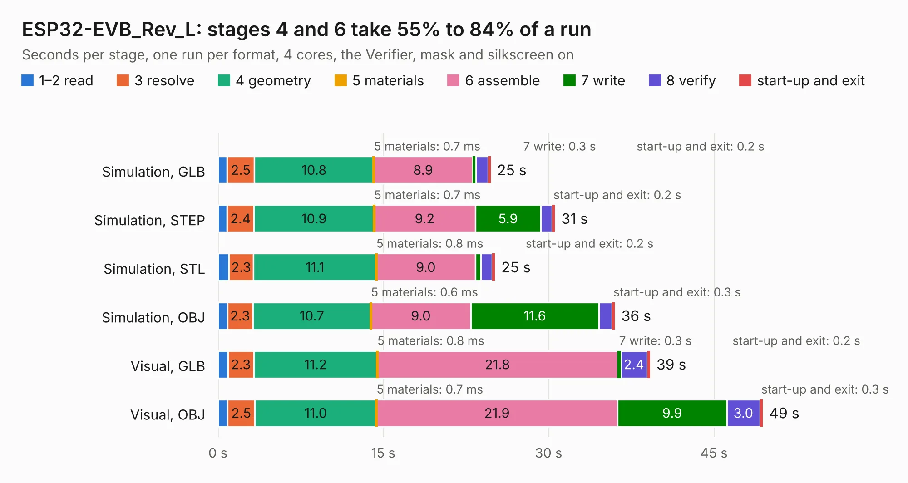

# 1831. ESP32-EVB_Rev_L

Board 1,831 of the 3,119 of [Corpus Testing](../Corpus-Testing.md), on [Corpus Page 17](../CorpusTestingPages/Corpus-Testing-17.md#1831-esp32-evb_rev_l).

| Mode and format | 1–2 read | 3 resolve | 4 geometry | 5 materials | 6 assemble | 7 write | 8 verify | start-up and exit | Total |
|---|---:|---:|---:|---:|---:|---:|---:|---:|---:|
| Simulation, GLB | 0.8 | 2.5 | 10.8 | 0.7&nbsp;ms | 8.9 | 0.3 | 1.1 | 0.2 | 24.7 |
| Simulation, STEP | 0.8 | 2.4 | 10.9 | 0.7&nbsp;ms | 9.2 | 5.9 | 1.0 | 0.2 | 30.6 |
| Simulation, STL | 1.0 | 2.3 | 11.1 | 0.8&nbsp;ms | 9.0 | 0.5 | 1.0 | 0.2 | 25.1 |
| Simulation, OBJ | 0.9 | 2.3 | 10.7 | 0.6&nbsp;ms | 9.0 | 11.6 | 1.2 | 0.3 | 36.0 |
| Visual, GLB | 0.9 | 2.3 | 11.2 | 0.8&nbsp;ms | 21.8 | 0.3 | 2.4 | 0.2 | 39.2 |
| Visual, OBJ | 0.9 | 2.5 | 11.0 | 0.7&nbsp;ms | 21.9 | 9.9 | 3.0 | 0.3 | 49.4 |

<table align="center"><tr><td valign="top">

| Board | Repo: [OLIMEX/ESP32-EVB](https://github.com/OLIMEX/ESP32-EVB) Board: `ESP32-EVB_Rev_L.kicad_pcb` |
|---|---|
| Folder | HARDWARE / REV-L |
| Complexity | 307&nbsp;/&nbsp;1000 (size&nbsp;247, features&nbsp;60) |
| KESE&nbsp;features | through vias, slotted holes, filled zones, knockout text |
| Tested | 9th November 2026 |
| Copper&nbsp;layers | 2 |
| File&nbsp;format | KiCad 7 (20221018) |
| Parts,&nbsp;tracks,&nbsp;vias | 155, 3,066, 307 |
| Triangles,&nbsp;simulation | 2,193,876 in 144 parts |
| Verifier | PASS in all six runs |

</td><td valign="top">

<table>
<tr><th>File type</th><th>File size</th><th>Peak memory used</th></tr>
<tr><th colspan="3" align="left">Simulation</th></tr>
<tr><td>GLB</td><td align="right">78&nbsp;MB</td><td align="right">830&nbsp;MB</td></tr>
<tr><td>STEP</td><td align="right">424&nbsp;MB</td><td align="right">981&nbsp;MB</td></tr>
<tr><td>STL</td><td align="right">110&nbsp;MB</td><td align="right">807&nbsp;MB</td></tr>
<tr><td>OBJ</td><td align="right">237&nbsp;MB</td><td align="right">1.5&nbsp;GB</td></tr>
<tr><th colspan="3" align="left">Visual</th></tr>
<tr><td>GLB</td><td align="right">62&nbsp;MB</td><td align="right">1.1&nbsp;GB</td></tr>
<tr><td>OBJ</td><td align="right">191&nbsp;MB</td><td align="right">1.4&nbsp;GB</td></tr>
</table>

</td></tr></table>

| Previous | Next |
|:---|---:|
| [1830. ESP32-EVB_Rev_K2](b1830b_ESP32-EVB_ESP32-EVB-Rev-K2.md) | [1832. ESP32-GATEWAY_Rev_A](b1832b_ESP32-GATEWAY_ESP32-GATEWAY-Rev-A.md) |
