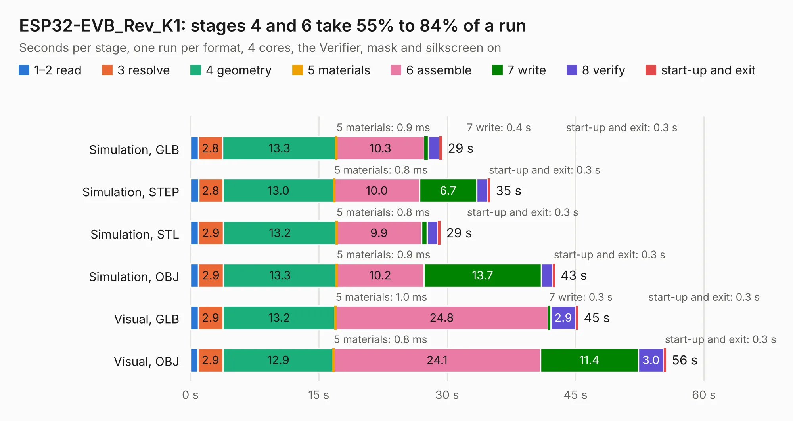

# 1834. ESP32-EVB_Rev_K1

Board 1,834 of the 3,124 of [Corpus Testing](../Corpus-Testing.md), on [Corpus Page 17](../CorpusTestingPages/Corpus-Testing-17.md#1834-esp32-evb_rev_k1).

| Mode and format | 1–2 read | 3 resolve | 4 geometry | 5 materials | 6 assemble | 7 write | 8 verify | start-up and exit | Total |
|---|---:|---:|---:|---:|---:|---:|---:|---:|---:|
| Simulation, GLB | 0.9 | 2.8 | 13.3 | 0.9&nbsp;ms | 10.3 | 0.4 | 1.3 | 0.3 | 29.4 |
| Simulation, STEP | 1.0 | 2.8 | 13.0 | 0.8&nbsp;ms | 10.0 | 6.7 | 1.3 | 0.3 | 35.0 |
| Simulation, STL | 0.9 | 2.9 | 13.2 | 0.8&nbsp;ms | 9.9 | 0.7 | 1.2 | 0.3 | 29.2 |
| Simulation, OBJ | 0.9 | 2.9 | 13.3 | 0.9&nbsp;ms | 10.2 | 13.7 | 1.3 | 0.3 | 42.6 |
| Visual, GLB | 0.9 | 2.9 | 13.2 | 1.0&nbsp;ms | 24.8 | 0.3 | 2.9 | 0.3 | 45.3 |
| Visual, OBJ | 0.9 | 2.9 | 12.9 | 0.8&nbsp;ms | 24.1 | 11.4 | 3.0 | 0.3 | 55.6 |

<table align="center"><tr><td valign="top">

| Board | Repo: [OLIMEX/ESP32-EVB](https://github.com/OLIMEX/ESP32-EVB) Board: `ESP32-EVB_Rev_K1.kicad_pcb` |
|---|---|
| Folder | HARDWARE / REV-K1 |
| Complexity | 303&nbsp;/&nbsp;1000 (size&nbsp;248, features&nbsp;55) |
| KESE&nbsp;features | through vias, slotted holes, filled zones, copper text |
| Tested | 9th November 2026 |
| Copper&nbsp;layers | 2 |
| File&nbsp;format | KiCad 5 (20171130) |
| Parts,&nbsp;tracks,&nbsp;vias | 157, 3,236, 315 |
| Triangles,&nbsp;simulation | 2,292,316 in 145 parts |
| Verifier | PASS in all six runs |

</td><td valign="top">

<table>
<tr><th>File type</th><th>File size</th><th>Peak memory used</th></tr>
<tr><th colspan="3" align="left">Simulation</th></tr>
<tr><td>GLB</td><td align="right">81&nbsp;MB</td><td align="right">865&nbsp;MB</td></tr>
<tr><td>STEP</td><td align="right">430&nbsp;MB</td><td align="right">1.0&nbsp;GB</td></tr>
<tr><td>STL</td><td align="right">115&nbsp;MB</td><td align="right">852&nbsp;MB</td></tr>
<tr><td>OBJ</td><td align="right">247&nbsp;MB</td><td align="right">1.6&nbsp;GB</td></tr>
<tr><th colspan="3" align="left">Visual</th></tr>
<tr><td>GLB</td><td align="right">66&nbsp;MB</td><td align="right">1.1&nbsp;GB</td></tr>
<tr><td>OBJ</td><td align="right">203&nbsp;MB</td><td align="right">1.4&nbsp;GB</td></tr>
</table>

</td></tr></table>

| Previous | Next |
|:---|---:|
| [1833. ESP32-EVB_Rev_K](b1833b_ESP32-EVB_ESP32-EVB-Rev-K.md) | [1835. ESP32-EVB_Rev_K2](b1835b_ESP32-EVB_ESP32-EVB-Rev-K2.md) |
