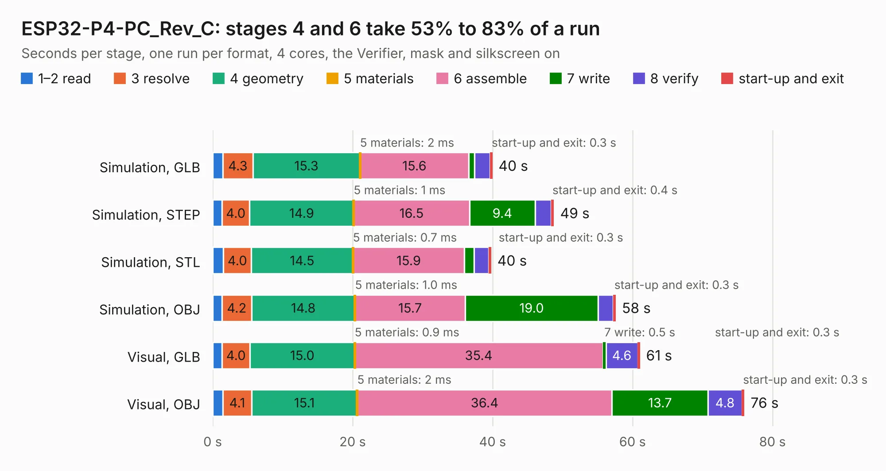

# 1836. ESP32-P4-PC_Rev_C

Board 1,836 of the 3,108 of [Corpus Testing](../Corpus-Testing.md), on [Corpus Page 17](../CorpusTestingPages/Corpus-Testing-17.md#1836-esp32-p4-pc_rev_c).

| Mode and format | 1–2 read | 3 resolve | 4 geometry | 5 materials | 6 assemble | 7 write | 8 verify | start-up and exit | Total |
|---|---:|---:|---:|---:|---:|---:|---:|---:|---:|
| Simulation, GLB | 1.5 | 4.3 | 15.3 | 2&nbsp;ms | 15.6 | 0.8 | 2.2 | 0.3 | 39.9 |
| Simulation, STEP | 1.3 | 4.0 | 14.9 | 1&nbsp;ms | 16.5 | 9.4 | 2.2 | 0.4 | 48.8 |
| Simulation, STL | 1.5 | 4.0 | 14.5 | 0.7&nbsp;ms | 15.9 | 1.4 | 2.1 | 0.3 | 39.8 |
| Simulation, OBJ | 1.3 | 4.2 | 14.8 | 1.0&nbsp;ms | 15.7 | 19.0 | 2.1 | 0.3 | 57.6 |
| Visual, GLB | 1.3 | 4.0 | 15.0 | 0.9&nbsp;ms | 35.4 | 0.5 | 4.6 | 0.3 | 61.0 |
| Visual, OBJ | 1.5 | 4.1 | 15.1 | 2&nbsp;ms | 36.4 | 13.7 | 4.8 | 0.3 | 76.0 |

<table align="center"><tr><td valign="top">

| Board | Repo: [OLIMEX/ESP32-P4-PC](https://github.com/OLIMEX/ESP32-P4-PC) Board: `ESP32-P4-PC_Rev_C.kicad_pcb` |
|---|---|
| Folder | HARDWARE / ESP32-P4-PC-Rev.C |
| Complexity | 409&nbsp;/&nbsp;1000 (size&nbsp;294, features&nbsp;115) |
| KESE&nbsp;features | through vias, slotted holes, rounded, trapezoid or chamfered pads, filled zones, copper text, knockout text, stack-up, dielectric εr and tanδ, mask and silkscreen colours |
| Tested | 9th November 2026 |
| Copper&nbsp;layers | 4 |
| File&nbsp;format | KiCad 7 (20221018) |
| Parts,&nbsp;tracks,&nbsp;vias | 312, 5,436, 553 |
| Triangles,&nbsp;simulation | 4,016,618 in 316 parts |
| Verifier | PASS in all six runs |

</td><td valign="top">

<table>
<tr><th>File type</th><th>File size</th><th>Peak memory used</th></tr>
<tr><th colspan="3" align="left">Simulation</th></tr>
<tr><td>GLB</td><td align="right">142&nbsp;MB</td><td align="right">1.3&nbsp;GB</td></tr>
<tr><td>STEP</td><td align="right">671&nbsp;MB</td><td align="right">1.5&nbsp;GB</td></tr>
<tr><td>STL</td><td align="right">201&nbsp;MB</td><td align="right">1.3&nbsp;GB</td></tr>
<tr><td>OBJ</td><td align="right">439&nbsp;MB</td><td align="right">2.7&nbsp;GB</td></tr>
<tr><th colspan="3" align="left">Visual</th></tr>
<tr><td>GLB</td><td align="right">95&nbsp;MB</td><td align="right">1.5&nbsp;GB</td></tr>
<tr><td>OBJ</td><td align="right">302&nbsp;MB</td><td align="right">2.0&nbsp;GB</td></tr>
</table>

</td></tr></table>

| Previous | Next |
|:---|---:|
| [1835. ESP32-P4-PC_Rev_B](b1835b_ESP32-P4-PC_ESP32-P4-PC-Rev-B.md) | [1837. ESP32-PoE_Rev_B1](b1837b_ESP32-POE_ESP32-PoE-Rev-B1.md) |
